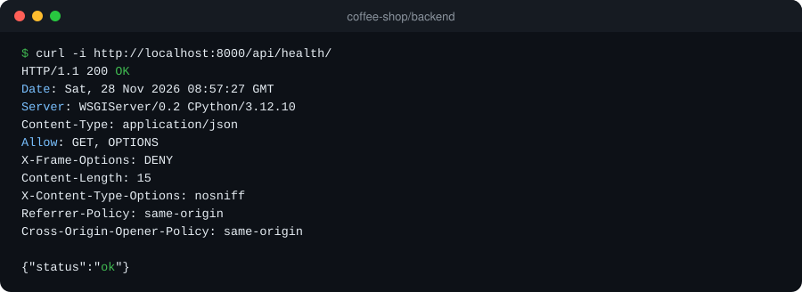
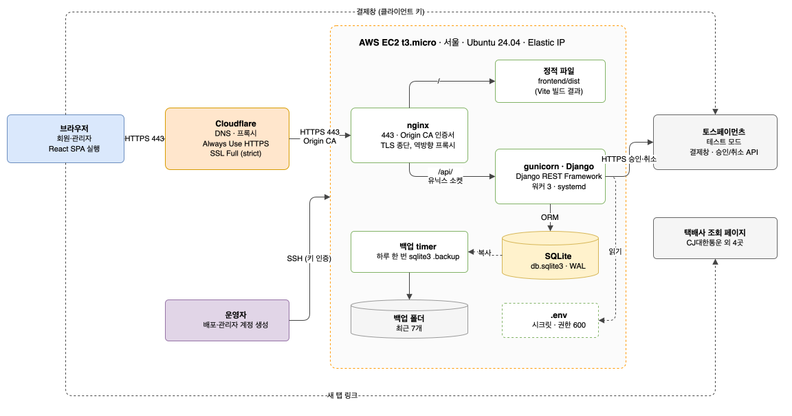
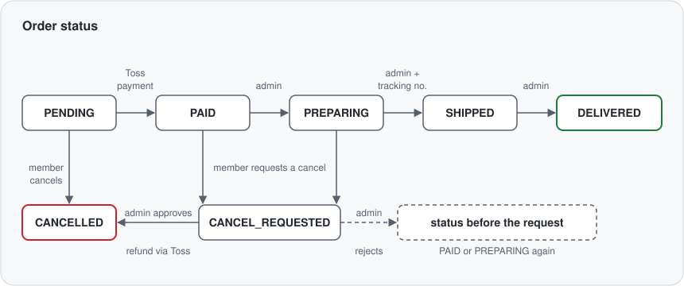

# coffee-shop

[**Live site**](https://coffee.stairnoworks.com) | [**Quickstart**](#quickstart) | [**How it works**](#how-it-works) | [**Configuration**](#configuration) | [**Examples**](#examples) | [**FAQ**](#faq)

**coffee-shop** is an online shop for **coffee beans**: visitors browse and filter beans, members order and pay, and an admin runs stock, shipping and cancellations. It is the **term project for the Software Engineering course at Chungbuk National University (CBNU)**, built from a written SRS and SDD where **every requirement ID is traced to the design, the tests and the code**. React 19 + Vite on the front end, Django 6.1 + Django REST Framework on the back end, SQLite, deployed to one AWS EC2 instance behind Cloudflare.

[](https://coffee.stairnoworks.com)

[](https://github.com/seren-wib/coffee-shop/actions/workflows/ci.yml)
[](LICENSE)
[](https://www.python.org/)
[](https://nodejs.org/)

[](backend/requirements.txt)
[](frontend/package.json)
[](#payments)
[](CONTRIBUTING.md)

## Updates

- [2026/11/28] **Design document reorganised.** Class and module spec added and placed right after the component design (section 5); every screen part gets an ID shown on its wireframe. [#129](https://github.com/seren-wib/coffee-shop/pull/129), [#132](https://github.com/seren-wib/coffee-shop/pull/132)
- [2026/11/27] **First production deploy** (`release-20261127-1`) and automatic deploys after CI passes on `main`. [#127](https://github.com/seren-wib/coffee-shop/pull/127)
- [2026/11/23] **Front end complete**: 18 screens for customers and admins. [#111](https://github.com/seren-wib/coffee-shop/pull/111) ~ [#119](https://github.com/seren-wib/coffee-shop/pull/119)
- [2026/11/19] **CI**: `backend` and `frontend` checks are required to merge into `main`. [#77](https://github.com/seren-wib/coffee-shop/pull/77)
- [2026/11/17] **Requirements and design rewritten** as stage documents in `docs/specs/`. [#60](https://github.com/seren-wib/coffee-shop/pull/60), [#62](https://github.com/seren-wib/coffee-shop/pull/62)

## Star History

<a href="https://star-history.com/#seren-wib/coffee-shop&Date">
  <picture>
    <source media="(prefers-color-scheme: dark)" srcset="https://api.star-history.com/svg?repos=seren-wib/coffee-shop&type=Date&theme=dark" />
    <source media="(prefers-color-scheme: light)" srcset="https://api.star-history.com/svg?repos=seren-wib/coffee-shop&type=Date" />
    
  </picture>
</a>

## Table of Contents

- [Why](#why)
- [Team](#team)
- [Quickstart](#quickstart)
- [How it works](#how-it-works)
- [Test results](#test-results)
- [Configuration](#configuration)
- [Examples](#examples)
- [Commands](#commands)
- [Privacy](#privacy)
- [FAQ](#faq)
- [Contribution](#contribution)
- [License](#license)

## Why

Course projects tend to end in two places that never meet:

- documents written once for a deadline and never read again, and
- a demo that only runs on one laptop.

coffee-shop keeps them in one repository:

- **Requirements have IDs.** Every function (`FR-n`), quality condition (`NFR-n`), data rule (`DR-n`) and use case (`UC-n`) in the SRS has an ID that the design, test names and pull requests cite.
- **Documents live next to the code.** The stage documents (plan, SRS, SDD, test plan, installation plan, maintenance plan) are Markdown in [`docs/specs/`](docs/specs/README.md), changed through pull requests and synced to Google Docs on every merge.
- **It runs somewhere real.** CI gates `main`, and a passing `main` can deploy itself to the live site.

## Team

| Role      | GitHub                                                    |
|-----------|-----------------------------------------------------------|
| Front-end | [Yang-HA-03](https://github.com/Yang-HA-03)               |
| Front-end | [seren-wib](https://github.com/seren-wib)                 |
| Back-end  | [Heisnotanimposter](https://github.com/Heisnotanimposter) |

## Quickstart

### Requirements

- **Git**, **Python 3.12** and **Node.js 24 LTS** on your `PATH`
- VS Code (optional). Install the recommended extensions when prompted.

On macOS, use `python3` instead of `python` until the virtual environment is activated.

### 1. Clone and create `.env`

```bash
git clone https://github.com/seren-wib/coffee-shop.git
cd coffee-shop
cp .env.example .env
```

Fill in `SECRET_KEY` in `.env` with any long random string. This one-liner prints one:

```bash
python -c "import secrets; print(secrets.token_urlsafe(50))"
```

> [!IMPORTANT]
> Never commit `.env`. Only `.env.example`, with keys and no values, belongs in the repository.

### 2. Set up the back end

Windows:

```powershell
cd backend
python -m venv .venv
.venv\Scripts\activate
pip install -r requirements.txt
python manage.py migrate
```

macOS / Linux:

```bash
cd backend
python3 -m venv .venv
source .venv/bin/activate
pip install -r requirements.txt
python manage.py migrate
```

If you use [uv](https://docs.astral.sh/uv/), replace `python -m venv .venv` with `uv venv --python 3.12` and `pip install` with `uv pip install`. Do not use `uv run` in this repo (see [FAQ 2](#2-a-second-venv-appears-at-the-repository-root)).

### 3. Set up the front end

In a second terminal:

```bash
cd frontend
npm install
```

### 4. Run both servers

```bash
# terminal 1, in backend/ with .venv active
python manage.py runserver      # http://localhost:8000

# terminal 2, in frontend/
npm run dev                     # http://localhost:5173
```

Open http://localhost:5173. The Vite dev server proxies `/api` to Django.

### 5. Check it

```bash
curl -i http://localhost:8000/api/health/
```

<p align="center">
  
</p>

The shop starts empty. To fill it with demo beans, members and orders, see [Examples](#examples).

## How it works

<p align="center">
  
</p>

The browser reaches one EC2 instance through Cloudflare. nginx serves the React build and passes `/api/` to gunicorn and Django. Data is one SQLite file with a daily backup. The payment window and courier tracking pages are opened by the browser; the server only calls the payment provider to confirm and cancel.

<p align="center">
  
</p>

A few details:

- **Status changes are conditional updates.** Each transition is an `UPDATE ... WHERE order_status = <expected>`; zero rows changed means `409 INVALID_STATE`, so two admins cannot ship the same order twice.
- **Stock cannot go negative.** Orders take stock with a conditional `UPDATE` inside a SQLite `IMMEDIATE` transaction; a concurrency test runs 10 orders against the last unit of stock.
- <a id="payments"></a>**Payments are confirmed on the server.** The browser opens the Toss Payments window in test mode; Django checks the amount against the order and confirms it with the provider. With no Toss key configured, payment calls return `503 PAYMENTS_DISABLED` and the rest of the shop keeps working. The live site runs without a key, so payment is off there.
- **Members and admins are separate roles.** JWT access tokens; admin routes need the `ADMIN` role on the server, not only a hidden button.

The full design is in [`docs/specs/sdd/`](docs/specs/sdd/README.md); deployment and installation are in [`docs/specs/sip/`](docs/specs/sip/README.md).

## Test results

<details>
<summary><b>Back end: 230 tests</b></summary>

Measured 2026-11-28 on a fresh clone (Windows 11, Python 3.12.10):

```text
$ python manage.py test --settings=config.test_settings --exclude-tag=concurrency
Found 230 test(s).
System check identified no issues (0 silenced).
...
Ran 230 tests in 3.248s

OK
```

The concurrency test runs separately against a file database: `python manage.py test --settings=config.test_settings_file --tag=concurrency`.

</details>

<details>
<summary><b>Front end: 113 tests</b></summary>

Measured 2026-11-28 on the same clone (Node.js 24.19.0):

```text
$ npm test
      Tests  113 passed (113)
   Duration  16.38s
```

</details>

CI runs both, plus `black --check`, a missing-migration check, `prettier --check`, `npm run lint` and `npm run build`, on every pull request ([`ci.yml`](.github/workflows/ci.yml)).

## Configuration

All settings come from `.env` at the repository root ([`.env.example`](.env.example) lists every key):

- **`SECRET_KEY`**: Django secret key. Required.
- **`DEBUG`**: `True` for development. Production runs with `False`.
- **`ALLOWED_HOSTS`**: comma-separated host names. Required when `DEBUG` is off.
- **`SQLITE_PATH`**: database file. Empty means `backend/db.sqlite3`.
- **`TOSS_SECRET_KEY`**: Toss Payments **test** secret key (`test_...`). Empty turns payments off (`503 PAYMENTS_DISABLED`).
- **`LOG_LEVEL`**: Django log level, `INFO` by default.
- **`VITE_TOSS_CLIENT_KEY`** in `frontend/.env.local`: Toss test client key for the payment window. Built into the front end, so only a public test key goes here.

Where each value is set in development and production: [`docs/specs/sdd/10-environment.md`](docs/specs/sdd/10-environment.md).

## Examples

<details>
<summary><b>Fill the shop with demo data</b></summary>

With `.venv` active in `backend/`, on an empty database:

```bash
python manage.py seed_demo
```

It inserts 100 beans, 50 members and 500 orders and prints the shared member password once (members are `demo001@example.com` to `demo050@example.com`). Change the counts with `--products`, `--members` and `--orders`.

</details>

<details>
<summary><b>Create an admin account</b></summary>

```bash
python manage.py create_admin --email admin@example.com
```

It asks for the password. Sign in at http://localhost:5173/login, and the admin menu appears in the header.

</details>

<details>
<summary><b>Try a payment locally</b></summary>

Put a Toss Payments **test** secret key in `.env` (`TOSS_SECRET_KEY=test_...`) and the matching test client key in `frontend/.env.local` (`VITE_TOSS_CLIENT_KEY=test_...`), then restart both servers. Test mode never charges a card.

</details>

## Commands

| Where | Command | What it does |
|---|---|---|
| `backend/` | `python manage.py runserver` | API on http://localhost:8000 |
| `backend/` | `python manage.py test --settings=config.test_settings --exclude-tag=concurrency` | Back-end tests |
| `backend/` | `python manage.py seed_demo` | Demo beans, members and orders |
| `backend/` | `python manage.py create_admin --email <email>` | Admin account |
| `frontend/` | `npm run dev` | Front end on http://localhost:5173 |
| `frontend/` | `npm test` | Front-end tests (Vitest) |
| `frontend/` | `npm run lint` | oxlint |
| `frontend/` | `npm run build` | Production build into `frontend/dist/` |

## Privacy

The live site is a course demo. Do not enter real names, phone numbers or addresses there, and do not use a real card: payments run in Toss test mode and are switched off on the live site. The database and backups are deleted after the course is graded.

## FAQ

### 1. `.venv\Scripts\activate cannot be loaded because running scripts is disabled on this system`

PowerShell blocks local scripts by default. Allow them for your user once, then activate again:

```powershell
Set-ExecutionPolicy -Scope CurrentUser RemoteSigned
```

### 2. A second `.venv` appears at the repository root

`uv run` reads the root `pyproject.toml`, treats the repository root as the project and creates `.venv` there. Delete the root `.venv` and use `backend/.venv` with `python manage.py ...` as in the Quickstart.

### 3. http://localhost:8000 shows `404`

Expected. Django serves only `/api/` (and `/admin/` in development). Open the front end at http://localhost:5173.

### 4. Paying shows `결제창 키가 설정되지 않았습니다` or `503 PAYMENTS_DISABLED`

No Toss test key is configured, so payments are off. See [Try a payment locally](#examples). Everything else, from browsing to admin order handling, works without a key.

## Contribution

Bug reports and pull requests from the team go through issues first. See [CONTRIBUTING.md](CONTRIBUTING.md) for the workflow, commit format and documentation rules.

If this repository helps with your own course project, a ⭐ helps other students find it.

## License

[MIT](LICENSE)
