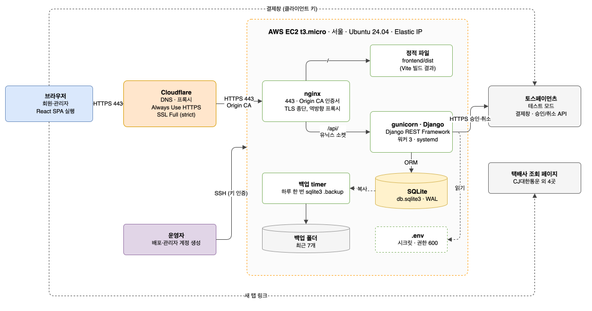
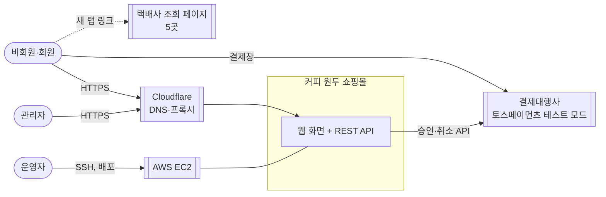
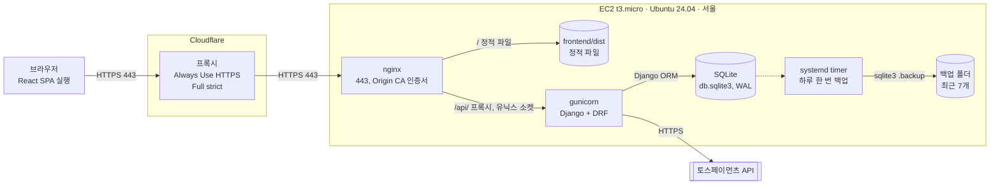
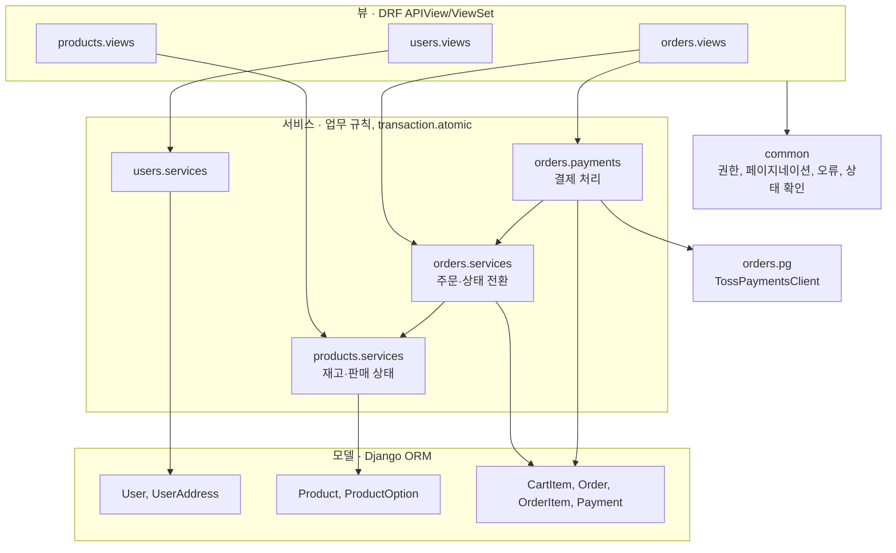

## 1. 아키텍처

이 절은 배포 단위, 단위 사이의 통신, 데이터가 있는 곳을 정한다. SRS 7.1절 결정에 따라 운영 환경은 AWS EC2 한 대와 Cloudflare 도메인이다(NFR-20, NFR-21). 인스턴스 사양과 프록시 방식의 근거는 11.1절이다.

전체 구성은 위 다이어그램과 같다(로고: simple-icons 13.21.0(CC0-1.0), 토스페이먼츠 공식 사이트의 로고 파일, draw.io에 들어 있는 AWS 아키텍처 아이콘. 각 로고의 상표권은 해당 회사에 있다). 브라우저는 Cloudflare를 거쳐 EC2의 nginx로 들어오고, nginx가 정적 파일과 `/api/`(gunicorn·Django)를 나눈다. 데이터는 같은 인스턴스의 SQLite 파일 하나이고 하루 한 번 백업한다. 결제창과 택배사 조회 페이지는 브라우저가 직접 연다. 아래 1.1 ~ 1.5절이 각 부분을 나눠 설명한다.

### 1.1 시스템 맥락

| 외부 행위자·시스템 | 시스템과 주고받는 것 | 요구사항 |
| --- | --- | --- |
| 비회원, 회원 | 원두 조회, 가입, 로그인, 장바구니, 주문, 결제, 배송 조회 | UC-1 ~ UC-11 |
| 관리자 | 원두·옵션·재고 관리, 주문·배송·취소 처리 | UC-12 ~ UC-14, NFR-10 |
| 운영자 | 서버 접속, 배포, 관리자 계정 생성, 백업 확인 | FR-53, NFR-24, NFR-25 |
| 토스페이먼츠 | 브라우저는 결제창을 열고, 서버는 승인(confirm)·취소(cancel) API를 부른다. 웹훅은 받지 않는다 | FR-25 ~ FR-29, FR-50, SRS 7.1 |
| 택배사 조회 페이지 | 브라우저가 송장번호를 넣은 주소를 새 탭으로 연다. 서버는 택배사와 통신하지 않는다 | FR-35 |
| Cloudflare | 도메인 DNS, 프록시, 브라우저 쪽 인증서, HTTP → HTTPS 전환 | NFR-4, NFR-5, NFR-21 |
| AWS | EC2 인스턴스 한 대, Elastic IP 하나, 보안 그룹 | NFR-20 |

### 1.2 배포 단위

| 배포 단위 | 무엇 | 실행 방식 | 요구사항 |
| --- | --- | --- | --- |
| 프론트엔드 | React SPA(버전은 `frontend/package.json`이 원본, 2026-11-17 기준 React 19)를 Vite로 빌드한 정적 파일(`frontend/dist`) | nginx가 `/`에서 파일을 내준다. 없는 경로는 `index.html`로 돌려 React Router가 처리한다 | NFR-19, NFR-21 |
| 백엔드 | Django + Django REST Framework 앱(`backend/`, 버전은 `backend/requirements.txt`가 원본) | gunicorn이 WSGI로 띄우고, systemd 서비스가 재시작을 맡는다 | NFR-19, NFR-22, NFR-28 |
| 데이터베이스 | SQLite 파일 하나 | 백엔드 프로세스 안에서 파일로 연다. 별도 서버 없음 | NFR-20, 11.1절 |
| 웹 서버 | nginx | systemd 서비스. TLS 종단, 정적 파일, `/api/` 역방향 프록시 | NFR-4, NFR-5 |
| 백업 작업 | `sqlite3 .backup` 셸 스크립트 | systemd timer가 하루 한 번 실행하고 7개를 남긴다 | NFR-25 |

- 프로세스는 nginx, gunicorn(워커 3개), 백업 timer 셋이다. 모두 systemd 단위라 재부팅 뒤 사람 손 없이 다시 뜬다(NFR-22).
- 개발 환경은 SRS 1.3절대로 개발자 PC다. Vite 개발 서버(`localhost:5173`)가 `/api`를 Django 개발 서버(`localhost:8000`)로 넘긴다(`frontend/vite.config.js`). 운영과 경로 구조가 같아서 프론트엔드 코드는 두 환경에서 `baseURL: "/api"` 하나로 동작한다(NFR-27, NFR-31).

### 1.3 통신

| 출발 | 도착 | 프로토콜 | 인증 | 내용 |
| --- | --- | --- | --- | --- |
| 브라우저 | Cloudflare | HTTPS 443, TLS 1.2 이상 | 없음 | 화면과 API 요청. 80번은 Cloudflare가 HTTPS로 넘긴다(NFR-4, NFR-5) |
| Cloudflare | nginx | HTTPS 443 | Origin CA 인증서(Full strict) | 원 서버 연결. 보안 그룹은 443을 Cloudflare 주소 대역에만 연다(8.3절) |
| nginx | gunicorn | HTTP, 유닉스 소켓 | 없음(인스턴스 안) | `/api/` 요청. `X-Forwarded-Proto`, `X-Real-IP`를 붙인다 |
| 브라우저 | 백엔드 API | REST + JSON | `Authorization: Bearer <액세스 토큰>` | 회원·관리자 API(NFR-8, NFR-28) |
| 백엔드 | 토스페이먼츠 API | HTTPS | 시크릿 키 Basic 인증 | 결제 승인, 결제 취소(FR-26, FR-27, FR-50) |
| 브라우저 | 토스페이먼츠 결제창 | HTTPS | 클라이언트 키 | 결제창 열기, 결제 수단 고르기(FR-25) |
| 브라우저 | 택배사 조회 페이지 | HTTPS 링크 | 없음 | 새 탭으로 열기(FR-35) |

- 화면과 API가 같은 도메인이라 CORS 설정을 두지 않는다(SRS 6.5절).
- API는 JSON만 주고받는다. 오류 응답도 JSON이다(NFR-28, 7.2절).

### 1.4 데이터가 있는 곳

| 데이터 | 위치 | 보존 | 요구사항 |
| --- | --- | --- | --- |
| 회원, 배송지, 원두, 옵션, 장바구니, 주문, 결제 기록 | EC2의 SQLite 파일 | 백업 파일 7개(하루 한 번) | DR-1 ~ DR-24, NFR-25 |
| 액세스·리프레시 토큰 | 브라우저 `localStorage` | 로그아웃 때 지움 | FR-8, FR-54 |
| 결제 수단 정보(카드 번호 등) | 토스페이먼츠만 가진다. 시스템은 결제 키(`pg_tid`)만 저장한다 | | NFR-18 |
| 시크릿(Django 비밀 키, 토스 시크릿 키, Origin 인증서 키) | EC2의 `.env`와 인증서 파일(권한 600) | 레포에 없음 | NFR-13, 9절 |
| 상품 이미지 | 외부 이미지 URL 문자열만 저장한다. 파일은 서버에 두지 않는다 | | SRS 7.1 |
| 서버 로그 | nginx 접근 로그, gunicorn·Django 로그(journald) | 개인정보와 토큰을 남기지 않는다 | NFR-35, 8.5절 |

### 1.5 백엔드 논리 구조

백엔드는 Django 앱 셋과 공통 모듈 하나로 나눈다. 앱마다 모델(데이터), 서비스(업무 규칙과 트랜잭션), 시리얼라이저(입력 검증과 응답 모양), 뷰(경로와 권한) 네 층을 둔다. 업무 규칙은 서비스 함수에만 두고, 뷰는 서비스를 부르고 결과를 HTTP 상태 코드로 바꾸기만 한다.

| 앱 | 모델 | 서비스 책임 | 4절 |
| --- | --- | --- | --- |
| `users` | `User`, `UserAddress` | 가입, 로그인, 내 정보, 비밀번호, 배송지, 관리자 계정 생성 명령 | 4.1, 4.2 |
| `products` | `Product`, `ProductOption` | 원두 조회, 관리자 원두·옵션 관리, 재고 증감, 판매 상태 전환 | 4.3, 4.7 |
| `orders` | `CartItem`, `Order`, `OrderItem`, `Payment` | 장바구니, 주문 생성, 주문 상태 전환, 결제, 관리자 주문 처리 | 4.4 ~ 4.6, 4.8 |
| `common` | 없음 | 관리자 권한 클래스, 페이지네이션, 오류 응답 형식, 상태 확인 | 4.9, 7절 |

- 의존 방향은 `orders` → `products` → (없음), `orders` → `users`다. `products`는 `orders`를 모른다. 재고를 바꾸는 함수는 `products.services`에만 있고, 주문·취소는 그 함수를 부른다.
- 토스페이먼츠 호출은 `orders.pg` 한 모듈에만 둔다. 테스트는 이 모듈을 가짜(fake)로 바꿔 외부 호출 없이 돈다(STP 1절).
