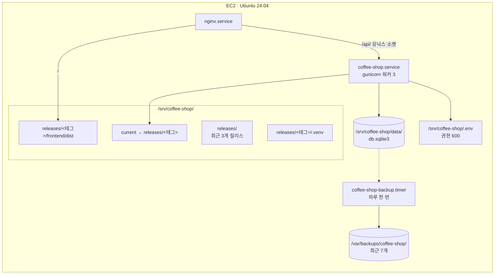
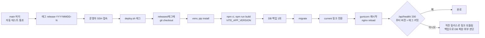

## 10. 배포

브랜치 모델, 환경, 서버 안 배치를 정한다. 단계별 절차, 멈추는 조건, 롤백 순서는 SIP 2절, 처음 한 번 하는 설정은 SIP 3절이다. 레포가 공개라 서버 주소와 운영자 계정은 이 절에도 SIP에도 쓰지 않는다.

### 10.1 브랜치 모델

| 브랜치 | 어디서 따서 | 어디로 | 배포 |
| --- | --- | --- | --- |
| `main` | | | 운영에 올리는 유일한 브랜치. 늘 로컬에서 돈다(CONTRIBUTING) |
| 작업 브랜치(`cart-api` 같은 이름) | `main` | `main`, PR 스쿼시 머지 | 배포하지 않는다 |

- GitHub Flow다. `main` 직접 push와 force push는 하지 않는다.
- 운영 배포 단위는 `main`의 커밋 하나다. 배포할 커밋에 `release-YYYYMMDD-N` 태그를 단다. 롤백은 직전 태그로 돌아가는 것이다.
- 별도 스테이징 환경은 없다. 운영에 올리기 전 확인은 개발 PC에서 `npm run build` 결과를 `vite preview`로 보는 것과 자동 테스트다.

### 10.2 환경과 배치

| 환경 | 어디 | 주소 | 용도 | 배포 방법 |
| --- | --- | --- | --- | --- |
| 개발 | 개발자 PC(Windows, macOS) | `http://localhost:5173` | 구현, 수동 확인 | 각자 실행(NFR-27) |
| 운영 | EC2 t3.micro 한 대(서울, Ubuntu 24.04) | `https://<도메인>`(SRS 7.2 미결) | 시연, 평가(2026-11-22 ~ 2026-12-06) | `deploy/deploy.sh`(10.4절) |



- 인스턴스: t3.micro(vCPU 2, 메모리 1GiB), EBS gp3 20GiB(암호화 켬), Elastic IP 하나(11.1절). 메모리가 작아서 스왑 파일 1GiB를 둔다(프론트엔드 빌드 때 메모리가 모자라지 않게).
- 앱 실행 계정은 로그인할 수 없는 시스템 계정 하나다. `.env`와 DB 폴더는 이 계정만 읽고 쓴다.
- 릴리스 폴더를 태그마다 따로 만들고 `current` 심볼릭 링크만 바꾼다. DB와 `.env`는 릴리스 폴더 밖에 있어서 릴리스를 바꿔도 그대로다.
- gunicorn 워커는 3개(sync 워커, 요청 시간 제한 30초)다. 워커 하나에 Django가 약 60 ~ 80MB를 쓴다고 보고 메모리 1GiB 안에 nginx와 함께 들어가게 잡은 값이다(추정, 안 잼). NFR-1 측정 때 메모리도 같이 본다.

### 10.3 nginx 배치

```nginx
# deploy/nginx/coffee-shop.conf (틀. __DOMAIN__, __ORIGIN_CERT__, __ORIGIN_KEY__ 자리표시자를 설치 때 sed로 바꾼다)
server {
    listen 443 ssl http2;                    # Ubuntu 24.04 패키지 nginx 1.24는 `http2 on;`을 모른다
    server_name __DOMAIN__;
    ssl_certificate     __ORIGIN_CERT__;
    ssl_certificate_key __ORIGIN_KEY__;
    ssl_protocols TLSv1.2 TLSv1.3;

    # Cloudflare 주소 대역에서 온 요청만 CF-Connecting-IP를 믿는다
    include /etc/nginx/cloudflare-real-ip.conf;
    real_ip_header CF-Connecting-IP;

    root /srv/coffee-shop/current/frontend/dist;

    location /api/ {
        proxy_pass http://unix:/run/coffee-shop/gunicorn.sock;
        proxy_set_header Host $host;
        proxy_set_header X-Forwarded-Proto https;
        proxy_set_header X-Forwarded-For $remote_addr;   # 클라이언트 값을 버리고 덮어쓴다 (8.3절)
        client_max_body_size 1m;
    }
    location = /api/health/ {
        access_log off;
        proxy_pass http://unix:/run/coffee-shop/gunicorn.sock;
        proxy_set_header Host $host;
    }
    location /assets/ {
        add_header Cache-Control "public, max-age=31536000, immutable";
        include /etc/nginx/coffee-shop-security-headers.conf;   # add_header는 상속되지 않는다
    }
    location / {
        try_files $uri /index.html;          # React Router 경로
        add_header Cache-Control "no-cache";
        include /etc/nginx/coffee-shop-security-headers.conf;   # 8.6절
    }
}
# 80번 서버 블록은 두지 않는다. HTTP → HTTPS는 Cloudflare가 한다(NFR-4).
# access_log는 쿼리 문자열을 뺀 log_format을 쓴다 (8.5절).
```

- Vite 빌드 결과의 `assets/` 파일은 이름에 해시가 붙으므로 오래 캐시하고, `index.html`은 매번 다시 확인하게 해서 배포 직후 새 화면이 뜨게 한다.
- Cloudflare 캐시는 기본(정적 파일 확장자만)으로 둔다. `/api/`는 Cloudflare가 캐시하지 않는다(JSON).

### 10.4 배포 흐름 (NFR-24)



- 배포는 운영자가 서버에서 `deploy/deploy.sh <태그>`를 실행하는 수동 방식이다. 같은 스크립트를 누가 실행해도 같은 결과가 난다(NFR-24). GitHub Actions로 자동 배포할지는 11.2절 미결이다.
- 프론트엔드는 서버에서 빌드한다(Node.js 24는 빌드에만 쓰고, nginx는 빌드 결과 정적 파일만 내준다. SRS 1.4절).
- `migrate` 전에 백업을 하나 더 만든다. 일일 백업과 섞이지 않게 `/var/backups/coffee-shop/pre-deploy/db-<태그>.sqlite3`로 따로 두고 최근 3개만 남긴다. 마이그레이션이 데이터를 바꾸는 배포를 되돌릴 때 이 파일로 복원한다.
- 롤백: `current`를 직전 릴리스로 되돌리고 gunicorn을 재시작한다. 이번 배포에 마이그레이션이 있었다면 배포 직전 백업으로 DB를 복원한다. 롤백 리허설 1회가 NFR-24의 측정이다(SIP 2절, STP 8절).
- 배포 중 수십 초 동안 API가 502일 수 있다(gunicorn 재시작). 시연 시간에는 배포하지 않는다.

### 10.5 재시작, 백업, 감시

| 요구 | 수단 | 확인 |
| --- | --- | --- |
| 재부팅 뒤 자동 시작(NFR-22) | `nginx.service`, `coffee-shop.service`, `coffee-shop-backup.timer` 모두 `enable`. gunicorn 서비스는 `Restart=always` | 재부팅 후 5분 안에 `/api/health/` 200 |
| 백업(NFR-25) | `deploy/backup.sh`: `sqlite3 -cmd ".timeout 20000" <DB> ".backup <폴더>/db-YYYYMMDD.sqlite3"`(잠금이면 20초까지 기다림) 뒤 8번째부터 지움. 실패하면 0이 아닌 종료 코드로 끝나 journald에 남는다. timer `OnCalendar=*-*-* 04:00 Asia/Seoul`, `Persistent=true` | 백업 폴더 파일 7개, 복원 리허설 1회 |
| 감시(NFR-23) | 외부에서 5분마다 `GET https://<도메인>/api/health/` | 실패 비율 1% 이하. 도구는 11.2절 미결 |
| 디스크 | journald 최대 크기 200MB, 릴리스 폴더 최근 3개만 | |

- 백업 파일은 같은 EBS 볼륨에 있다. 인스턴스나 볼륨이 통째로 사라지면 백업도 사라진다. 다른 곳으로 복사할지는 11.2절 미결이다.
- `sqlite3 .backup`은 WAL 모드에서도 쓰는 중인 DB를 일관된 상태로 복사한다. 파일 복사(`cp`)는 쓰지 않는다.
