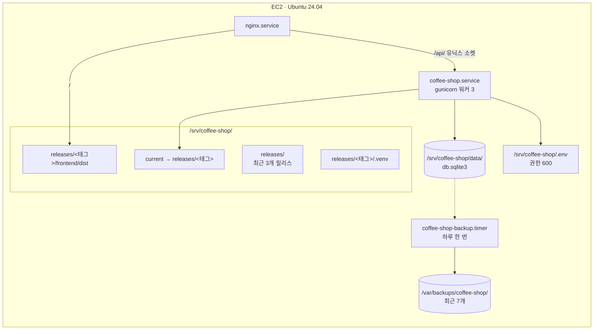
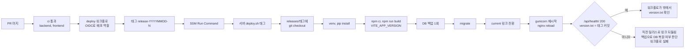

## 11. 배포

브랜치 모델, 환경, 서버 안 배치를 정한다. 단계별 절차, 멈추는 조건, 롤백 순서는 SIP 2절, 처음 한 번 하는 설정은 SIP 3절이다. 레포가 공개라 서버 주소와 운영자 계정은 이 절에도 SIP에도 쓰지 않는다.

### 11.1 브랜치 모델

| 브랜치 | 어디서 따서 | 어디로 | 배포 |
| --- | --- | --- | --- |
| `main` | | | 운영에 올리는 유일한 브랜치. 늘 로컬에서 돈다(CONTRIBUTING) |
| 작업 브랜치(`cart-api` 같은 이름) | `main` | `main`, PR 스쿼시 머지 | 배포하지 않는다 |

- GitHub Flow다. `main` 직접 push와 force push는 하지 않는다.
- 운영 배포 단위는 `main`의 커밋 하나다. 배포할 커밋에 `release-YYYYMMDD-N` 태그를 단다. 태그는 CI 두 작업이 통과한 커밋에만 단다(NFR-39, STP 7절). 롤백은 직전 태그로 돌아가는 것이다(FR-62). (2026-11-27 CI 문장과 ID 추가)
- 태그는 사람이 달지 않는다. `ci`가 `main` push에서 통과하면 `deploy.yml`이 다음 번호 태그를 달고 배포한다(11.4절, FR-61). (2026-11-27 추가)
- 별도 스테이징 환경은 없다. 운영에 올리기 전 확인은 개발 PC에서 `npm run build` 결과를 `vite preview`로 보는 것과 자동 테스트다.

### 11.2 환경과 배치

| 환경 | 어디 | 주소 | 용도 | 배포 방법 |
| --- | --- | --- | --- | --- |
| 개발 | 개발자 PC(Windows, macOS) | `http://localhost:5173` | 구현, 수동 확인 | 각자 실행(NFR-27) |
| 운영 | EC2 t3.micro 한 대(서울, Ubuntu 24.04) | `https://<도메인>`(이름은 문서에 적지 않음, 12.1절) | 시연, 평가(2026-12-01 12:00 발표 종료까지, SRS 7.1절) (2026-11-27 변경. 이전에는 "기간 미정, SRS 7.2절") | `deploy/deploy.sh`(11.4절) |



- 인스턴스: t3.micro(vCPU 2, 메모리 1GiB), EBS gp3 20GiB(암호화 켬), Elastic IP 하나(12.1절). 메모리가 작아서 스왑 파일 1GiB를 둔다(프론트엔드 빌드 때 메모리가 모자라지 않게).
- 앱 실행 계정은 로그인할 수 없는 시스템 계정 하나다. `.env`와 DB 폴더는 이 계정만 읽고 쓴다.
- 릴리스 폴더를 태그마다 따로 만들고 `current` 심볼릭 링크만 바꾼다. DB와 `.env`는 릴리스 폴더 밖에 있어서 릴리스를 바꿔도 그대로다.
- gunicorn 워커는 3개(sync 워커, 요청 시간 제한 30초)다. 워커 하나에 Django가 약 60 ~ 80MB를 쓴다고 보고 메모리 1GiB 안에 nginx와 함께 들어가게 잡은 값이다(추정, 안 잼). NFR-1 측정 때 메모리도 같이 본다.

### 11.3 nginx 배치

```nginx
# deploy/nginx/coffee-shop.conf (틀. __DOMAIN__, __ORIGIN_CERT__, __ORIGIN_KEY__ 자리표시자를 설치 때 sed로 바꾼다)
server {
    listen 443 ssl http2;                    # Ubuntu 24.04 패키지 nginx 1.24는 `http2 on;`을 모른다
    server_name __DOMAIN__;
    ssl_certificate     __ORIGIN_CERT__;
    ssl_certificate_key __ORIGIN_KEY__;
    ssl_protocols TLSv1.2 TLSv1.3;

    # Cloudflare 주소 대역에서 온 요청만 CF-Connecting-IP를 믿는다
    include /etc/nginx/cloudflare-real-ip.conf;
    real_ip_header CF-Connecting-IP;

    root /srv/coffee-shop/current/frontend/dist;

    location /api/ {
        proxy_pass http://unix:/run/coffee-shop/gunicorn.sock;
        proxy_set_header Host $host;
        proxy_set_header X-Forwarded-Proto https;
        proxy_set_header X-Forwarded-For $remote_addr;   # 클라이언트 값을 버리고 덮어쓴다 (9.3절)
        client_max_body_size 1m;
    }
    location = /api/health/ {
        access_log off;
        proxy_pass http://unix:/run/coffee-shop/gunicorn.sock;
        proxy_set_header Host $host;
    }
    location /assets/ {
        add_header Cache-Control "public, max-age=31536000, immutable";
        include /etc/nginx/coffee-shop-security-headers.conf;   # add_header는 상속되지 않는다
    }
    location / {
        try_files $uri /index.html;          # React Router 경로
        add_header Cache-Control "no-cache";
        include /etc/nginx/coffee-shop-security-headers.conf;   # 9.6절
    }
}
# 80번 서버 블록은 두지 않는다. HTTP → HTTPS는 Cloudflare가 한다(NFR-4).
# access_log는 쿼리 문자열을 뺀 log_format을 쓴다 (9.5절).
```

- Vite 빌드 결과의 `assets/` 파일은 이름에 해시가 붙으므로 오래 캐시하고, `index.html`은 매번 다시 확인하게 해서 배포 직후 새 화면이 뜨게 한다.
- Cloudflare 캐시는 기본(정적 파일 확장자만)으로 둔다. `/api/`는 Cloudflare가 캐시하지 않는다(JSON).

### 11.4 배포 흐름 (NFR-24, NFR-39 ~ NFR-41, NFR-43, FR-61, FR-62)



- 배포는 자동이다. `ci`가 `main` push에서 통과하면 `.github/workflows/deploy.yml`이 태그를 달고, SSM Run Command로 서버에서 `deploy/deploy.sh <태그>`를 실행한다(FR-61, 12.1절). 운영자가 서버에서 같은 스크립트를 손으로 실행할 수도 있다(SIP 2.3절). (2026-11-27 변경. 이전에는 "배포는 운영자가 서버에서 `deploy/deploy.sh <태그>`를 실행하는 수동 방식이다"였고, 이 항목 끝에 "GitHub Actions 자동 배포는 이번 학기엔 쓰지 않는다(12.1절)"가 있었다) 스크립트는 빌드 결과에 `version.txt`(커밋 7자)를 쓰고, nginx가 내주는 그 파일이 태그 커밋인지로 새 릴리스가 떴는지 본다. 화면 푸터 버전(NFR-24)은 사람이 4.2절 체크로 본다(SIP 4절). 처음 한 번 하는 설치는 `deploy/install.sh`다(SIP 3.3절). 같은 스크립트를 누가 실행해도 같은 결과가 난다(NFR-24).
- `deploy.yml`(2026-11-27 추가):
  - 트리거는 `ci`의 `workflow_run`(`main`, 완료)과 손으로 시작(`workflow_dispatch`)이다. `ci` 결과가 성공이고 그 실행이 `push`일 때만 배포한다. 저장소 변수 `DEPLOY_ENABLED`가 `true`가 아니면 아무것도 하지 않는다(시연 중 멈춤).
  - 자동 실행은 세 경우에 건너뛴다: `ci`가 끝난 커밋이 이미 `main` 최신이 아닐 때(더 새 커밋의 실행이 배포한다), 그 커밋에 이미 릴리스 태그가 있을 때(`ci`를 다시 돌린 경우), 직전 릴리스 태그 뒤로 `docs/`와 `*.md`만 바뀌었을 때. 손으로 시작하거나 실패한 실행을 다시 돌리면 늘 새 번호 태그로 배포한다(같은 릴리스 폴더는 `deploy.sh`가 거부하므로).
  - 순서: `main` 체크아웃 → 태그 이름 고르기(서울 날짜, 같은 날 다음 번호) → OIDC로 배포 역할 받기 → 태그 push → SSM `AWS-RunShellScript`로 `DEPLOY_BUILDER=ubuntu /srv/coffee-shop/current/deploy/deploy.sh <태그>` → 10초마다 결과 확인(최대 약 32분, 명령 실행 제한 30분) → SSM 출력을 실행 로그에 남김 → 밖에서 `https://<도메인>/version.txt`가 그 커밋인지 확인. 역할을 못 받으면 태그를 달기 전에 멈춘다.
  - 권한은 `contents: write`(태그 push)와 `id-token: write`(OIDC)뿐이다. AWS 쪽 배포 역할은 이 레포 `main`에서 온 토큰만 받고, 운영 인스턴스 하나에 `AWS-RunShellScript`를 보내고 결과를 읽는 것만 한다(`deploy/aws/`, NFR-43). 서버는 인스턴스 역할(`AmazonSSMManagedInstanceCore`)로 SSM 에이전트를 등록하고, 에이전트는 나가는 443만 쓰므로 보안 그룹은 바꾸지 않는다.
  - SSM은 root로 실행한다. `deploy.sh`는 root가 필요하고, 빌드(`git clone`, `pip`, `npm`)는 `DEPLOY_BUILDER` 계정으로 한다. 손으로 `sudo`로 실행할 때는 `SUDO_USER`가 그 자리를 채운다.
  - `concurrency: deploy-production`, `cancel-in-progress: false`로 배포는 한 번에 하나이고, 진행 중인 배포를 끊지 않는다. 실패는 `deploy.sh`의 종료 코드(바꾸기 전 멈춤, 바꾼 뒤 자동 롤백)가 SSM 상태로 올라와 워크플로 실패가 된다.
  - 공개 레포라 실행 로그도 공개다. 시크릿 셋(역할 ARN, 인스턴스 ID, 도메인 주소)은 로그에서 가려지고, `deploy.sh`는 도메인과 키를 출력하지 않는다.
- SQLite DB 파일은 배포하지 않는다. 레포에는 DB 파일이 없고(`db.sqlite3`는 커밋 금지), 처음 설치할 때 한 번 `migrate`가 `/srv/coffee-shop/data/db.sqlite3`를 빈 테이블로 만들고 `create_admin`(FR-53)으로 관리자를 넣는다(SIP 3절). 그 뒤 배포는 같은 파일에 새 마이그레이션만 적용하므로 데이터가 남는다. SQLite는 따로 띄우는 서버 프로세스가 없고, gunicorn 안의 Django가 파일을 직접 연다(1.2절).
- 프론트엔드는 서버에서 빌드한다(Node.js 24는 빌드에만 쓰고, nginx는 빌드 결과 정적 파일만 내준다. SRS 1.4절).
- `migrate` 전에 백업을 하나 더 만든다. 일일 백업과 섞이지 않게 `/var/backups/coffee-shop/pre-deploy/db-<태그>.sqlite3`로 따로 두고 최근 3개만 남긴다. 마이그레이션이 데이터를 바꾸는 배포를 되돌릴 때 이 파일로 복원한다(NFR-40, FR-63).
- 의존성 설치, 빌드, 백업, `migrate`, `check --deploy` 중 하나가 실패하면 `current`를 바꾸기 전에 멈추고 서비스는 이전 릴리스로 계속 돈다(NFR-41, SIP 2.1절). (2026-11-27 추가)
- 롤백: `current`를 직전 릴리스로 되돌리고 gunicorn을 재시작한다. 이번 배포에 마이그레이션이 있었다면 배포 직전 백업으로 DB를 복원한다. 롤백 리허설 1회가 FR-62의 측정이고, 백업으로 DB를 되살리는 복원 리허설 1회가 FR-63의 측정이다(SIP 2절, STP 8절). (2026-11-27 변경. 이전에는 "롤백 리허설 1회가 NFR-24의 측정")
- 배포 중 수십 초 동안 API가 502일 수 있다(gunicorn 재시작). 시연 시간에는 배포하지 않는다.

### 11.5 재시작, 백업, 감시

| 요구 | 수단 | 확인 |
| --- | --- | --- |
| 재부팅 뒤 자동 시작(NFR-22) | `nginx.service`, `coffee-shop.service`, `coffee-shop-backup.timer` 모두 `enable`. gunicorn 서비스는 `Restart=always` | 재부팅 후 5분 안에 `/api/health/` 200 |
| 백업(NFR-25) | `deploy/backup.sh`: `sqlite3 -cmd ".timeout 20000" <DB> ".backup <폴더>/db-YYYYMMDD.sqlite3"`(잠금이면 20초까지 기다림) 뒤 8번째부터 지움. 실패하면 0이 아닌 종료 코드로 끝나 journald에 남는다. timer `OnCalendar=*-*-* 04:00 Asia/Seoul`, `Persistent=true` | 백업 폴더 파일 7개, 복원 리허설 1회 |
| 감시(NFR-23) | 외부에서 5분마다 `GET https://<도메인>/api/health/` | 실패 비율 1% 이하. 도구는 UptimeRobot 무료 요금제(12.1절) |
| 디스크 | journald 최대 크기 200MB, 릴리스 폴더 최근 3개만 | |

- 백업 파일은 같은 EBS 볼륨에 있다. 인스턴스나 볼륨이 통째로 사라지면 백업도 사라진다. 시연·평가 기간 동안은 인스턴스 밖으로 복사하지 않기로 했다(12.1절). 데이터가 사라지면 시드 명령(NFR-3)으로 다시 만든다.
- `sqlite3 .backup`은 WAL 모드에서도 쓰는 중인 DB를 일관된 상태로 복사한다. 파일 복사(`cp`)는 쓰지 않는다.
