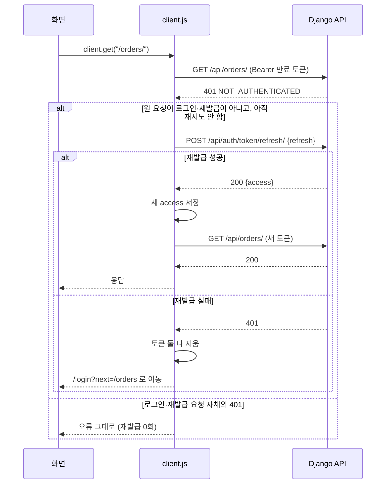

## 4.1 회원과 인증

| 항목 | 내용 |
| --- | --- |
| 책임 | 가입, 로그인, 토큰 발급·재발급, 내 정보 관리를 맡고 다른 부품이 쓰는 인증과 권한 검사를 제공한다 (NFR-8 ~ NFR-10) |
| 제공 인터페이스 | `/api/auth/register/`, `/api/auth/token/`, `/api/auth/token/refresh/`, `/api/me/`, `/api/me/password/` (FR-7 ~ FR-13, FR-54, FR-58). 권한 클래스 `IsAdminRole` |
| 의존 | 없음 |
| 구현 모듈 | `users/models.py`의 `User`, `users/services.py`, `users/serializers.py`, `users/views.py`, `common/permissions.py`, 프론트엔드 `src/api/client.js`, `src/auth/` |

`users` 앱과 프론트엔드 `src/api/client.js`, `src/auth/`. 인증은 djangorestframework-simplejwt의 JWT다(NFR-8). 사용자 모델은 커스텀 사용자 모델 `users.User`이고 이메일이 로그인 ID다(11.1절, 5.1절).

### 4.1.0 설정

```python
# backend/config/settings.py (발췌)
AUTH_USER_MODEL = "users.User"

REST_FRAMEWORK = {
    "DEFAULT_AUTHENTICATION_CLASSES": [
        "rest_framework_simplejwt.authentication.JWTAuthentication",
    ],
    "DEFAULT_PERMISSION_CLASSES": [
        "rest_framework.permissions.IsAuthenticated",   # NFR-9: 기본은 잠금
    ],
    "DEFAULT_PAGINATION_CLASS": "common.pagination.StandardPagination",
    "EXCEPTION_HANDLER": "common.exceptions.api_exception_handler",
    "DEFAULT_RENDERER_CLASSES": ["rest_framework.renderers.JSONRenderer"],  # NFR-28
    "DEFAULT_THROTTLE_RATES": {"login": "10/min", "register": "20/hour"},  # 8.3절
    "NUM_PROXIES": 1,   # nginx가 X-Forwarded-For를 클라이언트 IP로 덮어쓴다 (10.3절)
}

SIMPLE_JWT = {
    "ACCESS_TOKEN_LIFETIME": timedelta(minutes=30),    # NFR-8
    "REFRESH_TOKEN_LIFETIME": timedelta(days=7),       # NFR-8
    "ROTATE_REFRESH_TOKENS": False,
    "USER_ID_FIELD": "user_id",
    "USER_ID_CLAIM": "user_id",
    "AUTH_HEADER_TYPES": ("Bearer",),
}

AUTH_PASSWORD_VALIDATORS = [
    {"NAME": "django.contrib.auth.password_validation.MinimumLengthValidator",
     "OPTIONS": {"min_length": 8}},                    # FR-7, FR-13, NFR-6
]
```

- 공개 경로(목록·상세, 가입, 로그인, 재발급, 상태 확인)만 뷰에서 `permission_classes = [AllowAny]`로 연다(NFR-9, 7.3절).
- 비밀번호 해시는 Django 기본 `PBKDF2PasswordHasher`(`pbkdf2_sha256`)다. `PASSWORD_HASHERS`는 바꾸지 않는다(NFR-6).
- 액세스 토큰에는 `user_id`, `role` 클레임을 넣는다. `role`은 화면에서 관리자 메뉴를 보일지 정하는 데만 쓰고, 서버의 권한 판단은 늘 DB의 `role`로 한다(NFR-10).

### 4.1.1 회원가입 (FR-7, FR-58)

- 경로: `POST /api/auth/register/`, 공개.
- 입력: `email`, `password`, `user_name`, `phone_number`, `privacy_agreed`(불리언, 2026-11-19 추가). `role`은 시리얼라이저 필드에 없어서 보내도 무시된다.
- 처리:
  1. `email`을 소문자로 바꾸고 형식을 확인한다.
  2. `validate_password(password)`로 8자 이상인지 본다.
  3. 같은 이메일이 있으면 400 `VALIDATION_ERROR`, `fields.email`에 "이미 가입된 이메일입니다".
  4. `privacy_agreed`가 `true`가 아니면(빠짐, `false`) 400 `VALIDATION_ERROR`, `fields.privacy_agreed`에 "개인정보 수집·이용에 동의해야 가입할 수 있습니다"(FR-58).
  5. `User.objects.create_user(email, password, ...)`가 `set_password`로 해시하고 `role=MEMBER`, `privacy_agreed_at=timezone.now()`로 저장한다. `privacy_agreed` 값 자체는 열로 두지 않는다(5.1절).
- 응답: 201, `{user_id, email, user_name, phone_number, role}`. 비밀번호와 해시는 응답에 없다.
- 오류: 400(형식, 7자 비밀번호, 겹치는 이메일, 동의 없음), 429(IP당 시간당 20회 초과).
- 요청 제한: `throttle_classes = [ScopedRateThrottle]`, `throttle_scope = "register"`(8.3절).
- 화면(SCR-04): 비밀번호 확인 칸이 비밀번호와 다르거나 동의 칸이 비어 있으면 요청을 보내지 않고 칸 옆에 오류를 보인다. 성공하면 로그인 화면으로 보낸다(UC-2).
- 관리 명령(FR-53)으로 만든 관리자 계정은 이 경로를 지나지 않으므로 `privacy_agreed_at`이 NULL이다.

### 4.1.2 로그인과 토큰 발급 (FR-8, NFR-7)

- 경로: `POST /api/auth/token/`, 공개. simplejwt `TokenObtainPairView`를 상속한 `LoginView`.
- 입력: `email`, `password`.
- 처리: `authenticate(email=..., password=...)`. 없는 이메일, 틀린 비밀번호, 비활성 계정이 모두 같은 분기로 간다.
- 응답: 200, `{access, refresh, user: {user_id, email, user_name, role}}`.
- 오류: 401, 본문은 늘 `{"code": "INVALID_CREDENTIALS", "message": "이메일 또는 비밀번호가 올바르지 않습니다."}`. 이메일이 있는지 알려주지 않는다(NFR-7).
- 요청 제한: `throttle_classes = [ScopedRateThrottle]`, `throttle_scope = "login"`. IP당 분당 10회를 넘으면 429 `THROTTLED`(8.3절). 테스트 설정은 `DEFAULT_THROTTLE_RATES`를 크게 잡아 FR-8 테스트가 429에 걸리지 않게 한다.
- `last_login`은 갱신하지 않는다(`UPDATE_LAST_LOGIN=False`, 기본값). 로그인마다 쓰기 잠금을 잡지 않으려는 것이다.

### 4.1.3 액세스 토큰 재발급 (FR-9)

- 경로: `POST /api/auth/token/refresh/`, 공개. simplejwt `TokenRefreshView` 그대로.
- 입력: `refresh`.
- 응답: 200, `{access}`.
- 오류: 401 `INVALID_TOKEN`(만료, 서명 위조, 형식 오류).
- 리프레시 토큰은 돌려쓰기(rotation)와 폐기 목록(blacklist)을 쓰지 않는다. 7일이 지나면 다시 로그인한다. 폐기 목록이 없으므로 로그아웃은 브라우저에서 토큰을 지우는 것으로 끝난다(FR-54, 11.1절).

### 4.1.4 프론트엔드 401 처리와 재요청 (FR-10)

`src/api/client.js`의 axios 응답 인터셉터 하나가 맡는다. 모든 API 호출이 이 인스턴스를 지나므로(NFR-31) 화면마다 따로 처리하지 않는다.



- 요청 인터셉터: 저장된 액세스 토큰이 있으면 `Authorization: Bearer <access>`를 붙인다.
- 응답 인터셉터: 401이고, `config.url`이 `/auth/token/`나 `/auth/token/refresh/`가 아니고, `config._retried`가 없으면 재발급을 한 번 시도한다. 재발급 요청은 같은 인스턴스로 보내되 `_retried=true`를 달아 다시 들어오지 않게 한다.
- 401이 여러 요청에서 동시에 나면 재발급 요청은 하나만 보내고 나머지는 그 결과를 기다린다(진행 중인 재발급 Promise 하나를 모듈 변수로 공유).
- 재발급이 실패하면 토큰을 지우고 `/login?next=<현재 경로>`로 보낸다. 로그인 성공 뒤 `next`로 돌아간다(UC-3 2단계). `next`는 `/`로 시작하는 같은 사이트 경로만 받는다(열린 리다이렉트 방지).

### 4.1.5 토큰 저장 (FR-8, FR-54)

- 액세스 토큰과 리프레시 토큰은 `localStorage`의 `coffee.access`, `coffee.refresh`에 둔다. 새로 고침해도 로그인이 유지된다.
- `src/auth/tokenStore.js` 한 파일만 이 키를 읽고 쓴다. 다른 파일은 `getAccess()`, `setTokens()`, `clearTokens()`만 부른다.
- `localStorage`는 페이지의 스크립트가 읽을 수 있어서 XSS에 약하다. CSP와 출력 이스케이프(8.6절)로 막는다. httpOnly 쿠키를 쓰지 않은 이유는 11.1절.

### 4.1.6 로그아웃 (FR-54)

- 서버 호출 없이 `clearTokens()`로 두 토큰을 지우고 원두 목록(`/`)으로 보낸다(UC-3 4단계).
- 회원 전용 화면은 `RequireAuth`가 토큰이 없으면 `/login?next=...`로 보낸다(6.0절).

### 4.1.7 내 정보 조회 (FR-11)

- 경로: `GET /api/me/`, 회원·관리자.
- 응답: 200, `{user_id, email, user_name, phone_number, role}`. 늘 `request.user` 자신이다. 경로에 ID가 없으므로 다른 회원 정보를 볼 방법이 없다(NFR-11).

### 4.1.8 내 정보 수정 (FR-12)

- 경로: `PATCH /api/me/`, 회원·관리자.
- 입력: `user_name`, `phone_number` 중 바꿀 것. 시리얼라이저에서 `email`, `role`은 읽기 전용이라 보내도 바뀌지 않는다.
- 응답: 200, 4.1.7과 같은 모양.
- 오류: 400(빈 이름, 연락처 형식). 연락처는 숫자와 `-`만, 20자 이하.

### 4.1.9 비밀번호 변경 (FR-13)

- 경로: `POST /api/me/password/`, 회원·관리자.
- 입력: `current_password`, `new_password`.
- 처리:
  1. `request.user.check_password(current_password)`가 거짓이면 400, `fields.current_password`에 "현재 비밀번호가 올바르지 않습니다".
  2. `validate_password(new_password, user)`로 8자 이상 확인.
  3. `set_password(new_password)`, `save(update_fields=["password"])`.
- 응답: 204.
- 이미 발급된 토큰은 만료 때까지 유효하다(폐기 목록 없음, 4.1.3). 옛 비밀번호로 새로 로그인하면 401이다.

### 4.1.10 권한 클래스 (NFR-9, NFR-10)

```python
# backend/common/permissions.py
class IsAdminRole(BasePermission):
    def has_permission(self, request, view):
        return bool(request.user and request.user.is_authenticated
                    and request.user.role == Role.ADMIN)
```

- `/api/admin/` 아래 뷰는 모두 `permission_classes = [IsAuthenticated, IsAdminRole]`이다. 토큰이 없으면 401, 회원 토큰이면 403이다.
- 관리자도 회원 경로(`/api/me/`, `/api/cart/` 등)를 쓸 수 있다. 관리자 계정의 장바구니·주문도 자기 것만 보인다.
