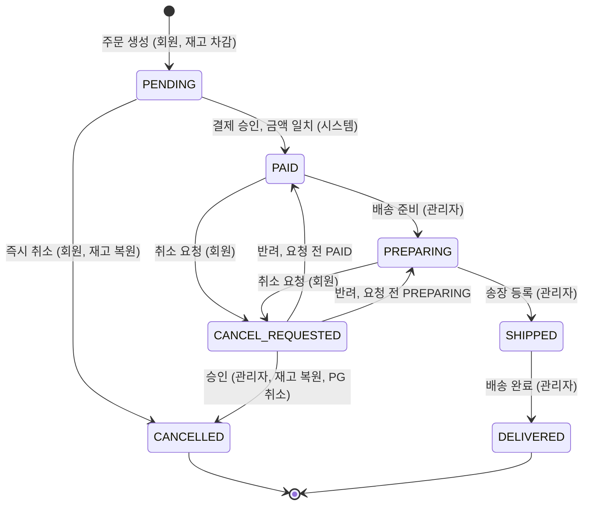
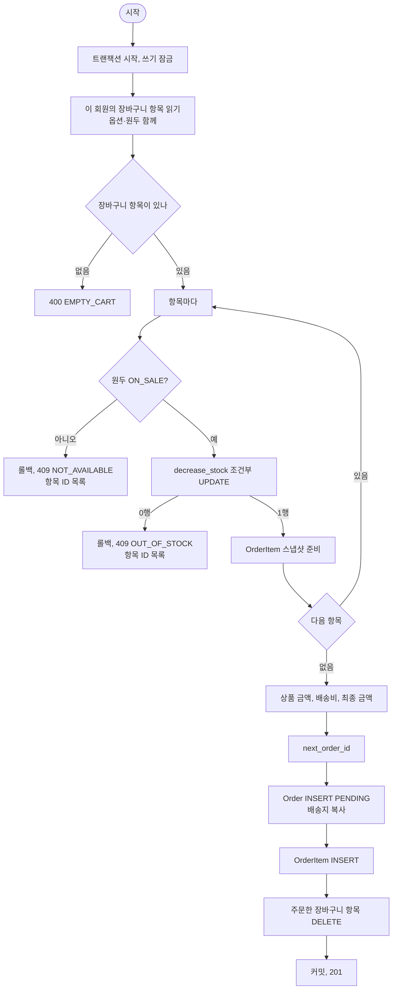
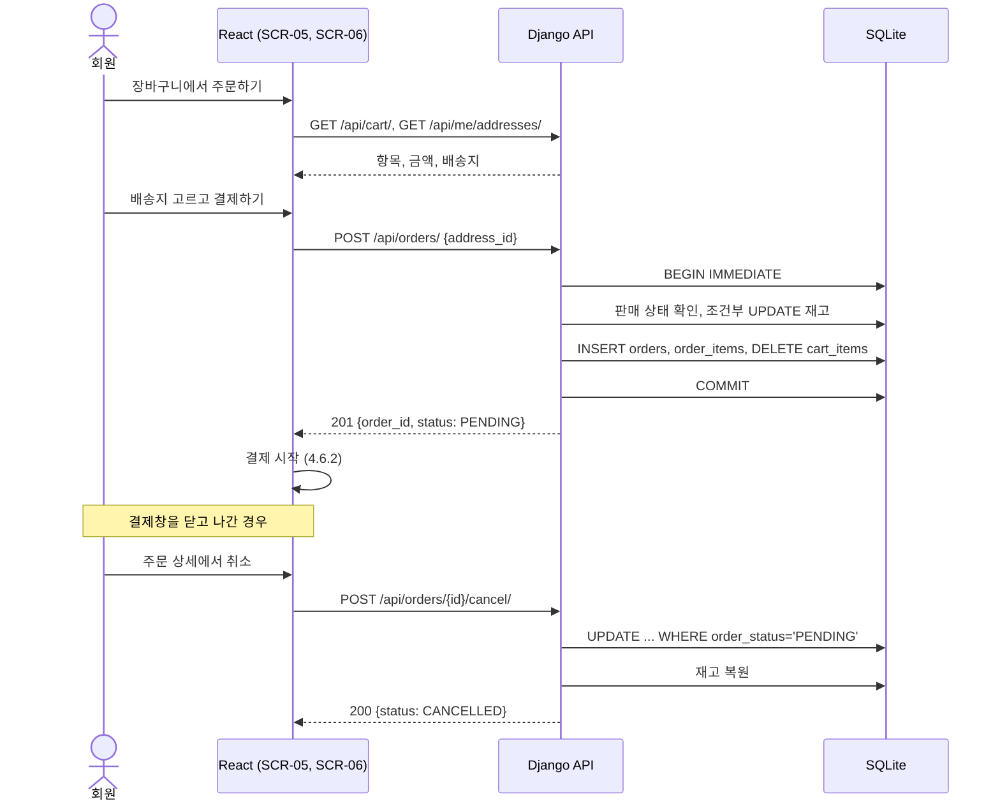

## 4.5 주문

`orders` 앱의 `Order`, `OrderItem`, `orders/services.py`, `orders/order_number.py`. 주문의 상태는 이 절의 전환표로만 바뀐다(DR-19). 결제로 바뀌는 전환은 4.6절, 관리자가 바꾸는 전환은 4.8절에 있고, 표는 여기 하나로 모은다.

### 4.5.0 주문 상태 기계



### 4.5.1 상태 전환표 (DR-19, DR-20)

| 함수 | 조건부 UPDATE의 WHERE | SET | 함께 하는 일 | 요구사항 |
| --- | --- | --- | --- | --- |
| `create_order` | (INSERT) | `PENDING` | 재고 차감, 장바구니 항목 삭제 | FR-23 |
| `mark_paid` | `order_status='PENDING'` | `PAID` | 결제 `SUCCESS` | FR-26, DR-22 |
| `cancel_pending_order` | `order_status='PENDING'` | `CANCELLED` | 재고 복원 | FR-32 |
| `request_cancel` | `order_status IN ('PAID','PREPARING')` | `CANCEL_REQUESTED`, `status_before_cancel=<현재>`, `cancel_reason` | | FR-33 |
| `prepare` | `order_status='PAID'` | `PREPARING` | | FR-47 |
| `ship` | `order_status='PREPARING'` | `SHIPPED`, `courier_code`, `tracking_number`, `shipped_at=now` | | FR-48 |
| `deliver` | `order_status='SHIPPED'` | `DELIVERED`, `delivered_at=now` | | FR-49 |
| `approve_cancel` | `order_status='CANCEL_REQUESTED'` | `CANCELLED` | 재고 복원, 성공 결제 PG 취소 | FR-50, DR-21 |
| `reject_cancel` | `order_status='CANCEL_REQUESTED'` | `order_status=status_before_cancel`, `status_before_cancel=NULL` | 사유는 기록으로 남긴다 | FR-51 |

- 표에 없는 전환을 요청하면 바뀐 행이 0이고 409 `INVALID_STATE`다. 응답 `message`에 현재 상태의 한국어 이름을 넣는다("배송 중인 주문은 취소를 요청할 수 없습니다").
- `CANCELLED`, `DELIVERED`에서 나가는 전환은 없다(DR-20).
- `request_cancel`의 `WHERE`는 실제로는 `order_status = <읽은 현재 상태>`로 쓴다. 읽은 뒤 다른 요청이 상태를 바꿨으면 0행이고, `status_before_cancel`에 틀린 값이 들어가지 않는다.

### 4.5.2 주문번호 생성 (DR-11)

```python
def next_order_id(today: date) -> str:
    prefix = f"ORD-{today:%Y%m%d}-"
    last = (Order.objects.filter(order_id__startswith=prefix)
            .order_by("-order_id").values_list("order_id", flat=True).first())
    seq = int(last[-3:]) + 1 if last else 1
    if seq > 999:
        raise DomainError("ORDER_LIMIT", "오늘 받을 수 있는 주문 수를 넘었습니다.", 503)
    return f"{prefix}{seq:03d}"
```

- `today`는 `timezone.localdate()`, 곧 Asia/Seoul 날짜다(11.1절). UTC 자정이 아니라 한국 자정에 001로 돌아간다.
- `create_order` 트랜잭션 안에서 부른다. 트랜잭션이 IMMEDIATE로 쓰기 잠금을 먼저 잡으므로 두 주문이 같은 번호를 읽지 않는다. 그래도 겹치면 PK 충돌로 트랜잭션 전체가 롤백되고 500이 아니라 409 `RETRY`로 답한다(화면은 "다시 시도해 주세요").
- 일련번호가 세 자리라 하루 999건이 상한이다(DR-11). 시연 규모(주문 500건 전체, NFR-3)에서는 닿지 않는다.

### 4.5.3 주문 생성 (FR-23, NFR-14, NFR-15, NFR-16)

- 경로: `POST /api/orders/`, 회원.
- 입력: 배송지 둘 중 하나.
  - `{"address_id": 5}`: 저장된 배송지.
  - `{"address": {recipient_name, recipient_phone, zipcode, base_address, detail_address}}`: 새로 입력한 주소. 배송지 목록에 저장하지 않는다.
- 처리(`create_order`, `transaction.atomic()` 하나):



  1. 이 회원의 장바구니 항목 전부가 주문 대상이다. 서버는 항목을 조용히 빼지 않는다. 0개면 400 `EMPTY_CART`.
  2. 항목마다 원두가 `ON_SALE`인지 잠금을 잡은 뒤 읽은 값으로 확인한다. 하나라도 아니면 롤백하고 409 `NOT_AVAILABLE`(NFR-16, DR-8). 화면 표시와 관계없이 서버가 다시 본다.
  3. 재고는 `decrease_stock(option_id, quantity)`(4.7.6절) 조건부 UPDATE로 줄인다. 한 항목이라도 0행이면 예외를 던져 트랜잭션 전체가 롤백된다. 앞 항목에서 줄인 재고도 돌아간다(NFR-14).
  4. 스냅샷: `product_name`, `weight_size`, `grind_type`(코드값), `order_price = base_price + extra_price`(DR-12).
  5. `total_product_amt = Σ(order_price × quantity)`, `shipping_fee = shipping_fee_for(total)`, `final_payment_amt = total + fee`(DR-13 ~ DR-15). 요청 본문의 금액은 받지 않는다.
  6. 배송지 복사: `recipient_name`, `recipient_phone`, `shipping_address = f"({zipcode}) {base_address} {detail_address}".strip()`(DR-18). 저장된 배송지는 `user=request.user`로 찾고, 없으면 404.
- 응답: 201, 4.5.6의 주문 상세 모양(`status=PENDING`).
- 오류: 400(`EMPTY_CART`, 배송지 형식), 404(다른 회원 배송지), 409(`NOT_AVAILABLE`, `OUT_OF_STOCK`, `RETRY`), 503(`ORDER_LIMIT`, 4.5.2). 409 본문의 `details.cart_item_ids`에 문제 항목을 넣어 화면이 어느 항목인지 보인다(UC-5 4단계). 재고·장바구니는 요청 전 그대로다(FR-23, NFR-14).
- SRS FR-23의 "주문 가능한 모든 항목"은 화면 쪽 규칙으로 읽는다. 장바구니 화면은 주문할 수 없는 항목이 있으면 주문하기를 끄고 그 항목을 빼라고 안내한다(6.5절). 그래서 서버에 도착하는 주문은 늘 장바구니 전체이고, 섞여 있으면 409다. 이 해석은 11.1절에 적었다.
- 동시성: 재고 1개 옵션에 동시 주문이 들어와도 쓰기 트랜잭션이 하나씩 돌고, 두 번째부터는 조건부 UPDATE가 0행이라 409다(NFR-15). 3.1절 스파이크로 확인한다.
- 초안: `Order.create_order`, ALG-01. 초안과 달리 주문번호를 호출자가 넘기지 않고 이 함수가 만든다.

### 4.5.4 주문 화면 금액 표시 (FR-24)

- 주문 화면(SCR-06)은 주문을 만들기 전에 `GET /api/cart/`(4.4.2)의 `items`, `product_amount`, `shipping_fee`, `total_amount`를 보인다. 같은 `shipping_fee_for`를 쓰므로 주문 생성 뒤 금액과 같다.
- 결과 화면과 주문 상세는 저장된 `total_product_amt`, `shipping_fee`, `final_payment_amt`를 보인다.

### 4.5.5 내 주문 목록 (FR-30, FR-55)

- 경로: `GET /api/orders/`, 회원.
- 입력: `status`(선택, `OrderStatus` 값 하나), `page`.
- 처리: `Order.objects.filter(user=request.user)`, `status`가 있으면 `order_status=status`, `order_by("-created_at")`. 다른 값이면 400.
- 응답: 200, 7.4절 페이지 형식. 항목은 `{order_id, created_at, final_payment_amt, status, item_count, first_item_name}`.
- 화면(SCR-07)은 상태 탭(전체, 결제 대기, 결제 완료, 배송 준비, 배송 중, 배송 완료, 취소 요청, 취소)으로 `status`를 바꾼다.

### 4.5.6 내 주문 상세 (FR-31, FR-34)

- 경로: `GET /api/orders/{id}/`, 회원. `{id}`는 주문번호다.
- 응답: 200.

```json
{
  "order_id": "ORD-20261120-003",
  "status": "SHIPPED",
  "created_at": "2026-11-20T14:03:11+09:00",
  "items": [
    {"product_name": "브라질 산토스", "weight_size": "200G", "grind_type": "WHOLE_BEAN",
     "order_price": 15000, "quantity": 2, "subtotal": 30000}
  ],
  "total_product_amt": 30000,
  "shipping_fee": 0,
  "final_payment_amt": 30000,
  "recipient_name": "홍길동",
  "recipient_phone": "010-0000-0000",
  "shipping_address": "(00000) 서울특별시 ...",
  "payments": [
    {"payment_id": 9, "status": "SUCCESS", "method": "CARD", "paid_amount": 30000,
     "failure_reason": null, "approved_at": "2026-11-20T14:04:02+09:00"}
  ],
  "courier_name": "CJ대한통운",
  "tracking_number": "1234567890",
  "tracking_url": "https://trace.cjlogistics.com/next/tracking.html?wblNo=1234567890",
  "shipped_at": "2026-11-21T09:30:00+09:00",
  "delivered_at": null,
  "cancel_reason": null,
  "can_pay": false,
  "can_cancel": false,
  "can_request_cancel": false
}
```

- 날짜는 Asia/Seoul 오프셋을 붙인 ISO 8601로 내보낸다(`USE_TZ=True`, `TIME_ZONE="Asia/Seoul"`).
- `courier_name`, `tracking_number`, `tracking_url`, `shipped_at`, `delivered_at`은 배송 중·배송 완료일 때만 값이 있다(FR-34). `courier_name`은 `courier_code`의 한국어 이름이다(5.10절).
- `can_pay = status == PENDING and 성공 결제 없음`(FR-29), `can_cancel = status == PENDING`(FR-32), `can_request_cancel = status in (PAID, PREPARING)`(FR-33). 화면은 이 값으로 버튼을 켜고 끈다. 서버는 버튼과 관계없이 4.5.1 전환표로 다시 막는다.
- 오류: 404(다른 회원 주문, NFR-11).

### 4.5.7 배송 조회 링크 (FR-35, UC-8)

- 주문 상세 화면(SCR-08)은 `tracking_url`이 있으면 "배송 조회" 링크를 `<a href={tracking_url} target="_blank" rel="noopener noreferrer">`로 그린다.
- 주소는 서버가 5.10절 표로 만든다. 프론트엔드는 주소 규칙을 모른다.

### 4.5.8 결제 대기 주문 즉시 취소 (FR-32)

- 경로: `POST /api/orders/{id}/cancel/`, 회원.
- 처리(`cancel_pending_order`, 한 트랜잭션):
  1. `UPDATE orders SET order_status='CANCELLED' WHERE order_id=? AND user_id=? AND order_status='PENDING'`.
  2. 0행이면 409 `INVALID_STATE`(결제 완료 이후 상태, 이미 취소).
  3. 1행이면 주문 항목마다 `increase_stock(option_id, quantity)`(4.7.7절).
  4. `READY` 상태 결제 기록은 `CANCELLED`, 사유 "주문 취소"로 바꾼다.
- 응답: 200, 주문 상세.
- 같은 요청이 두 번 와도 두 번째는 0행이라 재고가 한 번만 돌아간다(DR-21).
- 회원이 결제창을 연 채 취소하고 그 뒤에 승인 요청이 오는 경우는 4.6.3절이 처리한다(DR-22, DR-23).
- 초안: ALG-02 `PENDING` 분기.

### 4.5.9 취소 요청 (FR-33, DR-20)

- 경로: `POST /api/orders/{id}/cancel-request/`, 회원.
- 입력: `reason`(1 ~ 500자). 비면 400.
- 처리(`request_cancel`): 4.5.1 표의 조건부 UPDATE. 0행이면 409(배송 중, 배송 완료, 이미 요청, 취소, 결제 대기).
- 결제 대기 주문은 이 경로가 아니라 4.5.8로 취소한다. 화면은 상태에 따라 두 버튼 중 하나만 보인다.
- 응답: 200, 주문 상세(`status=CANCEL_REQUESTED`).
- 초안: ALG-02 `PAID`/`PREPARING` 분기.

### 4.5.10 주문·취소 시퀀스


