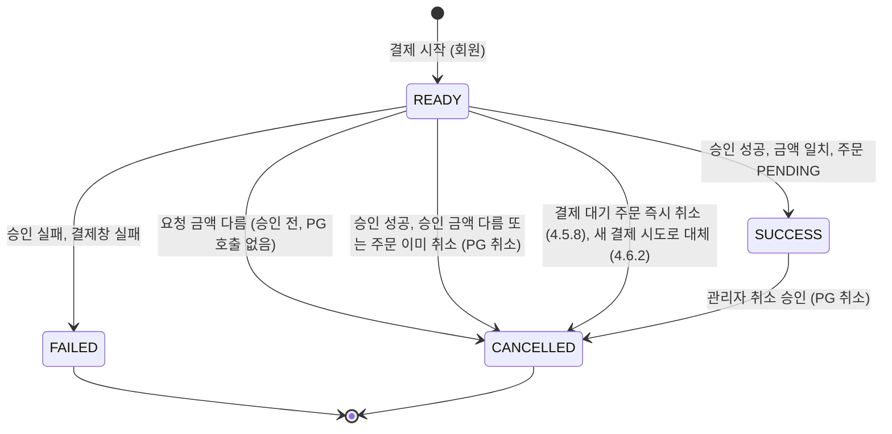
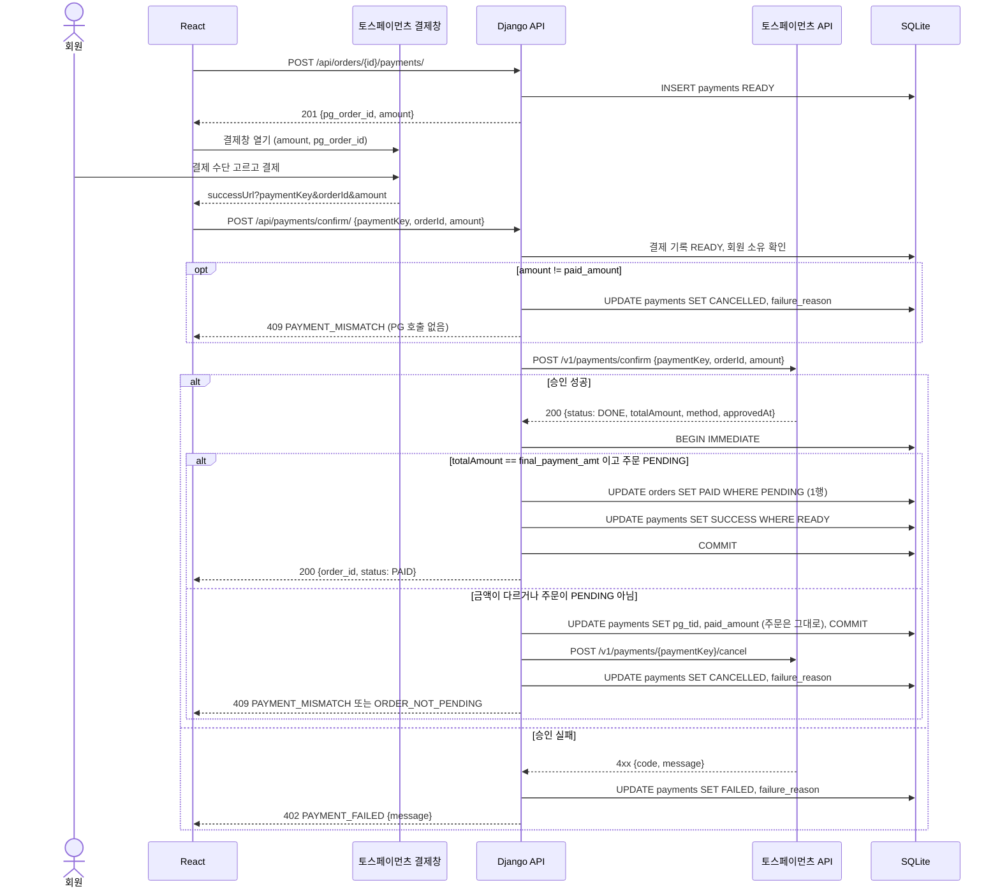

## 4.6 결제

| 항목 | 내용 |
| --- | --- |
| 책임 | 결제 시도를 만들고 PG 승인 결과를 확인해 주문을 결제 완료로 바꾼다. 성립할 수 없는 승인은 PG에서 취소한다 (DR-22 ~ DR-24) |
| 제공 인터페이스 | `/api/orders/{order_id}/payments/`, `/api/payments/confirm/`, `/api/payments/fail/` (FR-25 ~ FR-29, FR-60). 다른 부품이 쓰는 함수 `cancel_success_payment` |
| 의존 | 회원과 인증, 주문, 외부 시스템 토스페이먼츠 |
| 구현 모듈 | `orders/models.py`의 `Payment`, `orders/payments.py`, `orders/pg.py`, `orders/serializers.py`, `orders/views.py`, 프론트엔드 SCR-06과 `/checkout/result` |

`orders/payments.py`(업무 규칙), `orders/pg.py`(토스페이먼츠 호출), 프론트엔드 SCR-06과 `/checkout/result`. PG는 토스페이먼츠 테스트 모드이고, 결제창에서 돌아온 브라우저가 확인 API를 부르면 서버가 PG 승인 API를 부른다. 웹훅은 받지 않는다(SRS 7.1절). 필드 이름과 흐름은 토스페이먼츠 공개 문서 기준이며, 실제 응답은 3.2절 스파이크로 확인한다.

### 4.6.0 결제 상태 기계 (DR-24)



| 지금 | 다음 | 함수 | 요구사항 |
| --- | --- | --- | --- |
| (없음) | `READY` | `start_payment` | FR-25, FR-29 |
| `READY` | `SUCCESS` | `confirm_payment` | FR-26 |
| `READY` | `CANCELLED` | `confirm_payment`(불일치), `cancel_pending_order`, `start_payment`(새 시도로 대체) | FR-27, FR-29, FR-32 |
| `READY` | `FAILED` | `confirm_payment`(PG 오류), `fail_payment` | FR-28 |
| `SUCCESS` | `CANCELLED` | `cancel_success_payment` | FR-50 |

결제 상태도 주문과 같이 조건부 UPDATE(`WHERE payment_status='READY'`)로 바꾼다. 한 결제 기록은 `READY`에서 한 번만 나간다.

### 4.6.1 PG 주문 번호

- 토스페이먼츠는 결제 요청마다 `orderId`가 겹치지 않아야 한다. 한 주문에서 결제를 여러 번 시도하므로(DR-24) 주문번호를 그대로 쓰지 않고 시도마다 `pg_order_id = f"{order_id}-P{n}"`을 만든다. `n`은 그 주문의 결제 기록 수 + 1이다(예: `ORD-20261120-003-P2`, 19자. 토스 규칙 6 ~ 64자, 영문·숫자·`-`·`_` 안에 든다).
- `payments.pg_order_id`는 UNIQUE라 같은 시도 번호가 두 번 생기지 않는다.

### 4.6.2 결제 시작과 재결제 (FR-25, FR-29)

- 경로: `POST /api/orders/{id}/payments/`, 회원.
- 처리(`start_payment`, 한 트랜잭션):
  1. 주문을 `user=request.user`로 찾는다. 없으면 404.
  2. 성공 결제가 이미 있으면 409 `ALREADY_PAID`(FR-29). 그다음 `order_status != PENDING`이면 409 `INVALID_STATE`(DR-22).
  3. 이 주문의 `READY` 결제 기록은 `CANCELLED`, 사유 "새 결제 시도로 대체"로 바꾼다. 결제창을 닫고 다시 누른 경우다. 하나의 주문에 열린 시도는 늘 하나뿐이다.
  4. `Payment(order, pg_provider="TOSS", pg_order_id, payment_status=READY, paid_amount=final_payment_amt)` INSERT.
- 응답: 201, `{payment_id, pg_order_id, amount, order_name, customer_name}`. `amount = final_payment_amt`, `order_name`은 "첫 원두 이름 외 N건".
- 프론트엔드: 토스페이먼츠 SDK를 클라이언트 키(`VITE_TOSS_CLIENT_KEY`, 9절)로 초기화하고, 응답의 `amount`, `pg_order_id`, `order_name`과 `successUrl=<origin>/checkout/result`, `failUrl=<origin>/checkout/result?fail=1`로 결제창을 연다. 결제 수단은 결제창 안에서 고른다(FR-25).
- 주문/결제 화면(SCR-06)의 결제하기는 4.5.3 주문 생성 → 이 경로를 이어서 부른다(SRS 7.1 "결제하기 한 번"). 주문 상세(SCR-08)의 결제하기는 이 경로만 부른다(FR-29, UC-6 5단계).

### 4.6.3 결제 승인 확인 (FR-26, FR-27, DR-22, DR-23)

- 경로: `POST /api/payments/confirm/`, 회원(토큰 필요. 웹훅이 아니라서 NFR-9 예외가 없다).
- 입력: `paymentKey`, `orderId`(= `pg_order_id`), `amount`. 토스가 `successUrl`에 붙여 준 값을 화면이 그대로 보낸다.
- 처리(`confirm_payment`):



  1. `pg_order_id`로 결제 기록을 찾는다. 없거나 주문이 다른 회원 것이면 404. 이미 `SUCCESS`면 PG를 다시 부르지 않고 200으로 같은 결과를 돌려준다(새로 고침으로 두 번 부른 경우). `FAILED`·`CANCELLED`면 409 `INVALID_STATE`.
  2. 결제 기록이 결제 대기 주문 취소(4.5.8)로 `CANCELLED`가 된 경우는 PG를 부르지 않고 409 `ORDER_NOT_PENDING`이다. 토스페이먼츠는 서버가 승인 API를 부르기 전에는 돈을 빼지 않고, 승인되지 않은 결제는 10분 뒤 사라진다. 그래서 FR-27의 "PG 취소 요청"이 필요한 건 승인한 뒤 주문이 취소돼 있음을 안 경우(5번)뿐이다.
  3. 요청 `amount`가 `payment.paid_amount`(시작 때 금액)와 다르면 PG를 부르지 않고 결제를 `CANCELLED`, `failure_reason="결제 금액 불일치"`로 닫고 409 `PAYMENT_MISMATCH`로 답한다. 주문은 `PENDING` 그대로다(DR-23, FR-27). 토스는 결제창 금액과 다른 승인 요청을 403 `FORBIDDEN_REQUEST`로 거절하고 돈을 빼지 않으므로(3.2절 4단계) 취소할 돈이 없다. 승인 응답의 `totalAmount`가 다를 때의 5번 분기(PG 취소)는 방어용으로 남긴다.
  4. 트랜잭션 밖에서 `pg.confirm(paymentKey, orderId, amount)`. 토스는 결제 요청 뒤 10분 안에 승인해야 하므로, 늦게 온 확인 요청은 PG 오류로 7번 분기를 탄다. 이 10분 제한과 그때의 응답은 공개 문서 기준이고 스파이크에서 재지 않았다(3.2절 6단계).
  5. PG 성공이면 트랜잭션 안에서:
     - `pg_tid=paymentKey`, `payment_method`(토스 `method`를 5.0.2 열거형으로: 카드 → `CARD`, 간편결제 → `EASY_PAY`, 계좌이체 → `TRANSFER`, 그 밖 → `OTHER`), `paid_amount=totalAmount`를 기록한다.
     - `totalAmount == order.final_payment_amt`이면 `UPDATE orders SET order_status='PAID' WHERE order_id=? AND order_status='PENDING'`. 1행이면 결제를 `SUCCESS`, `approved_at`으로 바꾸고 커밋한다. 이 두 UPDATE가 4.5.1 표의 `mark_paid`다.
     - 금액이 다르거나 0행(승인 중에 회원이 취소함)이면 주문은 그대로 두고, `pg_tid`, `payment_method`, `paid_amount`만 결제 기록에 UPDATE하고 커밋한다(PG 취소에 `pg_tid`가 필요하다). 그 뒤 `pg.cancel(paymentKey, 사유)`, 결제를 `CANCELLED`로 바꾼다. 사유는 "결제 금액 불일치" 또는 "이미 취소된 주문"(DR-23, FR-27).
  6. PG가 시간 초과(`PgError("TIMEOUT")`)면 승인됐는지 모르므로 결제를 `READY`로 두고 502 `PG_ERROR`로 답한다. 화면은 "결제 확인이 늦어지고 있습니다"와 다시 확인 버튼을 보이고, 같은 값으로 확인 API를 다시 부르면 위 복구 절차(`ALREADY_PROCESSED_PAYMENT`면 결제 조회)로 이어진다. `FAILED`로 닫지 않는 이유는 재결제로 두 번 승인되는 걸 막으려는 것이다.
  7. 그 밖의 PG 실패면 결제를 `FAILED`, `failure_reason="<토스 code>: <토스 message>"`로 바꾼다. 주문은 `PENDING` 그대로다(FR-28, DR-24).
- 응답: 200 `{order_id, status: "PAID", final_payment_amt}`. 실패는 402 `PAYMENT_FAILED`, 불일치는 409 `PAYMENT_MISMATCH`, 주문이 취소돼 있으면 409 `ORDER_NOT_PENDING`. 모두 `message`에 화면에 보일 사유를 넣는다.
- 결과 화면(`/checkout/result`): 200이면 주문번호와 "결제가 완료되었습니다", 오류면 사유와 "다시 결제" 버튼(4.6.2를 다시 부름)을 보인다(UC-6 3·4단계).
- 부분 유니크 제약 `uq_payments_order_success`가 마지막 방어선이다. 동시에 두 승인이 같은 주문을 `SUCCESS`로 만들려 하면 두 번째는 제약 오류로 롤백되고, 그 결제는 5번의 불일치 분기처럼 PG 취소한 뒤 409 `ALREADY_PAID`(사유 "이미 결제된 주문")로 답한다.
- 승인으로 보는 건 PG 응답 `status`가 `DONE`일 때뿐이다. 그 밖의 상태(가상계좌 `WAITING_FOR_DEPOSIT`, 조회했더니 `CANCELED` 등)와, `ALREADY_PROCESSED_PAYMENT` 뒤 조회한 결제의 `orderId`가 이 시도의 `pg_order_id`와 다른 경우는 7번 실패 분기다.
- `mark_paid`는 결제 기록을 `READY` → `SUCCESS`로 먼저 바꾸고, 1행일 때만 같은 저장점에서 주문을 `PAID`로 바꾼다. 주문이 0행이면 저장점을 되돌린다. 그래서 승인하는 사이 새 결제 시작(4.6.2 3단계)이 이 시도를 닫았으면 주문은 `PAID`가 되지 않고, 승인한 돈은 PG 취소한 뒤 409 `INVALID_STATE`(사유 "새 결제 시도로 대체")다(2026-11-19 코드 리뷰 반영).
- PG 응답이 5xx이거나 JSON이 아니거나 연결이 끊기면 승인 여부를 모르는 것으로 보고 6번(`READY` 유지, 502)과 같이 처리한다.
- 외부 호출 뒤 DB 쓰기가 실패하면(프로세스 종료 등) PG는 승인됐는데 결제 기록이 `READY`로 남을 수 있다. 화면이 같은 값으로 확인 API를 다시 부르면 토스가 `ALREADY_PROCESSED_PAYMENT`로 답하므로, 그 코드면 결제 조회(`GET /v1/payments/{paymentKey}`)로 상태를 가져와 4번을 이어서 한다(5번). 운영 절차는 SMP 3절.
- 결제 결과는 PG 콜백으로 받지 않는다. 브라우저가 결제창에서 돌아오면 서버가 승인 API를 부른다.

### 4.6.4 결제창 실패·이탈 (FR-28)

- 토스는 결제창에서 실패하면 `failUrl`로 `code`, `message`, `orderId`를 붙여 보낸다. 결과 화면은 `POST /api/payments/fail/`로 `{orderId, code, message}`를 보낸다(`orderId`는 선택).
- 회원이 결제창을 X로 닫으면 `failUrl`로 가지 않는다. SDK의 `requestPayment()`가 `{code: "USER_CANCEL"}` 오류로 끝나고 페이지는 그대로다(3.2절 5단계, 2026-11-19 확인). 주문/결제 화면(SCR-06)은 이 오류를 받아 "결제를 취소했습니다"와 다시 결제 버튼을 보이고, 서버는 부르지 않는다. 결제 기록은 `READY`로 남고 아래처럼 정리된다.
- 서버(`fail_payment`): `orderId`가 없으면 아무것도 바꾸지 않고 200. 있으면 `pg_order_id`로 찾되 주문이 요청자 것이 아니면 404(NFR-11), `READY`가 아니면 바꾸지 않고 200, `READY`면 `FAILED`와 `failure_reason="<code>: <message>"`로 바꾼다. 주문은 `PENDING`이다.
- 이 경로는 SRS 6.2 목록에 없다. FR-28 검증("결제 `FAILED` + 실패 사유")을 결제창 실패에서도 만족시키려고 둔 것이라 11.1절에 적었다.
- 회원이 결제창을 닫고 아무 화면으로도 돌아오지 않으면 결제 기록은 `READY`로 남는다. 다음 결제 시작(4.6.2 3단계)이나 주문 취소(4.5.8)가 정리한다.

### 4.6.5 PG 클라이언트 (orders/pg.py, FR-60, NFR-42)

```python
class PaymentsClient(Protocol):
    def confirm(self, payment_key: str, pg_order_id: str, amount: int) -> PgResult: ...
    def cancel(self, payment_key: str, reason: str) -> PgResult: ...
    def get(self, payment_key: str) -> PgResult: ...

class TossPaymentsClient:
    BASE = "https://api.tosspayments.com"
    # 인증: Authorization: Basic base64("<TOSS_SECRET_KEY>:")
    # confirm: POST /v1/payments/confirm  {paymentKey, orderId, amount}
    # cancel:  POST /v1/payments/{paymentKey}/cancel  {cancelReason}, Idempotency-Key 헤더
    # get:     GET  /v1/payments/{paymentKey}
    # 시간 제한 10초. 시간 초과는 PgError("TIMEOUT")

class FakePaymentsClient:
    # 테스트용. 미리 정한 결과(성공, 실패 코드, 다른 금액)를 돌려준다.
```

- 결제 끄기(FR-60, 2026-11-27 ID 추가): 설정 `PAYMENTS_ENABLED`가 거짓이면(`TOSS_SECRET_KEY`가 비어 있고 클라이언트가 `TossPaymentsClient`일 때, 9.1절) `get_client()`와 결제 시작·확인이 PG를 부르거나 DB를 바꾸기 전에 503 `PAYMENTS_DISABLED`로 멈춘다. 결제 시작은 결제 기록을 만들지 않고, 확인은 결제를 `READY`로 두고, 관리자 취소 승인은 주문을 `CANCEL_REQUESTED`로 둔다. 이 프로젝트 전용 테스트 키가 생기기 전에 운영 서버를 띄우려는 것이다(11.1절, SIP 3.4절) (2026-11-19 추가)

- 어떤 클라이언트를 쓸지는 설정 `PAYMENTS_CLIENT`(점 경로)로 고른다. 테스트 설정은 `FakePaymentsClient`다. 테스트는 토스 서버를 부르지 않는다(STP 1절).
- `PgResult`는 `{ok, status, total_amount, method, approved_at, code, message}`만 담는다. 응답 원문은 저장하지 않는다(NFR-18).
- 시크릿 키는 서버 환경 변수 `TOSS_SECRET_KEY`에만 있다. 로그에 `Authorization` 헤더와 `paymentKey` 전체를 남기지 않는다(8.5절).

### 4.6.6 성공 결제 취소 (FR-50에서 부름)

- `cancel_success_payment(payment, reason)`: `pg.cancel(pg_tid, reason)` 뒤 `UPDATE payments SET payment_status='CANCELLED', failure_reason=? WHERE payment_id=? AND payment_status='SUCCESS'`.
- 취소 요청에는 `Idempotency-Key: cancel-<payment_id>` 헤더를 붙인다. 같은 키의 두 번째 요청은 토스가 첫 결과를 돌려준다. 그래도 `ALREADY_CANCELED_PAYMENT`가 오면 성공으로 보고 DB만 바꾼다. 같은 승인이 두 번 처리돼도 결과가 같다(DR-21). 실제 응답은 3.2절 스파이크 3단계로 확인한다.
- 그 밖의 PG 오류면 예외를 던지고, 부른 쪽(4.8.7)이 502 `PG_ERROR`로 답한다.
