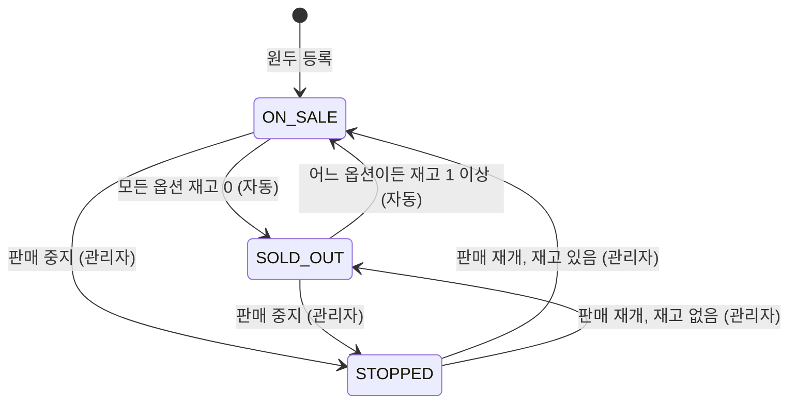
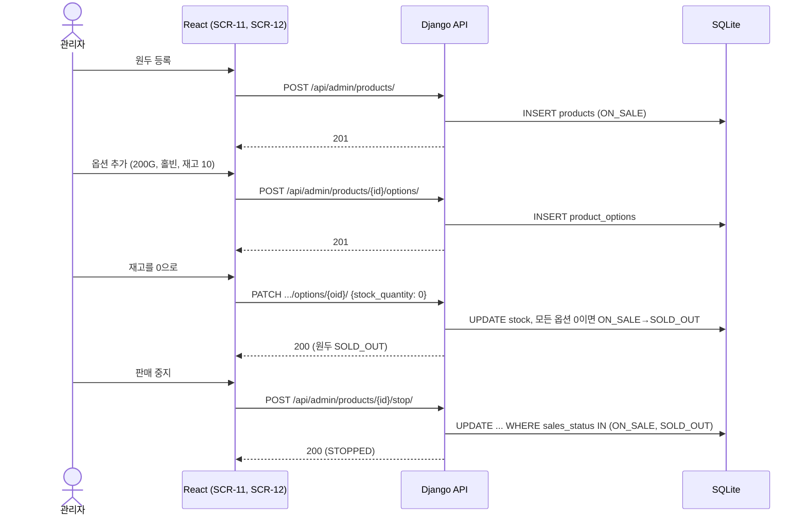

## 4.7 관리자 원두·재고

`products` 앱의 관리자용 뷰와 `products/services.py`. 모든 경로는 `/api/admin/products/` 아래이고 `IsAuthenticated + IsAdminRole`이다(NFR-10, 4.1.10). 재고를 바꾸는 함수는 `decrease_stock`, `increase_stock`, `set_stock` 셋이고(2.1절), 판매 상태는 이 셋과 `stop_sales`, `resume_sales`만 바꾼다(5.9절).

### 4.7.0 판매 상태 기계 (DR-6, DR-7)



| 지금 | 일어난 일 | 다음 | 함수 | 조건부 UPDATE의 WHERE |
| --- | --- | --- | --- | --- |
| `ON_SALE` | 재고 감소로 모든 옵션 0 | `SOLD_OUT` | `decrease_stock`, `set_stock` | `sales_status='ON_SALE'` |
| `SOLD_OUT` | 어느 옵션 재고 1 이상 | `ON_SALE` | `increase_stock`, `set_stock` | `sales_status='SOLD_OUT'` |
| `ON_SALE`, `SOLD_OUT` | 판매 중지 | `STOPPED` | `stop_sales` | `sales_status IN ('ON_SALE','SOLD_OUT')` |
| `STOPPED` | 판매 재개 | 재고 있으면 `ON_SALE`, 없으면 `SOLD_OUT` | `resume_sales` | `sales_status='STOPPED'` |
| `STOPPED` | 재고 변화 | `STOPPED` 그대로 | (위 자동 UPDATE의 WHERE에 걸리지 않음) | DR-7 |

- 자동 전환의 WHERE에 지금 상태를 넣었기 때문에 판매 중지 원두는 재고가 바뀌어도 `SOLD_OUT`이나 `ON_SALE`로 덮이지 않는다(DR-7). 지금 코드(`backend/`)의 "재고 0이면 무조건 `SOLD_OUT`" 문제를 이렇게 고친다.
- 관리자는 `SOLD_OUT`을 직접 고르지 못한다. 수정 API의 시리얼라이저에 `sales_status` 필드가 없다(DR-6).
- 옵션이 하나도 없는 원두는 "모든 옵션 재고 0"으로 보지 않는다. 등록 직후 `ON_SALE`이지만 고객 상세에서 옵션이 없어 담을 수 없다. 화면은 "준비 중"을 보인다.

### 4.7.1 전체 원두 목록 (FR-36)

- 경로: `GET /api/admin/products/`.
- 입력: `search`(4.7.11), `sales_status`(선택, 3개 값 중 하나), `page`.
- 응답: 200, 7.4절 페이지 형식. 항목은 `{product_id, name, origin, roast_level, base_price, sales_status, option_count, total_stock, options: [{option_id, weight_size, grind_type, extra_price, stock_quantity}]}`. 판매 중지 원두를 포함한다.
- 화면(SCR-11)의 상태 필터는 `sales_status` 매개변수다.

### 4.7.2 원두 등록 (FR-37)

- 경로: `POST /api/admin/products/`.
- 입력: `name`, `origin`(4.3.7절 고정 목록 중 하나, 목록 밖이면 400), `roast_level`, `base_price`(0 이상 정수), `tasting_notes`(선택), `description`(선택), `image_url`(선택, `https://`).
- 처리: `sales_status=ON_SALE`로 INSERT. 옵션은 4.7.4로 따로 추가한다.
- 응답: 201, 관리자 원두 상세(4.7.12).
- 오류: 400(필수 항목, 음수 가격, 로스팅 값), 403(회원 토큰).

### 4.7.3 원두 수정 (FR-38)

- 경로: `PATCH /api/admin/products/{id}/`.
- 입력: 4.7.2의 필드 중 바꿀 것. `sales_status`는 받지 않는다.
- 처리: 해당 열만 UPDATE. 주문 항목은 스냅샷이라 바뀌지 않는다(DR-12). 장바구니는 가격을 저장하지 않으므로 다음 조회부터 새 가격이다.
- 응답: 200.

### 4.7.4 옵션 추가 (FR-39)

- 경로: `POST /api/admin/products/{id}/options/`.
- 입력: `weight_size`, `grind_type`, `extra_price`(0 이상), `stock_quantity`(0 이상).
- 처리(한 트랜잭션): 재고 0으로 INSERT한 뒤 요청의 재고 수량으로 `set_stock`(4.7.8)을 부른다. 재고를 바꾸는 길이 셋뿐이라는 규칙(2.1절)을 지키고, 판매 상태 전환도 `set_stock`이 맡는다. 그래서 옵션 없는 `ON_SALE` 원두에 재고 0 옵션을 처음 넣으면 `SOLD_OUT`이 되고(4.7.0), 재고가 있으면 `SOLD_OUT` → `ON_SALE`이다. 판매 중지 원두면 그대로다.
- 응답: 201, 옵션.
- 오류: 409 `DUPLICATE_OPTION`(같은 원두에 같은 용량·분쇄도, `uq_product_options_combo`, DR-3), 400(음수 추가 금액, 목록 밖 용량·분쇄도).

### 4.7.5 옵션 추가 금액 수정 (FR-40)

- 경로: `PATCH /api/admin/products/{id}/options/{oid}/`, 본문에 `extra_price`.
- 처리: UPDATE. 옵션 가격은 계산값이라 상세 응답에 바로 반영된다(DR-4).
- 용량·분쇄도는 바꾸지 않는다. 바꾸려면 새 옵션을 추가하고 기존 옵션 재고를 0으로 둔다(주문된 옵션은 지우지 못한다, 5.7절).
- 응답: 200. 오류: 404(다른 원두의 옵션 ID), 400.

### 4.7.6 재고 차감 `decrease_stock` (DR-5, NFR-15)

주문 생성(4.5.3)이 부른다. 관리자 경로가 아니지만 재고 함수를 한 곳에 모으려고 여기 둔다.

```python
def decrease_stock(option_id: int, quantity: int) -> None:
    updated = (ProductOption.objects
               .filter(option_id=option_id, stock_quantity__gte=quantity)
               .update(stock_quantity=F("stock_quantity") - quantity))
    if updated == 0:
        raise DomainError("OUT_OF_STOCK", "재고가 부족합니다.", 409)
    _sync_sold_out(option_id)

def _sync_sold_out(option_id):
    product_id = ProductOption.objects.values_list("product_id", flat=True).get(pk=option_id)
    if not ProductOption.objects.filter(product_id=product_id, stock_quantity__gt=0).exists():
        Product.objects.filter(pk=product_id, sales_status=SalesStatus.ON_SALE) \
               .update(sales_status=SalesStatus.SOLD_OUT)
```

- 비교와 차감이 한 UPDATE 문이라 읽고 비교하고 쓰는 사이에 다른 주문이 끼지 않는다. 0 밑으로는 CHECK 제약도 막는다(5.4절).
- 호출한 쪽의 트랜잭션 안에서 돈다. 주문의 다른 항목이 실패하면 함께 롤백된다(NFR-14).

### 4.7.7 재고 복원 `increase_stock` (DR-6)

결제 대기 취소(4.5.8)와 취소 승인(4.8.7)이 부른다.

```python
def increase_stock(option_id: int, quantity: int) -> None:
    ProductOption.objects.filter(pk=option_id) \
        .update(stock_quantity=F("stock_quantity") + quantity)
    product_id = ProductOption.objects.values_list("product_id", flat=True).get(pk=option_id)
    Product.objects.filter(pk=product_id, sales_status=SalesStatus.SOLD_OUT) \
        .update(sales_status=SalesStatus.ON_SALE)
```

- DB 값에 더한다. 메모리의 값을 저장하지 않으므로 그 사이의 차감이 사라지지 않는다.
- 두 번 불리지 않게 막는 것은 부른 쪽의 조건부 UPDATE다(DR-21, 4.5.8, 4.8.7).

### 4.7.8 재고 조정 `set_stock` (FR-41)

- 경로: `PATCH /api/admin/products/{id}/options/{oid}/`, 본문에 `stock_quantity`(새 재고 수량, 0 이상). FR-40과 같은 경로이고, 본문에 온 필드에 따라 서비스 함수가 나뉜다. 둘 다 오면 한 트랜잭션에서 둘 다 한다.
- 처리(한 트랜잭션): `stock_quantity = 새 값` UPDATE 뒤
  - 새 값이 0이고 이 원두의 다른 옵션도 모두 0이면 `ON_SALE` → `SOLD_OUT`.
  - 새 값이 1 이상이면 `SOLD_OUT` → `ON_SALE`.
  - `STOPPED`는 그대로(DR-7).
- 오류: 400(음수, DR-5).
- 관리자가 "늘리기·줄이기"를 고르는 대신 새 수량을 넣는다. 화면(SCR-12)은 재고 칸에 지금 값을 채워 두고 바꾼 값을 보낸다. 관리자가 화면을 보는 사이 주문으로 재고가 줄었다면 관리자 값으로 덮인다. 시연 규모에선 받아들이고, 11.1절에 남겼다.

### 4.7.9 판매 중지 (FR-42)

- 경로: `POST /api/admin/products/{id}/stop/`.
- 처리(`stop_sales`): 4.7.0 표의 조건부 UPDATE. 이미 `STOPPED`이면 0행이고 409 `INVALID_STATE`.
- 응답: 200, `{product_id, sales_status: "STOPPED"}`.
- 장바구니에 담긴 그 원두의 옵션은 남지만 `is_available=false`가 되고, 그 항목을 빼기 전까지 주문 생성은 409 `NOT_AVAILABLE`이다(4.4.2, 4.5.3).

### 4.7.10 판매 재개 (FR-43)

- 경로: `POST /api/admin/products/{id}/resume/`.
- 처리(`resume_sales`, 한 트랜잭션): 재고가 있는 옵션이 있거나 옵션이 하나도 없으면 `ON_SALE`(4.7.0 마지막 줄과 같은 규칙), 옵션이 있는데 모두 재고 0이면 `SOLD_OUT`으로 `WHERE sales_status='STOPPED'` UPDATE. 0행이면 409.
- 응답: 200, `{product_id, sales_status}`.

### 4.7.11 관리자 이름 검색 (FR-56)

- `GET /api/admin/products/?search=에티`. 고객용과 같은 `name__icontains`이지만 판매 중지 원두를 뺀 쿼리셋이 아니라 전체에서 찾는다.

### 4.7.12 관리자 원두 상세 (FR-37 ~ FR-41)

- 경로: `GET /api/admin/products/{id}/`(SRS 6.2에 없음, 7.7절).
- 응답: 200, `{product_id, name, origin, roast_level, base_price, tasting_notes, description, image_url, sales_status, created_at, options: [{option_id, weight_size, grind_type, extra_price, price, stock_quantity, is_available}]}`. 판매 중지 원두도 돌려준다.
- 4.7.2 ~ 4.7.5, 4.7.8 ~ 4.7.10의 응답 본문도 이 모양이다. 그래서 등록 응답에서 `sales_status=ON_SALE`을 확인할 수 있다(FR-37 검증).
- 오류: 404(없는 ID).

### 4.7.13 관리자 원두 시퀀스 (SEQ-07, SEQ-08)


