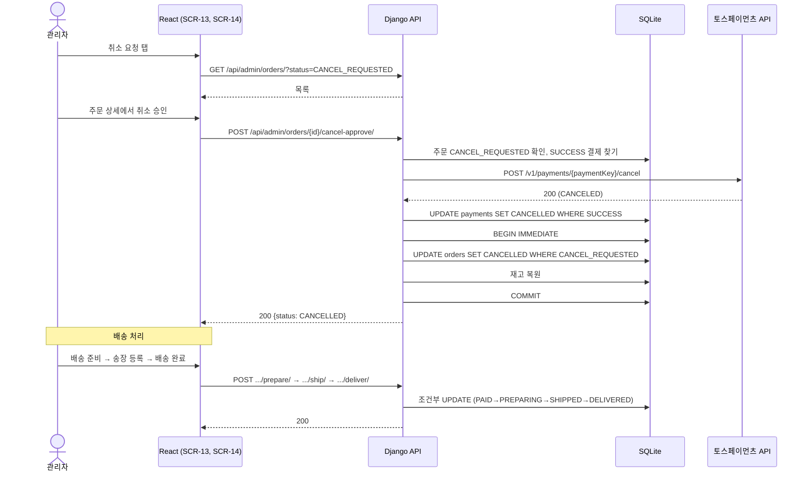

## 4.8 관리자 주문·배송·취소

| 항목 | 내용 |
| --- | --- |
| 책임 | 관리자가 주문을 조회하고 배송 준비·배송 시작·배송 완료·취소 승인·취소 반려로 상태를 바꾼다 (DR-19 ~ DR-21) |
| 제공 인터페이스 | `/api/admin/orders/` 아래 경로 7개 (FR-44 ~ FR-51, FR-57) |
| 의존 | 회원과 인증(`IsAdminRole`), 주문, 결제(`cancel_success_payment`), 관리자 원두·재고(`increase_stock`) |
| 구현 모듈 | `orders/services.py`, `orders/serializers.py`, `orders/views.py` |

`orders` 앱의 관리자용 뷰. 모든 경로는 `/api/admin/orders/` 아래이고 `IsAuthenticated + IsAdminRole`이다(NFR-10). 상태 전환은 4.5.1 전환표를 따르고, 표에 없는 전환은 409다(SRS 3.7절).

### 4.8.1 전체 주문 목록 (FR-44)

- 경로: `GET /api/admin/orders/`.
- 입력: `status`(4.8.2), `search`(4.8.9), `page`.
- 처리: `Order.objects.select_related("user").order_by("-created_at")`. 회원으로 거르지 않는다.
- 응답: 200, 7.4절 페이지 형식. 항목은 `{order_id, created_at, member_email, member_name, final_payment_amt, status}`.

### 4.8.2 상태 필터 (FR-45)

- `?status=CANCEL_REQUESTED`처럼 `OrderStatus` 값 하나. 목록 밖 값은 400.
- 화면(SCR-13)의 상태 탭이 이 값을 바꾼다. 취소 요청 탭에는 처리할 건수를 배지로 보인다(`GET /api/admin/orders/?status=CANCEL_REQUESTED`의 `count`).

### 4.8.3 관리자 주문 상세 (FR-46)

- 경로: `GET /api/admin/orders/{id}/`.
- 응답: 200. 4.5.6 회원용 상세의 모든 필드에 더해 `member: {user_id, email, user_name, phone_number}`, `status_before_cancel`, 결제 기록 전부(`pg_order_id`, 실패 사유 포함)와 `allowed_actions` 배열을 준다.
- `allowed_actions`는 지금 상태에서 가능한 동작이다: `PAID` → `["prepare"]`, `PREPARING` → `["ship"]`, `SHIPPED` → `["deliver"]`, `CANCEL_REQUESTED` → `["cancel_approve", "cancel_reject"]`, 그 밖 → `[]`. 화면(SCR-14)은 이 배열로 버튼을 보인다. HW2 와이어프레임의 "배송 상태 드롭다운 + 상태 변경" 대신 동작별 버튼을 둔다(6.15절).
- `pg_tid`는 화면에 뒤 8자만 보인다.

### 4.8.4 배송 준비 (FR-47)

- 경로: `POST /api/admin/orders/{id}/prepare/`.
- 처리(`prepare`): `UPDATE orders SET order_status='PREPARING' WHERE order_id=? AND order_status='PAID'`. 0행이면 409(결제 대기, 취소 요청 등).
- 같은 순간 회원이 취소를 요청했다면 둘 중 먼저 잠금을 잡은 쪽만 1행이다. 취소 요청 상태가 배송 준비로 덮이지 않는다.
- 응답: 200, 관리자 주문 상세.

### 4.8.5 송장 등록과 배송 시작 (FR-48)

- 경로: `POST /api/admin/orders/{id}/ship/`.
- 입력: `courier_code`(5개 중 하나, 5.10절), `tracking_number`(숫자와 `-`, 1 ~ 30자).
- 처리(`ship`): 4.5.1 표의 조건부 UPDATE(`WHERE order_status='PREPARING'`)로 `courier_code`, `tracking_number`, `shipped_at=now`, `SHIPPED`를 한 문장에 쓴다.
- 응답: 200.
- 오류: 400(송장번호 빈 값·형식, 목록 밖 택배사), 409(배송 준비가 아님).

### 4.8.6 배송 완료 (FR-49)

- 경로: `POST /api/admin/orders/{id}/deliver/`.
- 처리(`deliver`): `WHERE order_status='SHIPPED'` 조건부 UPDATE로 `DELIVERED`, `delivered_at=now`.
- 응답: 200. 오류: 409.

### 4.8.7 취소 승인 (FR-50, DR-21)

- 경로: `POST /api/admin/orders/{id}/cancel-approve/`.
- 처리(`approve_cancel`):
  1. 주문을 읽는다. `CANCEL_REQUESTED`가 아니면 409 `INVALID_STATE`.
  2. 이 주문의 `SUCCESS` 결제가 있으면 트랜잭션 밖에서 `cancel_success_payment(payment, "관리자 취소 승인")`(4.6.6). PG 오류면 여기서 멈추고 502 `PG_ERROR`. 주문은 `CANCEL_REQUESTED` 그대로라 관리자가 다시 누를 수 있다.
  3. 트랜잭션 안에서 `UPDATE orders SET order_status='CANCELLED' WHERE order_id=? AND order_status='CANCEL_REQUESTED'`.
  4. 0행이면 롤백, 409(그 사이 다른 승인·반려가 먼저 처리됨). 재고는 건드리지 않는다.
  5. 1행이면 주문 항목마다 `increase_stock`(4.7.7). 커밋.
- 응답: 200, 관리자 주문 상세(`status=CANCELLED`, 결제 `CANCELLED`).
- 같은 승인이 두 번 오면: 두 번째 요청은 1단계에서 409이거나, 동시에 들어왔으면 2단계 PG 취소는 "이미 취소" 성공으로 지나가고 3단계에서 0행이라 409다. 어느 쪽이든 재고는 한 번만 돌아간다(DR-21, FR-50 검증).
- PG 취소를 DB보다 먼저 하는 이유: DB를 먼저 `CANCELLED`로 바꾸면 PG 오류 때 "주문은 취소, 결제는 성공"인 상태가 남고, 승인 경로가 `CANCEL_REQUESTED`만 받으므로 다시 시도할 길이 없다. 반대로 PG 먼저면 실패해도 주문이 요청 상태로 남아 재시도할 수 있다. 다른 관리자가 그 사이 반려하면 "결제는 취소, 주문은 결제 완료"가 될 수 있는데, 관리자가 한 명인 시연 환경에서는 받아들이고 11.1절에 남겼다.

### 4.8.8 취소 반려 (FR-51)

- 경로: `POST /api/admin/orders/{id}/cancel-reject/`.
- 처리(`reject_cancel`): `UPDATE orders SET order_status = status_before_cancel, status_before_cancel = NULL WHERE order_id=? AND order_status='CANCEL_REQUESTED'`. 0행이면 409.
- `cancel_reason`은 지우지 않는다. 관리자 상세에서 반려된 요청의 사유를 볼 수 있다.
- 응답: 200, `status`가 `PAID` 또는 `PREPARING`.
- 지금 코드(`backend/`)는 반려하면 늘 `PREPARING`으로 돌린다. `status_before_cancel`로 요청 전 상태(`PAID` 또는 `PREPARING`)로 돌리도록 고친다.

### 4.8.9 주문 검색 (FR-57)

- `GET /api/admin/orders/?search=ORD-20261011`. `Q(order_id__icontains=search) | Q(user__email__icontains=search)`.
- 상태 필터와 함께 오면 AND다.

### 4.8.10 관리자 주문 처리 시퀀스 (SEQ-09)

