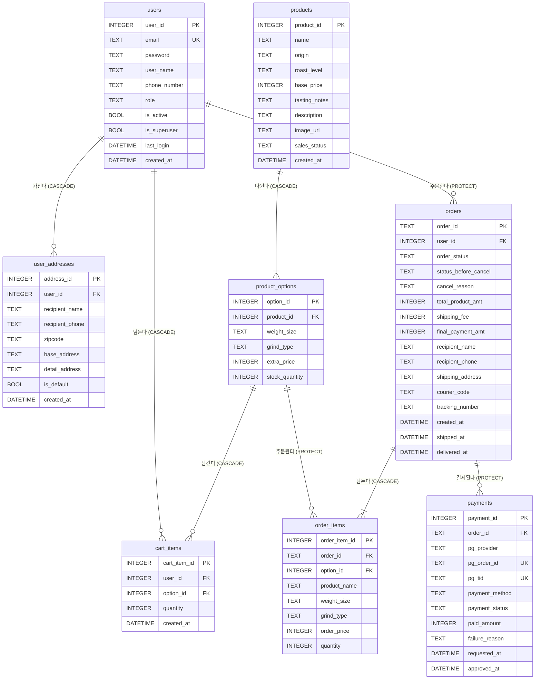

## 5. 데이터 모델

테이블 정의의 원본은 `backend/*/models.py`와 마이그레이션이다(11.1절). 이 절은 그 모델이 가져야 하는 열, 키, 제약과 각 제약이 지키는 요구사항을 적는다. 2026-11-17 결정(커스텀 사용자 모델, 시간대, 상품 이미지 URL, 택배사 고정 목록)을 반영했다. DB는 SQLite 3이고 Django가 연결마다 `PRAGMA foreign_keys = ON`을 켠다.

### 5.0 ERD

### 5.0.1 지금 코드(`backend/`)와 달라지는 점

| 항목 | 지금 코드 | 이 판 | 근거 |
| --- | --- | --- | --- |
| 비밀번호 열 | `password_hash` | `password`(Django `AbstractBaseUser`) | 11.1절 커스텀 사용자 모델, NFR-6 |
| 인증용 열 | 없음 | `is_active`, `last_login`, `is_superuser`(PermissionsMixin) | 11.1절 |
| 상품 이미지 | 없음 | `products.image_url`(선택) | SRS 7.1 |
| 주문 시각 열 | `ordered_at` | `created_at` | FR-30, FR-44 검증 열이 `created_at` 정렬 |
| 택배사 | `courier_name` 자유 문자열 | `courier_code`(고정 5개). API는 `courier_name`(한국어 이름)으로 내보낸다 | SRS 7.1, FR-34, FR-35 |
| 결제 주문 번호 | 없음 | `payments.pg_order_id`(PG에 넘기는 시도별 번호) | 4.6.1절, 11.1절 |
| 결제 수단 | NOT NULL | NULL 허용(승인 응답에서 채움) | 결제 시작 시점엔 수단을 모름(FR-25) |
| `payments.order_id` 삭제 규칙 | CASCADE | PROTECT | 주문은 지우지 않고, 결제 기록은 환불 근거라 남긴다(NFR-17과 같은 이유) |
| 주문번호 길이 | `order_id` 최대 50자 | `VARCHAR(16)`(`ORD-YYYYMMDD-NNN` 고정 길이). 일련번호 세 자리라 하루 999건 상한(4.5.2절) | DR-11 |
| 주문 항목 분쇄도 | 표시 이름(`get_grind_type_display()`) 저장 | 코드값 저장, 화면이 이름으로 바꾼다. 표시 이름 표(`src/lib/labels.js`)의 기존 값은 바꾸지 않고 더하기만 한다(옛 주문 표시가 바뀌지 않게) | DR-12 |
| 시각 기본값 | `DATETIME('now','localtime')` | ORM이 넣는 UTC 시각(`USE_TZ=True`). 화면과 주문번호 날짜만 `Asia/Seoul` | 11.1절 시간대 |
| 부분 유니크 인덱스, CHECK | 문서에만 있음 | 모델 `Meta.constraints`로 둔다 | 11.1절 |

### 5.0.2 열거형

| 열거형 | 값(DB에 저장) | 화면 표시 | 요구사항 |
| --- | --- | --- | --- |
| `Role` | `MEMBER`, `ADMIN` | 회원, 관리자 | FR-7, NFR-10 |
| `RoastLevel` | `LIGHT`, `MEDIUM`, `DARK` | 라이트, 미디엄, 다크 | DR-1 |
| `WeightSize` | `200G`, `500G`, `1KG` | 200g, 500g, 1kg | DR-2 |
| `GrindType` | `WHOLE_BEAN`, `HAND_DRIP`, `ESPRESSO` | 홀빈, 핸드드립용, 에스프레소용 | DR-2 |
| `SalesStatus` | `ON_SALE`, `SOLD_OUT`, `STOPPED` | 판매 중, 품절, 판매 중지 | SRS 2.2절 표, DR-6 |
| `OrderStatus` | `PENDING`, `PAID`, `PREPARING`, `SHIPPED`, `DELIVERED`, `CANCEL_REQUESTED`, `CANCELLED` | 결제 대기, 결제 완료, 배송 준비, 배송 중, 배송 완료, 취소 요청, 취소 | SRS 2.6절 표, DR-19 |
| `PaymentStatus` | `READY`, `SUCCESS`, `FAILED`, `CANCELLED` | 결제 대기, 결제 성공, 결제 실패, 결제 취소 | DR-24 |
| `PaymentMethod` | `CARD`, `EASY_PAY`, `TRANSFER`, `OTHER` | 카드, 간편결제, 계좌이체, 기타 | NFR-18 |
| `Courier` | `CJ`, `HANJIN`, `LOTTE`, `EPOST`, `LOGEN` | CJ대한통운, 한진택배, 롯데택배, 우체국택배, 로젠택배 | SRS 7.1, 5.10절 |

- 값은 영어 대문자 코드로 저장하고, 한국어 표시는 프론트엔드 `src/lib/`의 표에서 바꾼다(NFR-30). 지금 코드처럼 표시 이름(`get_grind_type_display()`)을 저장하지 않는다. 주문 항목 스냅샷도 코드값을 저장한다(DR-12).
- `WeightSize` 값은 지금 코드의 `'200g'` 문자열 대신 대문자 코드로 바꿨다. 이유는 11.1절.

### 5.1 users (회원)

`users.User`. `AbstractBaseUser` + `PermissionsMixin`, `USERNAME_FIELD = "email"`, `AUTH_USER_MODEL = "users.User"`(11.1절).

| 열 | 타입 | 키·제약 | 요구사항 |
| --- | --- | --- | --- |
| `user_id` | INTEGER | PK, 자동 증가 | |
| `email` | VARCHAR(255) | NOT NULL, UNIQUE. 저장 전에 소문자로 바꾼다 | FR-7(겹치는 이메일 400), FR-8 |
| `password` | VARCHAR(128) | NOT NULL. `pbkdf2_sha256$...` 해시만 저장 | NFR-6 |
| `user_name` | VARCHAR(100) | NOT NULL | FR-7, FR-11 |
| `phone_number` | VARCHAR(20) | NOT NULL | FR-7, FR-11 |
| `role` | VARCHAR(10) | NOT NULL, 기본 `MEMBER`, `CHECK(role IN ('MEMBER','ADMIN'))` | FR-7(가입은 항상 MEMBER), NFR-10 |
| `is_active` | BOOL | NOT NULL, 기본 TRUE | Django 인증. 비활성 계정은 로그인 401 |
| `is_superuser` | BOOL | NOT NULL, 기본 FALSE | PermissionsMixin. 개발용 `/admin/`에서만 의미가 있다 |
| `last_login` | DATETIME | NULL | `AbstractBaseUser`가 만드는 열. 로그인 때 갱신하지 않으므로 늘 NULL이다(4.1.2) |
| `created_at` | DATETIME | NOT NULL, 생성 시각 | |

- `is_staff`는 열로 두지 않고 `role == ADMIN`을 돌려주는 속성으로 둔다. 개발 환경 `/admin/`만 쓴다.
- 회원 행을 지우는 API는 없다. 주문이 있는 회원은 `orders.user_id`의 PROTECT로 DB가 삭제를 막는다(NFR-17).

### 5.2 user_addresses (배송지)

| 열 | 타입 | 키·제약 | 요구사항 |
| --- | --- | --- | --- |
| `address_id` | INTEGER | PK | |
| `user_id` | INTEGER | FK → `users`, ON DELETE CASCADE, 인덱스 `idx_user_addresses_user_id` | NFR-11 |
| `recipient_name` | VARCHAR(100) | NOT NULL | FR-15 |
| `recipient_phone` | VARCHAR(20) | NOT NULL | FR-15 |
| `zipcode` | VARCHAR(10) | NOT NULL, 숫자 5자리(시리얼라이저 검증) | FR-15 |
| `base_address` | VARCHAR(255) | NOT NULL | FR-15 |
| `detail_address` | VARCHAR(255) | NULL 허용 | FR-15 |
| `is_default` | BOOL | NOT NULL, 기본 FALSE | DR-16 |
| `created_at` | DATETIME | NOT NULL | FR-14 정렬(기본 먼저, 그다음 최근 순) |

- 부분 유니크 제약 `uq_user_addresses_one_default`: `UNIQUE(user_id) WHERE is_default = TRUE`. 회원마다 기본 배송지가 둘이 되지 않게 DB가 막는다(DR-16). "하나는 반드시 있다"는 서비스 함수가 지킨다(4.2절).

### 5.3 products (원두)

| 열 | 타입 | 키·제약 | 요구사항 |
| --- | --- | --- | --- |
| `product_id` | INTEGER | PK | |
| `name` | VARCHAR(200) | NOT NULL, 인덱스 `idx_products_name` | FR-2, FR-56 |
| `origin` | VARCHAR(100) | NOT NULL | FR-3 |
| `roast_level` | VARCHAR(10) | NOT NULL, `CHECK(roast_level IN ('LIGHT','MEDIUM','DARK'))` | DR-1, FR-5 |
| `base_price` | INTEGER | NOT NULL, `CHECK(base_price >= 0)` | DR-4, DR-13, FR-4 |
| `tasting_notes` | TEXT | NULL 허용 | FR-6 |
| `description` | TEXT | NULL 허용 | FR-6 |
| `image_url` | VARCHAR(500) | NULL 허용. `https://`로 시작하는 URL만(시리얼라이저 검증) | SRS 7.1 |
| `sales_status` | VARCHAR(10) | NOT NULL, 기본 `ON_SALE`, `CHECK(sales_status IN ('ON_SALE','SOLD_OUT','STOPPED'))` | DR-6 ~ DR-8, FR-37 |
| `created_at` | DATETIME | NOT NULL | 목록 정렬(최근 등록 순) |

- 복합 인덱스 `idx_products_filter(origin, roast_level, base_price)`는 원산지·로스팅·가격 필터(FR-3 ~ FR-5)를 위한 것이다. 고객 목록에 늘 붙는 판매 중지 제외 조건(`sales_status`)은 값이 셋뿐이라 인덱스에 넣지 않았다. 시연 규모(100종)에서는 인덱스 없이도 빠르지만 NFR-1 측정 때 실행 계획을 같이 본다.
- 원두 삭제 API는 없다. 판매를 멈출 땐 판매 중지를 쓴다(FR-42). 주문된 옵션이 있으면 `order_items.option_id` PROTECT가 삭제를 막는다.

### 5.4 product_options (옵션·재고)

| 열 | 타입 | 키·제약 | 요구사항 |
| --- | --- | --- | --- |
| `option_id` | INTEGER | PK | |
| `product_id` | INTEGER | FK → `products`, ON DELETE CASCADE | |
| `weight_size` | VARCHAR(4) | NOT NULL, `CHECK(weight_size IN ('200G','500G','1KG'))` | DR-2 |
| `grind_type` | VARCHAR(12) | NOT NULL, `CHECK(grind_type IN ('WHOLE_BEAN','HAND_DRIP','ESPRESSO'))` | DR-2 |
| `extra_price` | INTEGER | NOT NULL, 기본 0, `CHECK(extra_price >= 0)` | DR-4, FR-39(음수 400) |
| `stock_quantity` | INTEGER | NOT NULL, 기본 0, `CHECK(stock_quantity >= 0)` | DR-5, NFR-15 |

- 유니크 제약 `uq_product_options_combo(product_id, weight_size, grind_type)`(DR-3, FR-39의 409).
- 옵션 가격은 열로 저장하지 않고 `base_price + extra_price`로 계산한다(DR-4). 원두 기본 가격을 바꾸면 모든 옵션 가격이 같이 바뀐다(FR-38, FR-40).
- `stock_quantity >= 0` CHECK는 조건부 UPDATE(4.7.6절)가 빠졌을 때의 마지막 방어선이다.

### 5.5 cart_items (장바구니)

| 열 | 타입 | 키·제약 | 요구사항 |
| --- | --- | --- | --- |
| `cart_item_id` | INTEGER | PK | |
| `user_id` | INTEGER | FK → `users`, ON DELETE CASCADE, 인덱스 `idx_cart_items_user_id` | NFR-11 |
| `option_id` | INTEGER | FK → `product_options`, ON DELETE CASCADE | FR-19 |
| `quantity` | INTEGER | NOT NULL, 기본 1, `CHECK(quantity > 0)` | DR-10, FR-21(0개 400) |
| `created_at` | DATETIME | NOT NULL | FR-20 정렬(담은 순) |

- 유니크 제약 `uq_cart_items_user_option(user_id, option_id)`. 같은 옵션을 다시 담으면 새 행 대신 수량을 더한다(DR-9).
- 장바구니에는 가격을 저장하지 않는다. 조회할 때마다 현재 가격과 담을 수 있는지를 계산한다(FR-20).

### 5.6 orders (주문)

| 열 | 타입 | 키·제약 | 요구사항 |
| --- | --- | --- | --- |
| `order_id` | VARCHAR(16) | PK. `ORD-YYYYMMDD-NNN` | DR-11 |
| `user_id` | INTEGER | FK → `users`, ON DELETE PROTECT, 인덱스 `idx_orders_user_id` | NFR-11, NFR-17 |
| `order_status` | VARCHAR(16) | NOT NULL, 기본 `PENDING`, CHECK(7개 값) | DR-19 |
| `status_before_cancel` | VARCHAR(16) | NULL 허용, `CHECK(status_before_cancel IN ('PAID','PREPARING'))` | DR-19(반려 시 복원), FR-33, FR-51 |
| `cancel_reason` | TEXT | NULL 허용 | FR-33, FR-46 |
| `total_product_amt` | INTEGER | NOT NULL, `CHECK(>= 0)` | DR-13, FR-24 |
| `shipping_fee` | INTEGER | NOT NULL, `CHECK(shipping_fee IN (0, 3000))` | DR-14 |
| `final_payment_amt` | INTEGER | NOT NULL, `CHECK(final_payment_amt = total_product_amt + shipping_fee)` | DR-15 |
| `recipient_name` | VARCHAR(100) | NOT NULL, 주문 시점 복사 | DR-18 |
| `recipient_phone` | VARCHAR(20) | NOT NULL, 주문 시점 복사 | DR-18 |
| `shipping_address` | VARCHAR(400) | NOT NULL. `(우편번호) 주소 상세 주소`로 이어 붙여 복사 | DR-18 |
| `courier_code` | VARCHAR(10) | NULL 허용, `CHECK(courier_code IN (5개 코드))` | FR-48, SRS 7.1 |
| `tracking_number` | VARCHAR(30) | NULL 허용, 인덱스 `idx_orders_tracking` | FR-34, FR-48 |
| `created_at` | DATETIME | NOT NULL | FR-30, FR-44 정렬 |
| `shipped_at` | DATETIME | NULL 허용 | FR-48 |
| `delivered_at` | DATETIME | NULL 허용 | FR-34, FR-49 |

- 인덱스 `idx_orders_status_created(order_status, created_at DESC)`: 관리자 상태 필터(FR-45)와 회원 상태 필터(FR-55).
- CHECK `ck_orders_shipped_fields`: `order_status IN ('SHIPPED','DELIVERED')`이면 `courier_code`, `tracking_number`, `shipped_at`이 NOT NULL이다(SRS 2.6절 표 "택배사와 송장번호를 등록해야 한다"). 취소 요청은 배송 중 전에만 들어오므로(DR-20) 취소 요청·취소 주문의 이 열은 늘 비어 있다.
- 주문 상태는 4.5.1절 전환표에 있는 조건부 UPDATE로만 바뀐다. 모델에 `save()`로 상태를 바꾸는 메서드를 두지 않는다(DR-19).

### 5.7 order_items (주문 항목)

| 열 | 타입 | 키·제약 | 요구사항 |
| --- | --- | --- | --- |
| `order_item_id` | INTEGER | PK | |
| `order_id` | VARCHAR(16) | FK → `orders`, ON DELETE CASCADE, 인덱스 `idx_order_items_order_id` | |
| `option_id` | INTEGER | FK → `product_options`, ON DELETE PROTECT | 취소 시 재고 복원 대상(FR-32, FR-50) |
| `product_name` | VARCHAR(200) | NOT NULL, 주문 시점 복사 | DR-12 |
| `weight_size` | VARCHAR(4) | NOT NULL, 주문 시점 코드값 복사 | DR-12 |
| `grind_type` | VARCHAR(12) | NOT NULL, 주문 시점 코드값 복사 | DR-12 |
| `order_price` | INTEGER | NOT NULL, `CHECK(>= 0)`, 주문 시점 옵션 가격 | DR-12, FR-38 |
| `quantity` | INTEGER | NOT NULL, `CHECK(quantity > 0)` | DR-10 |

### 5.8 payments (결제 기록)

| 열 | 타입 | 키·제약 | 요구사항 |
| --- | --- | --- | --- |
| `payment_id` | INTEGER | PK | |
| `order_id` | VARCHAR(16) | FK → `orders`, ON DELETE PROTECT, 인덱스 `idx_payments_order_id` | DR-24 |
| `pg_provider` | VARCHAR(10) | NOT NULL, 지금은 `TOSS`만 | SRS 7.1 |
| `pg_order_id` | VARCHAR(64) | NOT NULL, UNIQUE. `<order_id>-P<시도 번호>` 형식 | 4.6.1절 |
| `pg_tid` | VARCHAR(200) | NULL 허용, UNIQUE. 토스페이먼츠 `paymentKey` | NFR-18 |
| `payment_method` | VARCHAR(10) | NULL 허용. 승인 응답의 결제 수단 | NFR-18 |
| `payment_status` | VARCHAR(10) | NOT NULL, 기본 `READY`, CHECK(4개 값) | DR-24 |
| `paid_amount` | INTEGER | NOT NULL, `CHECK(>= 0)`. 시작 때는 요청 금액, 승인 뒤에는 PG가 알려준 금액 | FR-25, FR-26, DR-23 |
| `failure_reason` | VARCHAR(500) | NULL 허용. 실패 사유 또는 취소 사유 | FR-28, FR-27 |
| `requested_at` | DATETIME | NOT NULL | |
| `approved_at` | DATETIME | NULL 허용 | FR-26 |

- 부분 유니크 제약 `uq_payments_order_success`: `UNIQUE(order_id) WHERE payment_status = 'SUCCESS'`. 승인 응답이 동시에 두 번 처리돼도 성공 결제는 하나뿐이다(DR-24, FR-29의 409).
- 카드 번호, 유효기간, 계좌번호 열은 두지 않는다. 승인 응답 원문도 저장하지 않는다(NFR-18). `payment_method`는 수단의 종류 코드(카드, 간편결제 등)일 뿐 카드·계좌 정보가 아니다.

### 5.9 상태 열이 바뀌는 곳

| 열 | 바꾸는 함수(서비스) | 4절 |
| --- | --- | --- |
| `products.sales_status` | `decrease_stock`, `increase_stock`, `set_stock`, `stop_sales`, `resume_sales` | 4.7.6 ~ 4.7.10 |
| `product_options.stock_quantity` | `decrease_stock`, `increase_stock`, `set_stock` | 4.7.6 ~ 4.7.8 |
| `orders.order_status` | `create_order`, `cancel_pending_order`, `request_cancel`, `mark_paid`, `prepare`, `ship`, `deliver`, `approve_cancel`, `reject_cancel` | 4.5, 4.6, 4.8 |
| `payments.payment_status` | `start_payment`, `confirm_payment`, `fail_payment`, `cancel_success_payment`, `cancel_pending_order` | 4.6, 4.5.8 |
| `user_addresses.is_default` | `create_address`, `set_default_address`, `delete_address` | 4.2 |

### 5.10 택배사 조회 주소

`orders/couriers.py`에 고정 표로 둔다. 조회 링크는 `url_template`의 `{n}`에 송장번호를 URL 인코딩해 넣은 주소다(FR-35). 2026-11-17에 예시 송장번호로 각 주소가 HTTP 200을 돌려주는 것만 확인했고, 실제 송장의 조회 결과는 보지 않았다.

| 코드 | 이름 | `url_template` |
| --- | --- | --- |
| `CJ` | CJ대한통운 | `https://trace.cjlogistics.com/next/tracking.html?wblNo={n}` |
| `HANJIN` | 한진택배 | `https://www.hanjin.com/kor/CMS/DeliveryMgr/WaybillResult.do?mCode=MN038&schLang=KR&wblnumText2={n}` |
| `LOTTE` | 롯데택배 | `https://www.lotteglogis.com/home/reservation/tracking/linkView?InvNo={n}` |
| `EPOST` | 우체국택배 | `https://service.epost.go.kr/trace.RetrieveDomRigiTraceList.comm?sid1={n}` |
| `LOGEN` | 로젠택배 | `https://www.ilogen.com/web/personal/trace/{n}` |

- 송장번호는 숫자와 `-`만, 30자 이하로 받는다(FR-48 시리얼라이저). 링크에 넣기 전 `-`를 지운다.
- 링크는 서버가 만들어 주문 상세 응답의 `tracking_url`로 내려준다. 프론트엔드에 주소 규칙을 두지 않는다.
