## 6. 화면 설계

화면 흐름은 HW1 와이어프레임 14장(`docs/images/wireframes/`)을 따른다(SRS 7.1 "화면 흐름은 HW1 와이어프레임을 따른다"). 색·글자·간격·부품 모양은 디자인 캔버스 BeanShop UI(화면 18장, 컴포넌트 시트, 레이아웃·내비게이션 규칙 보드, 2026-11-23)를 따른다. 이 절은 경로, 접근 권한, 공통 레이아웃, 디자인 규칙과 화면마다 쓰는 API를 정한다. 와이어프레임과 SRS가 다른 곳은 SRS를 따르고, 각 화면의 "와이어프레임과 다른 점"에 적는다.

### 6.0 라우트와 접근

React Router(`react-router-dom` 7)로 SRS 6.1 사이트맵의 경로를 그대로 쓴다. 경로 보호는 컴포넌트 두 개가 맡는다.

- `RequireAuth`: 액세스 토큰이 없으면 `/login?next=<지금 경로>`로 보낸다.
- `RequireAdmin`: `RequireAuth`에 더해 토큰의 `role`이 `ADMIN`이 아니면 `/`로 보낸다. 화면 보호는 편의일 뿐이고, 실제 차단은 서버의 403이다(NFR-10).

| 경로 | 화면 | 접근 | 컴포넌트 | 요구사항 |
| --- | --- | --- | --- | --- |
| `/` | SCR-01 원두 목록 | 모두 | `ProductListPage` | FR-1 ~ FR-5 |
| `/products/:id` | SCR-02 원두 상세 | 모두 | `ProductDetailPage` | FR-6, FR-19 |
| `/login` | SCR-03 로그인 | 비회원 | `LoginPage` | FR-8 |
| `/signup` | SCR-04 회원가입 | 비회원 | `SignupPage` | FR-7 |
| `/cart` | SCR-05 장바구니 | 회원 | `CartPage` | FR-20 ~ FR-22 |
| `/checkout` | SCR-06 주문/결제 | 회원 | `CheckoutPage` | FR-23 ~ FR-25 |
| `/checkout/result` | SCR-06 결제 결과 | 회원 | `CheckoutResultPage` | FR-26 ~ FR-28 |
| `/orders` | SCR-07 주문 목록 | 회원 | `OrderListPage` | FR-30, FR-55 |
| `/orders/:id` | SCR-08 주문 상세 | 회원 | `OrderDetailPage` | FR-29, FR-31 ~ FR-35 |
| `/me` | SCR-09 회원정보 관리 | 회원 | `AccountPage` | FR-11 ~ FR-13 |
| `/me/addresses` | SCR-10 배송지 관리 | 회원 | `AddressPage` | FR-14 ~ FR-18 |
| `/admin/products` | SCR-11 관리자 원두 목록 | 관리자 | `AdminProductListPage` | FR-36, FR-42, FR-43, FR-56 |
| `/admin/products/new` | SCR-12 원두 등록 | 관리자 | `AdminProductFormPage` | FR-37 |
| `/admin/products/:id` | SCR-12 원두 수정 | 관리자 | `AdminProductFormPage` | FR-38 ~ FR-41 |
| `/admin/orders` | SCR-13 관리자 주문 목록 | 관리자 | `AdminOrderListPage` | FR-44, FR-45, FR-57 |
| `/admin/orders/:id` | SCR-14 관리자 주문 상세 | 관리자 | `AdminOrderDetailPage` | FR-46 ~ FR-51 |
| `/privacy` | SCR-15 개인정보 처리방침 | 모두 | `PrivacyPage` | FR-59 (2026-11-19 추가) |
| `*` | 없는 경로 | 모두 | `NotFoundPage` | NFR-30 |

- 운영에서 `/admin/...`은 React 화면 경로다. Django 관리 사이트(`/admin/`)는 운영 URL에 없으므로 겹치지 않는다(11.1절). 개발 환경에서는 Vite가 `/api`만 Django로 넘기므로 역시 겹치지 않는다.
- nginx는 `/api/` 밖의 없는 파일 경로를 모두 `index.html`로 돌린다(10.3절). 새로 고침해도 화면이 뜬다.

### 6.0.1 공통 레이아웃

```
┌──────────────────────────────────────────────────────────┐
│ 학교 과제 데모입니다. 실제 판매와 결제는 이뤄지지 않습니다.      │  고지 배너
├──────────────────────────────────────────────────────────┤
│ BeanShop   원두 목록   장바구니   주문 내역   마이페이지   [관리자] [로그인|로그아웃] │  헤더
├──────────────────────────────────────────────────────────┤
│                                                          │
│   화면 본문 (전체 폭, 좌우 48px)                           │
│                                                          │
├──────────────────────────────────────────────────────────┤
│ © coffee-shop · 버전 <커밋 7자리> · 개인정보 처리방침        │  푸터
└──────────────────────────────────────────────────────────┘
```

- 헤더의 "관리자" 메뉴는 토큰의 `role`이 `ADMIN`일 때만 보이고 `/admin/orders`로 간다. HW1 와이어프레임 헤더에는 관리자 진입점과 로그아웃이 없어서 더했다(FR-54).
- 장바구니·주문 내역·마이페이지는 비회원이 누르면 로그인 화면으로 간다.
- 고지 배너는 `Layout` 맨 위에 두는 `DemoNoticeBanner` 컴포넌트 하나다. 모든 라우트가 `Layout` 안에 있으므로 화면마다 따로 넣지 않는다. 닫는 버튼이 없고 문구는 고정이다(NFR-36, 2026-11-19 추가).
- 푸터의 "개인정보 처리방침"은 `/privacy`로 가는 링크다(FR-59, 2026-11-19 추가).
- 푸터의 버전은 빌드 때 넣은 `VITE_APP_VERSION`(커밋 앞 7자리)이다. 배포한 커밋과 화면이 같은지 확인하는 데 쓴다(NFR-24).
- 본문은 max-width 컨테이너로 가두지 않는다. 좌우 여백 48px만 두고, 모니터가 넓어지면 본문도 넓어진다(2026-11-23 디자인 결정).
- 고지 배너는 amber-400 바탕에 espresso-950 글자, 헤더와 푸터는 espresso-950 바탕에 latte-100 글자다. 지금 메뉴는 amber-400 + 500 굵기로 보이고 `aria-current="page"`를 단다. 로그인·회원가입은 밑줄 텍스트 링크(`<a>`), 로그아웃은 같은 모양의 `<button>`이다.
- 기준 화면은 데스크톱 Chrome(가로 1280px 이상)이다(NFR-26). 좁은 화면 대응은 범위 밖이지만 본문이 가로로 넘치지 않게 표는 가로 스크롤 상자에 넣는다.

### 6.0.2 디자인 가이드

| 항목 | 규칙 | 요구사항 |
| --- | --- | --- |
| 스타일 | Tailwind CSS 4 유틸리티 클래스. 별도 CSS 파일은 `index.css` 하나 | |
| 글꼴 | 본문 `Pretendard Variable`(없으면 `Apple SD Gothic Neo`, `Malgun Gothic`), 화면 제목·상품명만 `Noto Serif KR` 700. 두 글꼴 모두 npm 패키지(`pretendard`, `@fontsource/noto-serif-kr`)로 빌드에 넣는다. CSP가 글꼴을 `self`에서만 받기 때문이다(8.6절). unicode-range로 나뉘어 있어 화면에 쓴 글자의 조각만 받는다 | NFR-30 |
| 색 | `index.css`의 `@theme` 토큰만 쓴다(Tailwind 기본 색은 끔). 바탕·카드·입력 white `#FFFFFF`, 본문 글자 brown-900 `#2B1D14`, 보조 글자 brown-600 `#6B5646`, 선 cream-300 `#DCCFBF`, 헤더·푸터·상태 배지·알림 띠 espresso-950 `#1C1512`(글자 latte-100 `#F2E8DC`), 주 동작 버튼과 본문 링크 caramel-700 `#9A4F1F`, 고지 배너와 헤더의 지금 메뉴 amber-400 `#E0A04A`, 오류 `#B3261E`, 성공 `#2F6B3A` | |
| 금액 | `Intl.NumberFormat("ko-KR")` + "원". `29000` → `29,000원`. `src/lib/format.js`의 `formatWon` 하나만 쓴다 | NFR-33 |
| 날짜 | `YYYY-MM-DD HH:mm`(Asia/Seoul). 목록은 날짜만 | |
| 상태 배지 | 주문·결제·판매 상태를 한국어 이름으로. 배지는 모두 espresso-950 바탕, 모서리 4px이고 상태는 글자와 왼쪽 점 색으로 구분한다. 이름 표는 `src/lib/labels.js`(5.0.2절 표와 같다) | NFR-30 |
| 버튼 | 높이 32px(표 안·관리자 화면은 28px), 모서리 6px, 글자 14/500. 주 동작 하나만 채운 버튼, 나머지는 테두리 버튼. 되돌릴 수 없는 동작(취소 승인, 주문 취소)은 `window.confirm`으로 한 번 묻는다 | |
| 입력 오류 | 400 응답의 `fields`를 입력 칸 아래 빨간 글자로. 필드 밖 오류는 폼 위에 한 줄 | NFR-34 |
| 요청 실패 | 409·5xx의 `message`를 화면 위 알림 띠(espresso-950, 점 색으로 종류 구분, 닫기 버튼 없음)로. 네트워크 오류는 "서버에 연결할 수 없습니다. 잠시 후 다시 시도해 주세요." | NFR-34 |
| 불러오는 중 | 첫 요청 동안 회색 자리표시자. 버튼은 요청 중 비활성(두 번 누르기 방지) | |
| 이미지 | `image_url`이 없거나 불러오기 실패면 `public/default-bean.svg` | SRS 7.1 |
| 문구 | 모든 버튼·안내·오류 문구는 한국어 | NFR-30 |

### 6.0.3 데이터 가져오기 규칙

- 화면은 `src/api/<영역>.js`의 함수를 `useEffect`에서 부르고 결과를 `useState`에 둔다. 전역 상태 라이브러리는 쓰지 않는다(NFR-32). 로그인 여부와 `role`은 `tokenStore`에서 그때그때 읽는다.
- 화면 사이에 넘기는 값은 URL(경로 매개변수, 쿼리)로만 넘긴다. 예: 목록의 검색·필터·페이지는 `/?search=에티&roast_level=LIGHT&page=2`. 뒤로 가기와 새로 고침에 조건이 남는다.
- 변경 요청(POST, PATCH, DELETE)이 성공하면 그 화면의 조회를 다시 부른다. 응답으로 화면 상태를 직접 고치지 않는다(서버가 계산하는 금액·상태를 화면이 따라 만들지 않으려는 것이다).
- 금액, 배송비, 품절 여부, 가능한 동작은 모두 서버 응답 값을 그대로 쓴다(4.4.0, 4.5.6, 4.8.3).

### 6.1 SCR-01 원두 목록 (FR-1 ~ FR-5, NFR-2, UC-1)

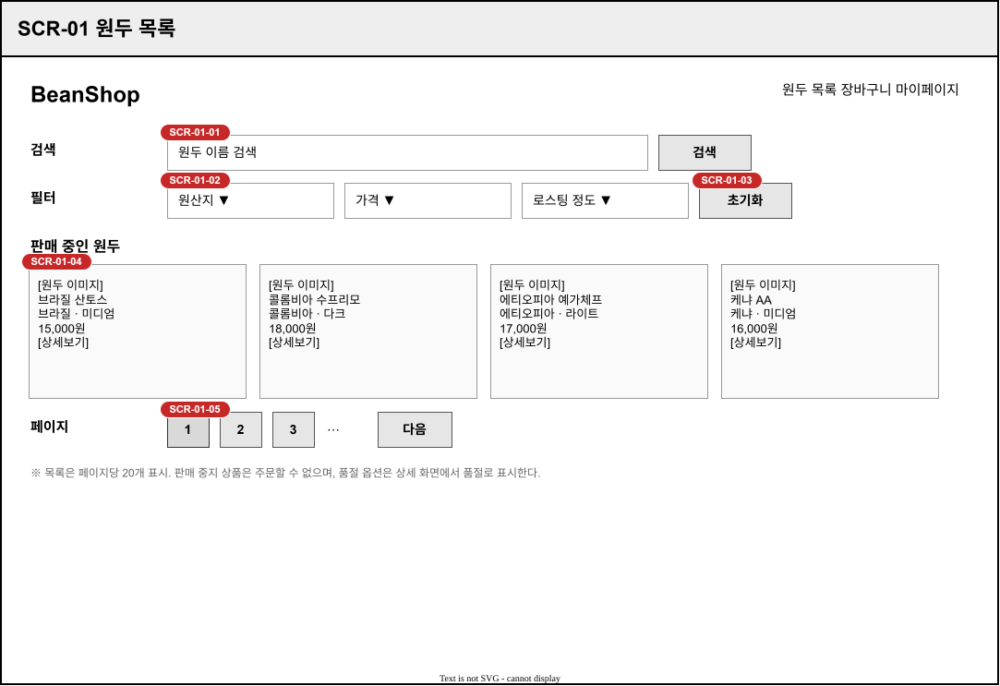

- 구성: 검색창(이름), 필터 세 개(원산지 선택, 가격 범위 선택, 로스팅 정도 선택), 초기화 버튼, 원두 카드 격자, 페이지 버튼. 격자는 `repeat(auto-fill, minmax(232px, 1fr))`, 간격 24px라 화면이 넓으면 열이 늘어난다(1440px에서 5열, 2026-11-23 디자인 결정).
- 카드: 이미지, 이름, 원산지·로스팅, `lowest_price`부터 시작하는 가격("15,000원~"), 품절이면 "품절" 배지. 카드를 누르면 `/products/:id`.
- 데이터: `GET /api/products/?search&origin&min_price&max_price&roast_level&page`(4.3.1 ~ 4.3.5). 조건은 URL 쿼리와 같게 둔다.
- 가격 선택지: 전체, 1만 원 미만, 1만 ~ 2만 원, 2만 ~ 3만 원, 3만 원 이상. 고르면 `min_price`, `max_price`로 바뀐다.
- 결과 0건: "조건에 맞는 원두가 없습니다"(UC-1).
- 첫 화면 표시 시간(NFR-2, 2초): 목록 API 한 번만 부르고, 카드 이미지는 `loading="lazy"`로 화면에 들어올 때 받는다. 빌드 결과 JS는 Vite 기본 분할을 쓰고 관리자 화면은 `React.lazy`로 따로 받는다.
- 와이어프레임과 다른 점: 제목을 "판매 중인 원두"에서 "원두 목록"으로 바꾼다. 품절 원두도 목록에 나오기 때문이다(FR-1).

### 6.2 SCR-02 원두 상세 (FR-6, FR-19)

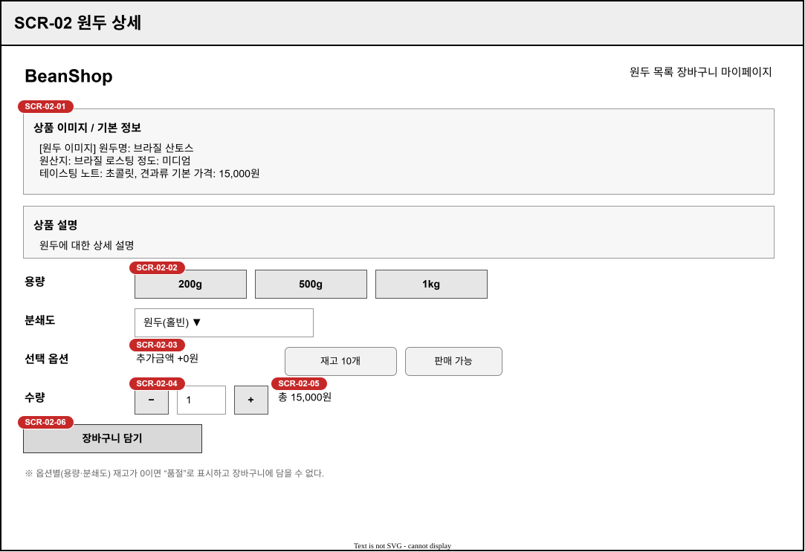

- 구성: 이미지, 이름·원산지·로스팅·맛 노트, 설명, 용량 버튼(200g/500g/1kg), 분쇄도 선택, 선택한 옵션의 추가 금액·재고·판매 가능 여부, 수량(−/+), 합계, 장바구니 담기 버튼.
- 데이터: `GET /api/products/:id/`(4.3.6). 용량·분쇄도를 고르면 `options`에서 맞는 옵션을 찾는다. 없는 조합은 고를 수 없게 흐리게 보인다.
- 담기: `POST /api/cart/items/`(4.4.1). 비회원이면 `/login?next=/products/:id`. 성공하면 "장바구니에 담았습니다 · 장바구니로 가기" 알림. 409면 `message`를 보인다.
- 수량 + 버튼은 그 옵션의 `stock_quantity`에서 멈춘다. 서버도 다시 막는다(DR-10).
- 404면 "판매하지 않는 원두입니다" 화면(판매 중지, FR-6).

### 6.3 SCR-03 로그인 (FR-8, FR-10)

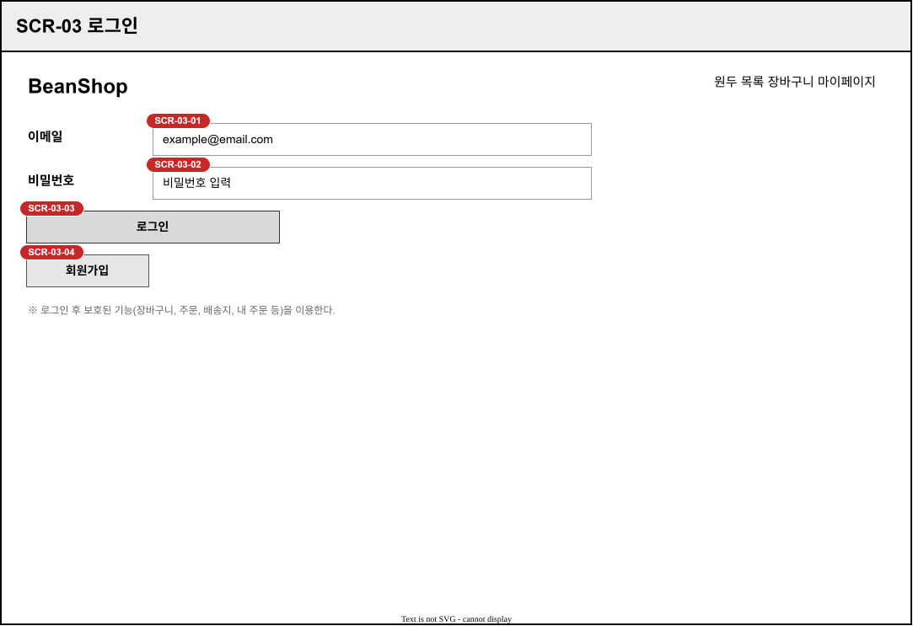

- 구성: 이메일, 비밀번호, 로그인 버튼, 회원가입 링크.
- 데이터: `POST /api/auth/token/`(4.1.2). 성공하면 토큰 저장 뒤 `next`(없으면 `/`)로 간다.
- 401: "이메일 또는 비밀번호가 올바르지 않습니다." 한 줄. 어느 쪽이 틀렸는지 말하지 않는다(NFR-7).

### 6.4 SCR-04 회원가입 (FR-7)

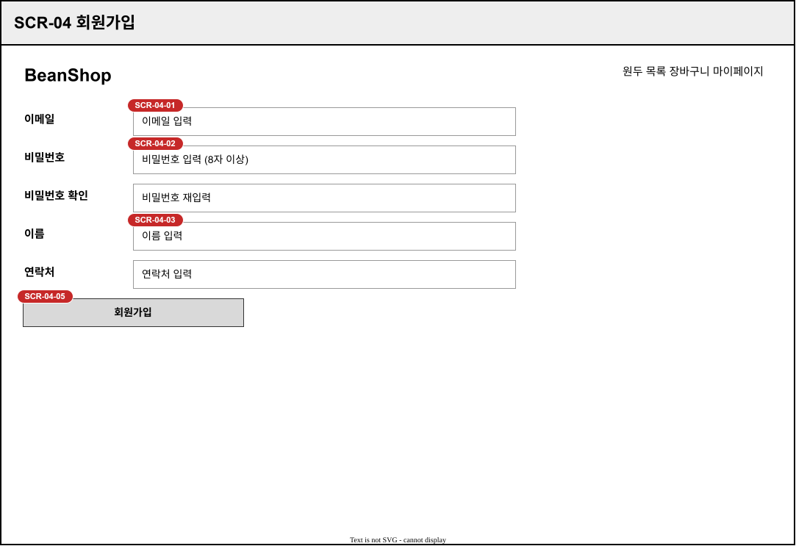

- 구성: 이메일, 비밀번호(8자 이상), 비밀번호 확인, 이름, 연락처, 개인정보 수집·이용 안내 상자와 동의 칸, 회원가입 버튼.
- 안내 상자(FR-58, 2026-11-19 추가): 수집 항목(이메일, 이름, 연락처, 배송지의 받는 사람·연락처·주소), 목적(회원 식별, 주문·배송 처리), 보유 기간(시연·평가가 끝나 운영 DB와 백업을 지울 때까지, 8.7절)을 표로 보이고 처리방침(`/privacy`) 링크를 단다. 동의 칸 문구는 "개인정보 수집·이용에 동의합니다(필수)".
- 화면 검증: 비밀번호 8자 미만, 확인 칸 불일치, 동의 칸 비어 있음이면 요청을 보내지 않는다(FR-7, FR-58).
- 데이터: `POST /api/auth/register/`(4.1.1). 동의 칸 값을 `privacy_agreed`로 보낸다.
- 와이어프레임과 다른 점: HW1 와이어프레임에 동의 칸이 없어서 더했다(SRS 7.1 2026-11-19). 성공하면 `/login`으로 보내고 "가입이 완료되었습니다. 로그인해 주세요."를 보인다(UC-2 3단계).

### 6.5 SCR-05 장바구니 (FR-20 ~ FR-22)

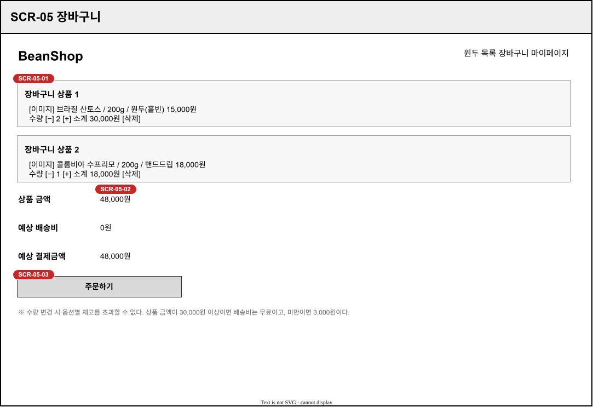

- 구성: 항목 목록(이미지, 이름/용량/분쇄도, 단가, 수량 −/+, 소계, 삭제), 상품 금액, 예상 배송비, 예상 결제금액, 주문하기 버튼.
- 데이터: `GET /api/cart/`(4.4.2). 수량은 `PATCH /api/cart/items/:id/`(4.4.3), 삭제는 `DELETE`(4.4.4) 뒤 다시 조회.
- `is_available=false` 항목은 "주문할 수 없는 상품(품절·판매 중지·재고 부족)"으로 표시한다. 그런 항목이 있으면(`can_order=false`) 주문하기를 끄고 "이 상품을 빼거나 수량을 줄여 주세요"를 보인다(4.5.3).
- 주문하기는 `/checkout`으로 간다. 장바구니 전체가 주문 대상이라 항목 선택 체크박스는 없다(SRS 7.1).

### 6.6 SCR-06 주문/결제 (FR-23 ~ FR-25)

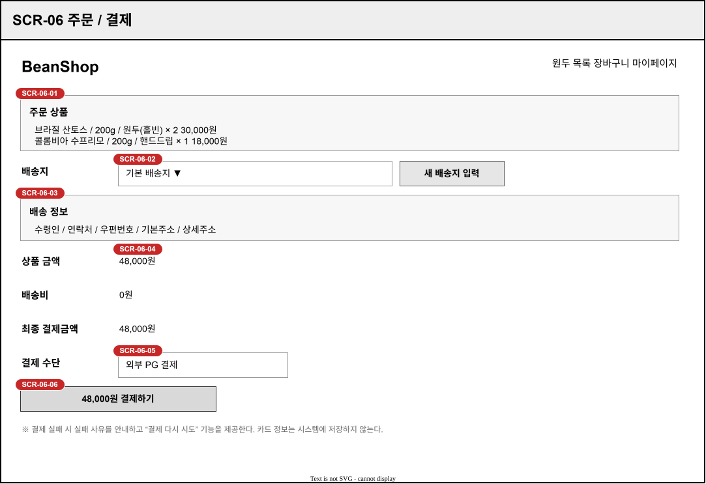

- 구성: 주문 상품(장바구니 전체), 배송지(저장된 배송지 선택 또는 "새 배송지 입력"), 배송 정보 입력 칸, 상품 금액·배송비·최종 결제금액, 결제 수단 안내("결제창에서 선택"), "N원 결제하기" 버튼.
- 데이터: 들어올 때 `GET /api/cart/`, `GET /api/me/addresses/`. 기본 배송지를 먼저 골라 둔다. 배송지가 없으면 새 배송지 입력 칸을 펼친다.
- 결제하기(한 번 누름, SRS 7.1):
  1. `POST /api/orders/`(4.5.3). 409면 문제 항목을 표시하고 멈춘다(UC-5 4단계).
  2. `POST /api/orders/:id/payments/`(4.6.2).
  3. 토스페이먼츠 결제창을 연다.
- 2·3단계에서 실패해도 주문은 이미 결제 대기로 만들어졌다. 화면은 "주문은 만들어졌습니다. 주문 상세에서 다시 결제할 수 있습니다."와 주문 상세 링크를 보인다(FR-29).
- 결제하기 버튼은 누른 뒤 끝날 때까지 꺼 둔다. 두 번 눌러 주문이 둘 생기지 않게 한다.

### 6.7 결제 결과 (`/checkout/result`, FR-26 ~ FR-28)

- 와이어프레임이 없는 화면이다. SRS 6.1에서 SCR-06의 일부로 더해졌다.
- 들어오면 쿼리를 읽는다.
  - `paymentKey`, `orderId`, `amount`가 있으면 `POST /api/payments/confirm/`(4.6.3). 그동안 "결제를 확인하는 중입니다".
  - `fail=1`이면 `POST /api/payments/fail/`(4.6.4)로 사유를 기록하고 실패를 보인다.
- 성공: 주문번호, 최종 결제금액, "결제가 완료되었습니다", 주문 상세·원두 목록 버튼.
- 실패·불일치: 사유(`message`)와 "다시 결제" 버튼(`POST /api/orders/:id/payments/` 후 결제창), 주문 상세 버튼(UC-6 4단계).
- 새로 고침으로 확인 API를 다시 불러도 성공한 결제는 같은 결과(200)다(4.6.3 1단계). 실패·취소된 결제는 409와 저장된 사유를 보인다.

### 6.8 SCR-07 주문 목록 (FR-30, FR-55, UC-7)

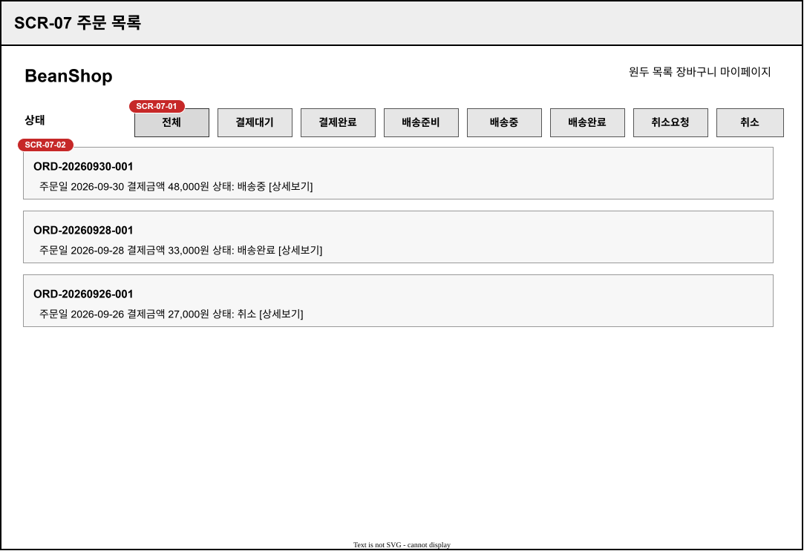

- 구성: 상태 탭(전체, 결제 대기, 결제 완료, 배송 준비, 배송 중, 배송 완료, 취소 요청, 취소), 주문 행(주문번호, 주문일, 결제금액, 상태 배지, 상세보기), 페이지 버튼.
- 데이터: `GET /api/orders/?status&page`(4.5.5). 탭은 URL 쿼리 `status`와 같다.
- 와이어프레임과 다른 점: 행에 "첫 원두 이름 외 N건"을 더한다(`first_item_name`, `item_count`).

### 6.9 SCR-08 주문 상세 (FR-29, FR-31 ~ FR-35, UC-7 ~ UC-9)

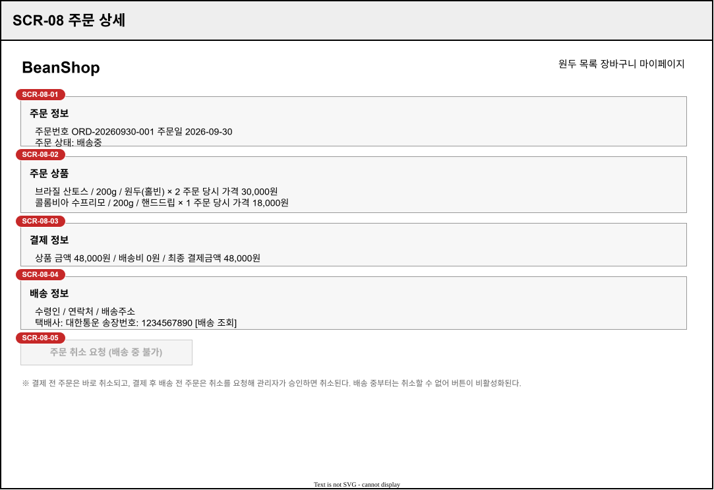

- 구성: 주문 정보(번호, 날짜, 상태), 주문 상품(주문 당시 가격), 결제 정보(금액 세 줄, 결제 기록), 배송 정보(수령인, 연락처, 주소, 택배사, 송장번호, 배송 조회 링크, 배송 완료 시각), 동작 버튼.
- 데이터: `GET /api/orders/:id/`(4.5.6).
- 버튼(서버의 `can_*` 값으로 정한다):
  - `can_pay`: "결제하기" → `POST /api/orders/:id/payments/` 후 결제창(FR-29).
  - `can_cancel`: "주문 취소" → 확인 창 → `POST /api/orders/:id/cancel/`(FR-32).
  - `can_request_cancel`: "취소 요청" → 사유 입력 상자 → `POST /api/orders/:id/cancel-request/`(FR-33).
  - 배송 중부터는 취소 버튼을 비활성으로 보이고 "배송이 시작되어 취소할 수 없습니다"를 붙인다(UC-9 4단계).
- 배송 조회: `tracking_url`이 있으면 "배송 조회" 링크, 새 탭(4.5.7, FR-35).
- 취소 요청 상태면 사유와 "관리자 확인 중"을 보인다.

### 6.10 SCR-09 회원정보 관리 (FR-11 ~ FR-13, UC-10)

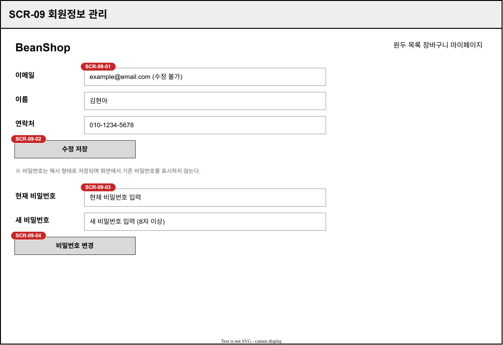

- 구성: 이메일(수정 불가), 이름, 연락처, 수정 저장 버튼. 아래에 현재 비밀번호, 새 비밀번호, 새 비밀번호 확인, 비밀번호 변경 버튼.
- 데이터: `GET /api/me/`(4.1.7), `PATCH /api/me/`(4.1.8), `POST /api/me/password/`(4.1.9).
- 비밀번호 변경이 성공하면 칸을 비우고 "비밀번호를 바꿨습니다"를 보인다. 로그인은 유지된다.
- 와이어프레임과 다른 점: 새 비밀번호 확인 칸을 더한다(가입 화면과 같은 오타 방지).
- 회원정보(`/me`)와 배송지 관리(`/me/addresses`)는 같은 "마이페이지" 제목 아래 탭 두 개로 오간다(2026-11-23 디자인 결정).

### 6.11 SCR-10 배송지 관리 (FR-14 ~ FR-18)

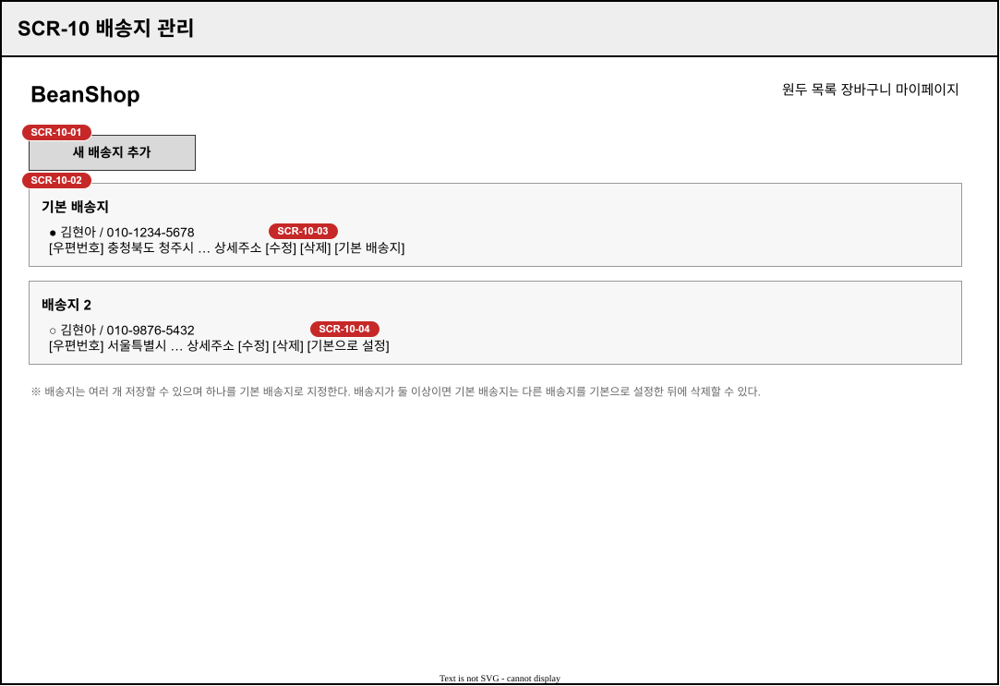

- 구성: 새 배송지 추가 버튼, 배송지 카드(기본 표시 ●/○, 수령인/연락처, 우편번호·주소, 수정, 삭제, 기본으로 설정).
- 데이터: `GET /api/me/addresses/`(4.2.1), 추가 `POST`(4.2.2), 수정 `PATCH`(4.2.3), 삭제 `DELETE`(4.2.4), 기본 지정 `POST .../default/`(4.2.5). 추가·수정은 같은 입력 상자를 쓴다.
- 기본 배송지 삭제가 409면 "다른 배송지를 먼저 기본으로 정해 주세요"(UC-11 2단계).
- 우편번호는 직접 입력한다. 주소 검색 서비스 연동은 범위 밖이다.

### 6.12 SCR-11 관리자 원두 목록 (FR-36, FR-42, FR-43, FR-56)

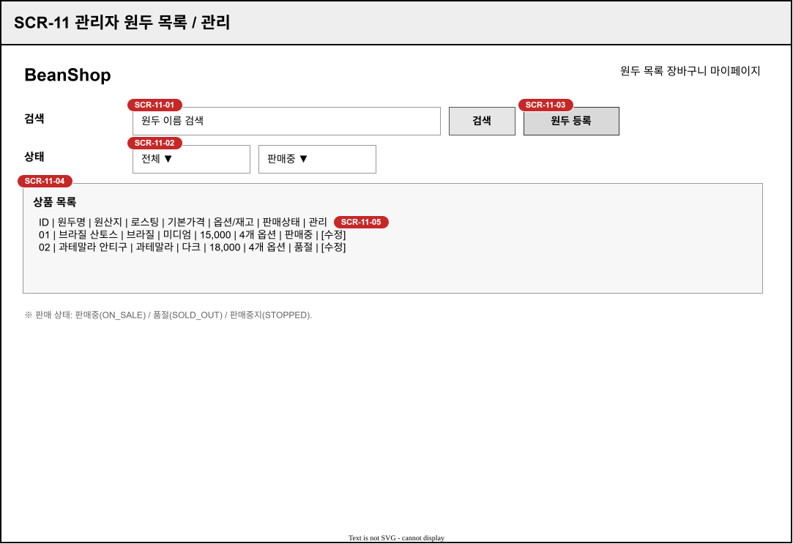

- 구성: 이름 검색, 판매 상태 필터, 원두 등록 버튼, 표(ID, 원두명, 원산지, 로스팅, 기본가격, 옵션 수/총 재고, 판매 상태, 관리).
- 데이터: `GET /api/admin/products/?search&sales_status&page`(4.7.1, 4.7.11).
- 관리 칸: 수정(→ `/admin/products/:id`), 판매 중지 또는 판매 재개 버튼(`POST .../stop/`, `.../resume/`, 4.7.9, 4.7.10).

### 6.13 SCR-12 관리자 원두 등록/수정 (FR-37 ~ FR-41)

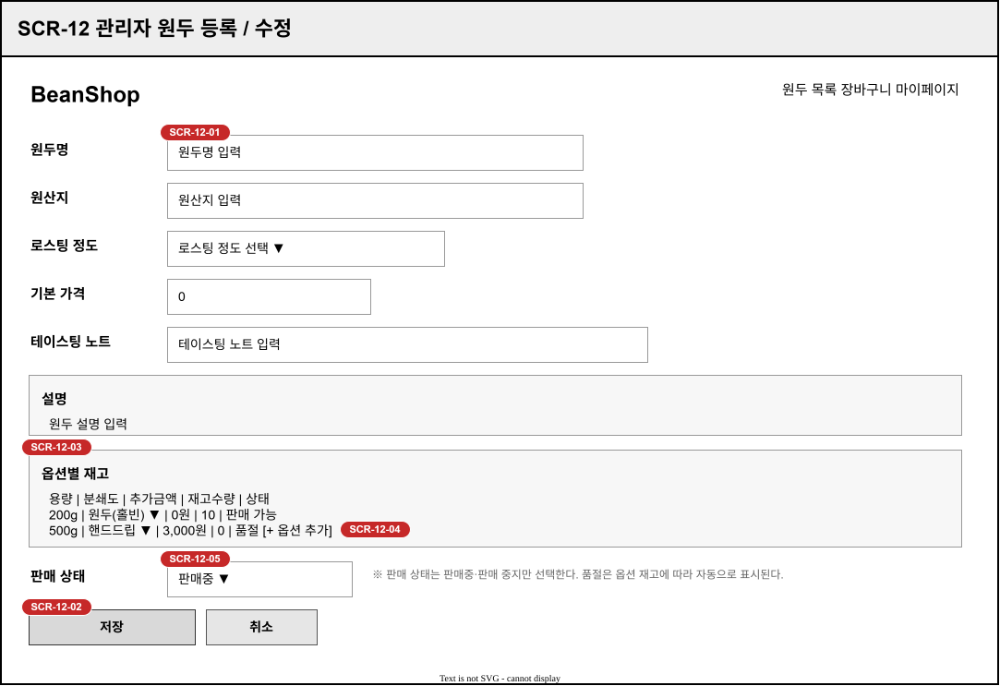

- 구성: 원두명, 원산지, 로스팅 정도, 기본 가격, 테이스팅 노트, 설명, 이미지 URL, 저장·취소 버튼. 수정 화면에는 아래에 옵션 표(용량, 분쇄도, 추가금액, 재고수량, 판매 가능 여부)와 옵션 추가 줄, 판매 상태와 판매 중지·재개 버튼.
- 등록(`/admin/products/new`): `POST /api/admin/products/`(4.7.2) 뒤 수정 화면으로 가서 옵션을 넣는다.
- 수정: `GET /api/admin/products/:id/`(관리자 상세), 저장은 `PATCH`(4.7.3). 옵션 추가는 `POST .../options/`(4.7.4), 옵션 줄의 추가 금액·재고 저장은 `PATCH .../options/:oid/`(4.7.5, 4.7.8).
- 와이어프레임과 다른 점: 이미지 URL 칸을 더한다(SRS 7.1). 판매 상태 선택 상자 대신 판매 중지·재개 버튼을 둔다. 품절은 고를 수 없고 재고에 따라 표시만 된다(DR-6).
- 관리자 원두 상세 조회 경로 `GET /api/admin/products/{id}/`는 SRS 6.2 목록에 없다. 수정 화면을 채우려고 필요해서 둔 경로다(11.1절).

### 6.14 SCR-13 관리자 주문 목록 (FR-44, FR-45, FR-57)

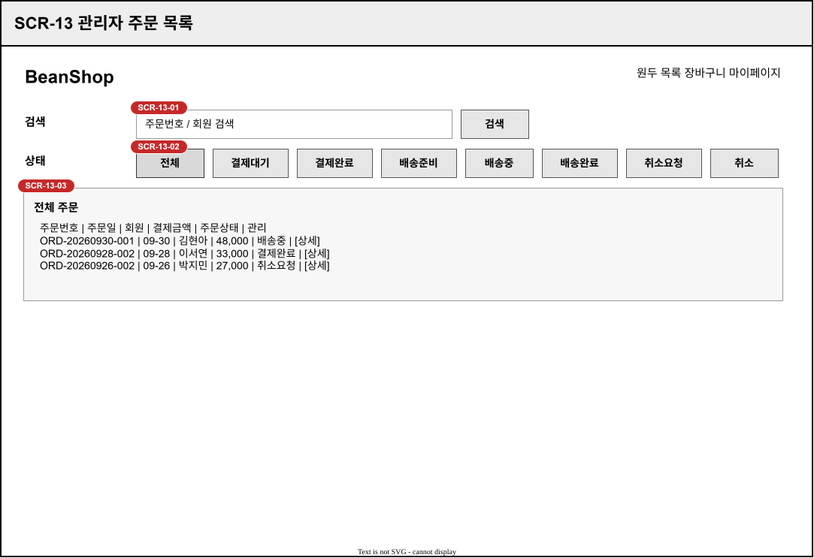

- 구성: 주문번호·회원 이메일 검색, 상태 탭, 표(주문번호, 주문일, 회원, 결제금액, 주문 상태, 상세).
- 데이터: `GET /api/admin/orders/?search&status&page`(4.8.1, 4.8.2, 4.8.9).
- 취소 요청 탭에는 건수 배지를 단다.

### 6.15 SCR-14 관리자 주문 상세/배송 처리 (FR-46 ~ FR-51, UC-13, UC-14)

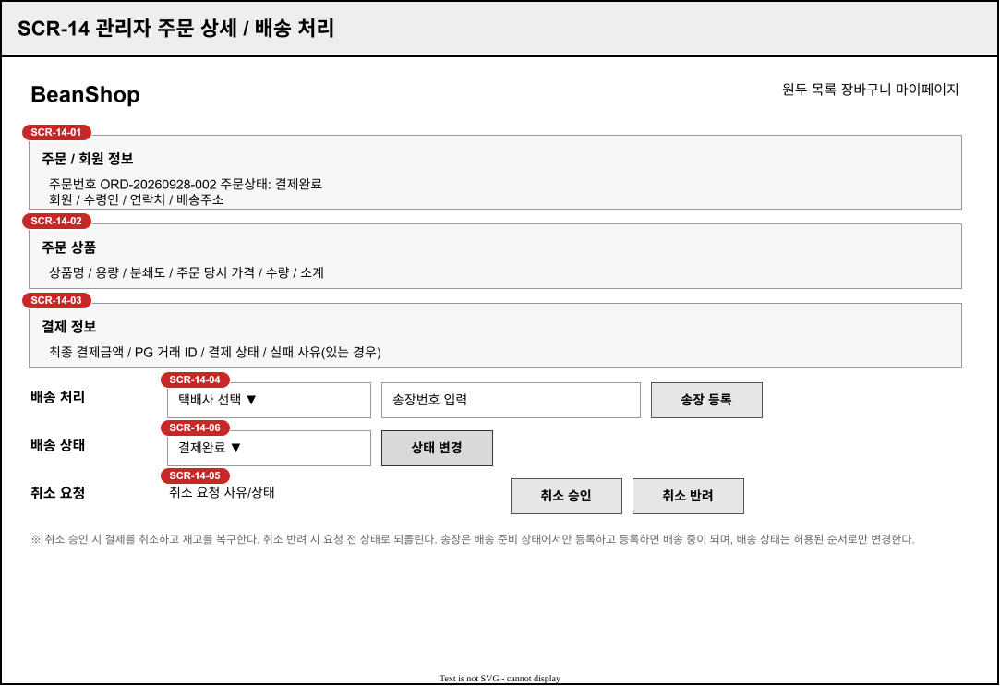

- 구성: 주문·회원 정보, 주문 상품, 결제 정보(최종 금액, 결제 기록별 상태·PG 거래 ID 뒤 8자·실패 사유), 배송 처리(택배사 선택, 송장번호 입력), 취소 요청(사유, 요청 전 상태), 동작 버튼.
- 데이터: `GET /api/admin/orders/:id/`(4.8.3).
- 버튼은 `allowed_actions`로 보인다.
  - `prepare`: "배송 준비" → `POST .../prepare/`(4.8.4).
  - `ship`: 택배사·송장번호 입력 + "송장 등록" → `POST .../ship/`(4.8.5).
  - `deliver`: "배송 완료" → `POST .../deliver/`(4.8.6).
  - `cancel_approve`, `cancel_reject`: "취소 승인"(확인 창), "취소 반려" → 4.8.7, 4.8.8.
- 와이어프레임과 다른 점: "배송 상태 ▼ + 상태 변경" 대신 지금 가능한 동작 버튼만 보인다. 허용되지 않은 전환을 고를 수 없게 하려는 것이다(DR-19). 택배사 선택지는 5.10절의 5곳이다.
- 502 `PG_ERROR`면 "결제 취소에 실패했습니다. 잠시 후 다시 승인해 주세요."를 보인다(4.8.7).

### 6.16 SCR-15 개인정보 처리방침 (FR-59, 2026-11-19 추가)

- 와이어프레임 없음. 본문 폭 안에 제목과 절 다섯 개를 글로 둔다.
- 구성: 1) 수집 항목(6.4절 안내 상자와 같음), 2) 목적, 3) 보유 기간과 파기(시연·평가가 끝나면 운영 DB와 백업을 함께 지움, 회원 탈퇴 기능 없음, 8.7절), 4) 결제대행사에 넘기는 정보(토스페이먼츠 테스트 모드에 주문명, 금액, 주문자 이름. 카드 정보는 이 시스템이 받지 않음, 4.6절, NFR-18), 5) 문의 방법.
- 데이터: 없음. 문구는 `src/pages/PrivacyPage.jsx` 안의 정적 텍스트이고 API를 부르지 않는다.
- 문의 방법에는 운영자 개인 연락처를 적지 않는다. 공개 레포라서 레포 이슈로 받는다(SRS 1.4절).
