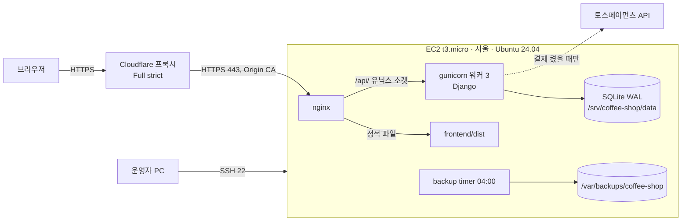

## 1. 환경

| 환경 | 주소 | 용도 | 배포 방법 |
| --- | --- | --- | --- |
| 개발 | `http://localhost:5173`(Vite) + `http://localhost:8000`(Django) | 구현, 수동 확인 | 각자 실행(README, NFR-27) |
| 테스트(자동) | GitHub Actions | PR마다 `backend`·`frontend` 검사 | `ci.yml`(STP 7절) |
| 운영 | `https://<도메인>` | 시연, 평가 | `deploy/deploy.sh <태그>`(2절) |

- 스테이징은 없다(SDD 10.1). 운영에 올리기 전 확인은 자동 테스트와 개발 PC의 `npm run build` + `vite preview`다.
- 서버 안 폴더 배치, nginx 설정, 재시작·백업·감시는 SDD 10.2 ~ 10.5절, 환경 변수 이름은 SDD 9절이다.
- 결제: 운영 `.env`에 `TOSS_SECRET_KEY`가 비어 있으면 결제를 끈다. 결제 시작·확인·관리자 취소 승인이 503 `PAYMENTS_DISABLED`이고, 나머지(조회, 장바구니, 주문, 관리자 상태 변경)는 돈다(SDD 4.6.5). 이 프로젝트 전용 토스 테스트 키가 생기면 3.4절대로 켠다.
