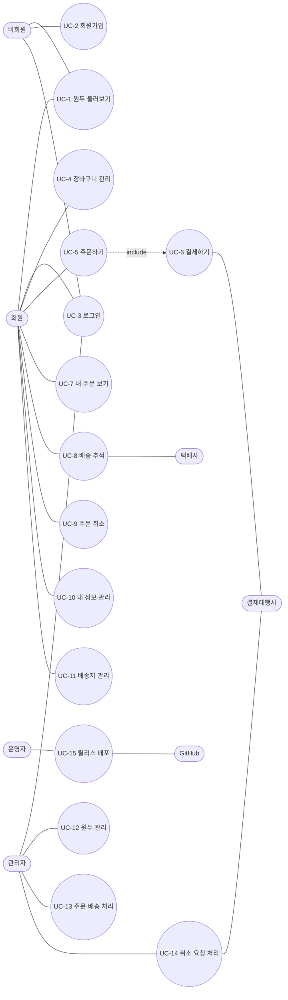

## 5. 사용사례

사용사례를 화면 단위로 묶었다. 괄호 안은 관련 요구사항과 화면 ID(SDD 6절의 SCR-n)다.

### 5.1 행위자

- 비회원: 로그인하지 않은 방문자.
- 회원: 가입하고 로그인한 고객. 비회원이 할 수 있는 일을 모두 한다.
- 관리자: 관리자 권한 계정으로 로그인한 운영자.
- 결제대행사(PG): 결제 승인·취소를 처리하는 외부 시스템.
- 택배사: 송장번호로 배송을 조회해주는 외부 시스템.
- 운영자: EC2 서버에서 배포 명령과 관리 명령을 실행하는 팀원. (2026-11-27 추가)
- GitHub: 레포와 PR, Actions 검사를 맡는 외부 서비스. (2026-11-27 추가)

### UC-1 원두 둘러보기 (1차)

FR-1 ~ FR-6, SCR-01, SCR-02

1. 방문자가 원두 목록 화면을 연다. 시스템은 판매 중·품절 원두를 20개씩 보여준다.
2. 방문자가 이름으로 검색하거나 원산지, 가격, 로스팅 정도로 거른다. 결과가 없으면 "조건에 맞는 원두가 없습니다"를 보여준다.
3. 방문자가 원두를 고르면 상세 화면에서 정보와 옵션별 가격·품절 여부를 본다.

### UC-2 회원가입 (1차)

FR-7, FR-58, SCR-04

1. 비회원이 이메일, 비밀번호, 비밀번호 확인, 이름, 연락처를 입력하고, 개인정보 수집·이용 안내를 읽은 뒤 동의 칸을 체크한다. 체크하지 않으면 가입 버튼이 동작하지 않는다(2026-11-19 추가).
2. 시스템이 이메일 중복과 비밀번호 길이를 확인하고 계정을 만든다. 이메일이 겹치면 오류를 보여주고 1로 돌아간다.
3. 시스템이 로그인 화면으로 보낸다.

### UC-3 로그인 (1차)

FR-8 ~ FR-10, FR-54, SCR-03

1. 비회원이 이메일과 비밀번호를 입력한다.
2. 시스템이 토큰을 발급하고, 로그인 전에 가려던 화면(없으면 원두 목록)으로 보낸다. 틀리면 "이메일 또는 비밀번호가 올바르지 않습니다"를 보여준다.
3. 이후 액세스 토큰이 만료되면 시스템이 자동으로 재발급한다. 재발급도 실패하면 로그인 화면으로 보낸다.
4. 회원이 로그아웃하면 시스템이 저장한 토큰을 지우고 원두 목록으로 보낸다.

### UC-4 장바구니 관리 (1차)

FR-19 ~ FR-22, SCR-02, SCR-05

1. 회원이 원두 상세에서 용량, 분쇄도, 수량을 고르고 담는다. 비회원이면 로그인 화면으로 보낸다(UC-3). 품절 옵션은 담기 버튼이 꺼져 있다.
2. 회원이 장바구니에서 항목, 상품 금액, 예상 배송비, 예상 결제 금액을 본다.
3. 회원이 수량을 바꾸거나 항목을 뺀다. 재고를 넘는 수량이면 오류를 보여준다.

### UC-5 주문하기 (1차)

FR-23, FR-24, SCR-05, SCR-06

1. 회원이 장바구니에서 주문하기를 누른다. 주문 가능한 모든 항목이 주문 대상이다.
2. 시스템이 주문 항목, 상품 금액, 배송비, 최종 결제 금액과 저장된 배송지를 보여준다.
3. 회원이 저장된 배송지를 고르거나 새 주소를 입력한다.
4. 회원이 결제하기를 누른다. 시스템이 재고를 차감하고 결제 대기 주문을 만든 뒤 UC-6으로 이어진다. 재고가 모자라면 어느 항목인지 알려주고 2로 돌아간다.

### UC-6 결제하기 (1차)

FR-25 ~ FR-29, SCR-06, 행위자: 회원, PG

1. 시스템이 결제 기록을 만들고 PG 결제창을 연다(UC-5 4단계의 결제하기).
2. 회원이 PG 결제창에서 결제 수단을 고르고 결제한다.
3. 결제창에서 돌아오면 시스템이 금액을 확인하고 주문을 결제 완료로 바꾼 뒤 결제 결과 화면에 주문 완료를 표시한다.
4. 결제가 실패하면 실패 사유와 다시 결제 버튼을 보여준다. 확인 금액이 결제 시작 금액과 다르면 시스템이 PG를 부르지 않고 결제를 닫고, PG 승인 금액이 다르면 PG에 결제 취소를 요청한다(FR-27). (2026-11-27 변경. 이전에는 "금액이 다르면 시스템이 PG에 결제 취소를 요청한다")
5. 결제창을 닫고 나간 회원은 주문 상세에서 결제 대기 주문을 다시 결제한다.
6. 결제가 꺼져 있으면 결제창을 열지 않고 안내와 주문 상세 링크를 보여준다(FR-60). (2026-11-27 추가)

### UC-7 내 주문 보기 (1차)

FR-30, FR-31, FR-55, SCR-07, SCR-08

1. 회원이 주문 목록에서 주문번호, 날짜, 금액, 상태를 보고, 상태로 거른다.
2. 회원이 주문을 고르면 상세에서 항목, 결제, 배송지, 상태를 본다.

### UC-8 배송 추적 (1차)

FR-34, FR-35, SCR-08, 행위자: 회원, 택배사

1. 회원이 배송 중이거나 배송 완료된 주문의 상세에서 택배사와 송장번호를 본다.
2. 회원이 조회 링크를 누르면 택배사 조회 페이지가 새 탭으로 열린다.

### UC-9 주문 취소 (1차)

FR-32, FR-33, SCR-08

1. 회원이 주문 상세에서 취소를 누른다.
2. 결제 대기 주문이면 시스템이 바로 취소하고 재고를 되돌린다.
3. 결제 완료나 배송 준비 주문이면 회원이 사유를 적고 취소를 요청한다. 주문은 취소 요청 상태가 되고 UC-14에서 관리자가 처리한다.
4. 배송 중부터는 취소 버튼이 비활성화된다.

### UC-10 내 정보 관리 (1차)

FR-11 ~ FR-13, SCR-09

1. 회원이 이름과 연락처를 보고 고친다.
2. 회원이 현재 비밀번호와 새 비밀번호를 입력해 비밀번호를 바꾼다. 현재 비밀번호가 틀리면 오류를 보여준다.

### UC-11 배송지 관리 (1차)

FR-14 ~ FR-18, SCR-10

1. 회원이 배송지 목록을 본다.
2. 회원이 배송지를 추가, 수정, 삭제하거나 기본 배송지로 정한다. 기본 배송지를 지우려 하면 다른 배송지를 먼저 기본으로 정하라고 알려준다.

### UC-12 원두 관리 (1차)

FR-36 ~ FR-43, FR-56, SCR-11, SCR-12, 행위자: 관리자

1. 관리자가 전체 원두 목록과 옵션별 재고를 보고, 이름으로 검색한다.
2. 관리자가 원두를 등록하거나 고친다.
3. 관리자가 옵션을 추가하고 재고를 조정한다. 시스템이 재고에 따라 품절·판매 중을 바꾼다.
4. 관리자가 판매를 중지하거나 다시 시작한다.

### UC-13 주문·배송 처리 (1차)

FR-44 ~ FR-49, FR-57, SCR-13, SCR-14, 행위자: 관리자

1. 관리자가 전체 주문을 상태로 거르거나 주문번호·회원 이메일로 검색한다.
2. 관리자가 결제 완료 주문을 배송 준비로 바꾼다.
3. 관리자가 택배사와 송장번호를 등록해 배송 중으로 바꾼다.
4. 관리자가 배송이 끝난 주문을 배송 완료로 바꾼다.

### UC-14 취소 요청 처리 (1차)

FR-50, FR-51, SCR-13, SCR-14, 행위자: 관리자, PG

1. 관리자가 취소 요청 주문과 사유를 본다.
2. 승인하면 시스템이 주문을 취소하고, 재고를 되돌리고, PG에 결제 취소를 요청한다.
3. 반려하면 주문이 요청 전 상태로 돌아간다.

### UC-15 릴리스 배포 (1차, 2026-11-27 추가)

FR-61 ~ FR-63, NFR-37 ~ NFR-41, 행위자: 운영자, GitHub

1. 운영자가 배포할 `main` 커밋의 CI `backend`·`frontend` 통과를 GitHub에서 확인하고 `release-YYYYMMDD-N` 태그를 단다.
2. 운영자가 서버에서 그 태그로 배포 명령을 실행한다.
3. 시스템이 태그를 받아 빌드하고, DB를 백업하고, 마이그레이션한 뒤 새 릴리스로 바꾸고 상태를 확인한다.
4. 빌드·백업·마이그레이션이 실패하면 바꾸기 전에 멈추고 이전 릴리스가 계속 돈다(NFR-41).
5. 바꾼 뒤 상태 확인이 실패하면 시스템이 직전 릴리스로 되돌린다(FR-62). 데이터를 바꾼 마이그레이션이 있었으면 운영자가 배포 직전 백업으로 DB를 복원한다(FR-63).

### 5.2 행위자와 사용사례 다이어그램

