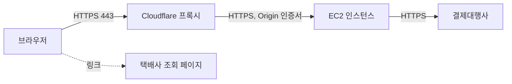

## 6. 외부 인터페이스

### 6.1 사이트맵

화면 경로와 화면 ID다. 경로 이름은 SDD 화면 설계에서 확정한다.

```
/                          SCR-01 원두 목록 (검색, 필터)
/products/:id              SCR-02 원두 상세
/login                     SCR-03 로그인
/signup                    SCR-04 회원가입
/cart                      SCR-05 장바구니          (회원)
/checkout                  SCR-06 주문/결제          (회원)
/checkout/result           SCR-06 결제 결과(PG 결제창에서 돌아오는 화면) (회원)
/orders                    SCR-07 주문 목록          (회원)
/orders/:id                SCR-08 주문 상세          (회원)
/me                        SCR-09 회원정보 관리      (회원)
/me/addresses              SCR-10 배송지 관리        (회원)
/admin/products            SCR-11 관리자 원두 목록   (관리자)
/admin/products/new        SCR-12 관리자 원두 등록   (관리자)
/admin/products/:id        SCR-12 관리자 원두 수정   (관리자)
/admin/orders              SCR-13 관리자 주문 목록   (관리자)
/admin/orders/:id          SCR-14 관리자 주문 상세   (관리자)
/privacy                   SCR-15 개인정보 처리방침  (2026-11-19 추가)
```

### 6.2 API

모든 경로는 같은 도메인의 `/api/` 아래다. 요청·응답 본문, 오류 형식, 페이지네이션은 SDD API 설계에서 정한다.

```
GET    /api/health/                                상태 확인 (FR-52)

POST   /api/auth/register/                         회원가입 (FR-7)
POST   /api/auth/token/                            로그인, 토큰 발급 (FR-8)
POST   /api/auth/token/refresh/                    액세스 토큰 재발급 (FR-9)

GET    /api/me/                                    내 정보 조회 (FR-11)
PATCH  /api/me/                                    내 정보 수정 (FR-12)
POST   /api/me/password/                           비밀번호 변경 (FR-13)
GET    /api/me/addresses/                          배송지 목록 (FR-14)
POST   /api/me/addresses/                          배송지 등록 (FR-15)
PATCH  /api/me/addresses/{id}/                     배송지 수정 (FR-16)
DELETE /api/me/addresses/{id}/                     배송지 삭제 (FR-17)
POST   /api/me/addresses/{id}/default/             기본 배송지 지정 (FR-18)

GET    /api/products/                              원두 목록, 검색, 필터 (FR-1 ~ FR-5)
GET    /api/products/{id}/                         원두 상세 (FR-6)

GET    /api/cart/                                  장바구니 조회 (FR-20)
POST   /api/cart/items/                            장바구니 담기 (FR-19)
PATCH  /api/cart/items/{id}/                       수량 변경 (FR-21)
DELETE /api/cart/items/{id}/                       항목 삭제 (FR-22)

POST   /api/orders/                                주문 생성 (FR-23)
GET    /api/orders/                                내 주문 목록, 상태 필터 (FR-30, FR-55)
GET    /api/orders/{id}/                           내 주문 상세 (FR-31, FR-34)
POST   /api/orders/{id}/cancel/                    결제 대기 주문 취소 (FR-32)
POST   /api/orders/{id}/cancel-request/            취소 요청 (FR-33)
POST   /api/orders/{id}/payments/                  결제 시작, 재결제 (FR-25, FR-29)
POST   /api/payments/confirm/                      PG 결제 결과 확인 (FR-26 ~ FR-28)
POST   /api/payments/fail/                         결제창 실패 기록 (FR-28, 2026-11-19 추가)

GET    /api/admin/products/                        전체 원두 목록, 이름 검색 (FR-36, FR-56)
POST   /api/admin/products/                        원두 등록 (FR-37)
GET    /api/admin/products/{id}/                   원두 상세, 수정 화면용 (FR-38 ~ FR-41, 2026-11-19 추가)
PATCH  /api/admin/products/{id}/                   원두 수정 (FR-38)
POST   /api/admin/products/{id}/options/           옵션 추가 (FR-39)
PATCH  /api/admin/products/{id}/options/{oid}/     옵션 수정, 재고 조정 (FR-40, FR-41)
POST   /api/admin/products/{id}/stop/              판매 중지 (FR-42)
POST   /api/admin/products/{id}/resume/            판매 재개 (FR-43)

GET    /api/admin/orders/                          전체 주문 목록, 상태 필터, 검색 (FR-44, FR-45, FR-57)
GET    /api/admin/orders/{id}/                     주문 상세 (FR-46)
POST   /api/admin/orders/{id}/prepare/             배송 준비 (FR-47)
POST   /api/admin/orders/{id}/ship/                송장 등록, 배송 중 (FR-48)
POST   /api/admin/orders/{id}/deliver/             배송 완료 (FR-49)
POST   /api/admin/orders/{id}/cancel-approve/      취소 승인 (FR-50)
POST   /api/admin/orders/{id}/cancel-reject/       취소 반려 (FR-51)
```

### 6.3 하드웨어 인터페이스

- 서버: AWS EC2 인스턴스 한 대(NFR-20). 인스턴스 종류와 구성은 SDD 11절이다.
- 사용자 단말: 최신 Chrome이 도는 데스크톱 PC(NFR-26).

### 6.4 소프트웨어 인터페이스

| 대상 | 방향 | 내용 |
| --- | --- | --- |
| 결제대행사(PG) | 양방향 | 결제창 호출, 결제 승인 결과 확인, 결제 취소. 테스트 모드만 쓴다(FR-25 ~ FR-29, FR-50) |
| 택배사 조회 페이지 | 시스템 → 택배사 | 송장번호를 넣은 조회 페이지 링크만 연다. API 연동 없음(FR-35) |
| Cloudflare | 운영자 → Cloudflare | 도메인 DNS 레코드가 EC2 인스턴스를 가리킨다(NFR-21) |

### 6.5 통신 인터페이스



- 브라우저는 도메인 하나에 HTTPS(443)로 접속한다. 80번 요청은 HTTPS로 넘긴다(NFR-4).
- 화면과 API가 같은 도메인이라 CORS 설정이 필요 없다(NFR-21).
- 데이터는 REST·JSON으로 주고받고, 인증은 `Authorization: Bearer <액세스 토큰>` 헤더로 한다(NFR-8, NFR-28).
- 브라우저는 Cloudflare 프록시에 접속하고, Cloudflare가 EC2로 넘긴다. 프록시와 TLS 방식은 SDD 11절이다.
