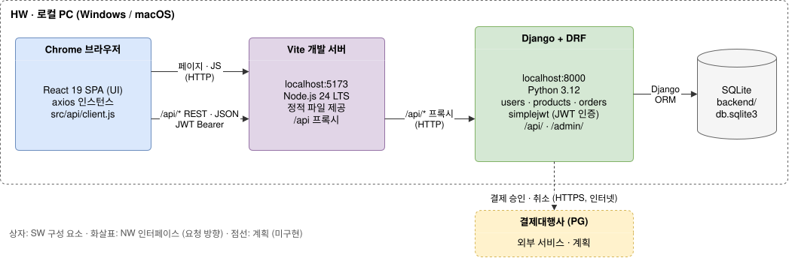

# 1. 시스템 아키텍처 설계 (HW/NW/SW)

- HW: 시연용 로컬 PC(Windows/macOS) 한 대에서 모든 구성 요소를 실행하며, 외부 서버에 배포하지 않는다.
- SW: React 19 SPA(Vite, Node.js 24 LTS), Django + DRF(Python 3.12), SQLite로 구성한다.
- NW: 브라우저는 `localhost:5173`에만 요청하고, Vite가 `/api/*` 요청을 Django(`localhost:8000`)로 프록시한다.
- NW: 데이터는 REST·JSON으로 주고받고 인증은 JWT로 하며, 결제대행사 연동(점선)은 계획 단계다.
